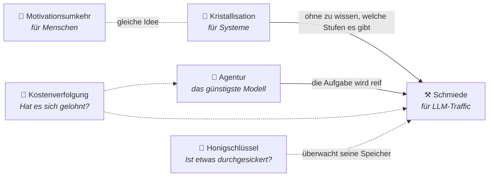

🌐 [Español](https://github.com/AbstractBike/SilvioMaciasSanchez/tree/es) · [English](https://github.com/AbstractBike/SilvioMaciasSanchez/tree/en) · **Deutsch**

# Silvio Macías Sánchez

Muster, um mit künstlicher Intelligenz zu arbeiten, ohne zu verlieren, was zählt: deine Handlungsfähigkeit und die Kontrolle über deine Systeme. Dazu auch ein paar Entwürfe für Speichersysteme.

Jedes Muster liest sich in wenigen Minuten und beginnt mit einer Zusammenfassung in einem Satz und einem Steckbrief. Wenn du nur einen Moment Zeit hast, lies das.

## Die Muster

| Muster | In einem Satz | Lesezeit |
| --- | --- | --- |
| [**Motivationsumkehr**](motivacion/inversion-de-motivacion.md) | Eine KI, die die Arbeit nicht für dich erledigt, sondern dir hilft, sie selbst zu erledigen. | 5 Min. |
| [**Kristallisation**](abstract-architectures/cristalizacion.md) | Bitte die KI um das Programm, das das Problem löst, nicht um die Antwort für jeden einzelnen Fall. | 6 Min. |
| [**Schmiede**](abstract-architectures/forja.md) | Ein Proxy vor dem LLM, der herausfindet, welche Aufgaben sich wiederholen, und dir sagt, wann du sie kristallisieren solltest. | 7 Min. |
| [**Agentur**](abstract-architectures/agencia.md) | Agenten, die Auftrag für Auftrag lernen, welches das günstigste Modell ist, das seine Arbeit gut erledigt. | 6 Min. |
| [**Kostenverfolgung**](abstract-architectures/seguimiento-de-costes.md) | Jeder Commit einer KI sagt, welches Modell ihn geschrieben hat und was er gekostet hat. | 6 Min. |
| [**Honigschlüssel**](abstract-architectures/llaves-de-miel.md) | Ein echter, harmloser Schlüssel an einem Ort, an dem er nie auftauchen dürfte; taucht er doch auf, meldet sich der Aussteller bei dir. | 7 Min. |

### Wie sie zusammenhängen

Sie teilen dieselbe Idee: **Das Ziel ist nicht die Antwort, sondern die Fähigkeit, die bleibt, wenn sich die KI zurückzieht.** Und sie greifen ineinander: zuerst das günstigste Modell, das es kann, dann gar keins, und die Rechnung wird notiert, um zu wissen, ob es sich gelohnt hat.

- **Nutzt du KI, um zu lernen oder zu erschaffen?** Fang mit der [Motivationsumkehr](motivacion/inversion-de-motivacion.md) an.
- **Hast du eine Pipeline, die bei jedem Schritt ein LLM aufruft?** Fang mit der [Kristallisation](abstract-architectures/cristalizacion.md) an.
- **Hast du viel LLM-Traffic und weißt nicht, was drinsteckt?** Fang mit der [Schmiede](abstract-architectures/forja.md) an.
- **Wiederholst du immer wieder denselben Prompt?** Fang mit der [Agentur](abstract-architectures/agencia.md) an.
- **Committen Agenten in deine Repos und du weißt nicht, was sie kosten?** Fang mit der [Kostenverfolgung](abstract-architectures/seguimiento-de-costes.md) an.
- **Macht dir Sorgen, dass der Kontext deiner Agenten durchsickern könnte?** Fang mit den [Honigschlüsseln](abstract-architectures/llaves-de-miel.md) an.

### Wie jedes Muster aufgebaut ist

Alle folgen derselben Struktur, damit du weißt, wo du suchen musst:

1. **In einem Satz** und ein **Steckbrief**: Problem, Lösung, wann man es einsetzt und wie man es misst.
2. **Die Idee** und **ein schnelles Beispiel**.
3. **Wann du es anwendest (und wann nicht).**
4. **Wie es funktioniert** und **wie du es umsetzt**.
5. **Risiken und Schutzmaßnahmen.**
6. **Siehe auch**.

## Dateisysteme

| Entwurf | In einem Satz |
| --- | --- |
| [**gefs + FDP**](sistemas-de-ficheros/gefs-fdp.md) | Das Dateisystem von 9front sagt der SSD, welche Blöcke zusammen sterben, damit die Schreibverstärkung auf ≈1 sinkt, ohne das Format auf der Platte zu ändern. |

## Sprachen

Der Inhalt liegt in drei Sprachen vor, jede in ihrem eigenen Branch, mit denselben Dateien unter denselben Pfaden:

| Branch | Sprache |
| --- | --- |
| [`es`](https://github.com/AbstractBike/SilvioMaciasSanchez/tree/es) | Español (Original) |
| [`en`](https://github.com/AbstractBike/SilvioMaciasSanchez/tree/en) | English |
| [`de`](https://github.com/AbstractBike/SilvioMaciasSanchez/tree/de) | Deutsch |

Spanisch ist die Originalversion; wenn eine Übersetzung und das Original nicht übereinstimmen, gilt das Original.

## Nutzung und Rechte

Frei für Forschung und Lehre ohne Gewinnabsicht, unter Nennung des Autors. Für kommerzielle Nutzung schreib mir —ich bin sehr freundlich—: silvio.macias.sanchez@abstract.bike oder info@abstractarchitectures.ltd. Details in [COPYRIGHT.md](COPYRIGHT.md).

---

© 2026 Silvio Macías Sánchez. Alle Rechte vorbehalten.
