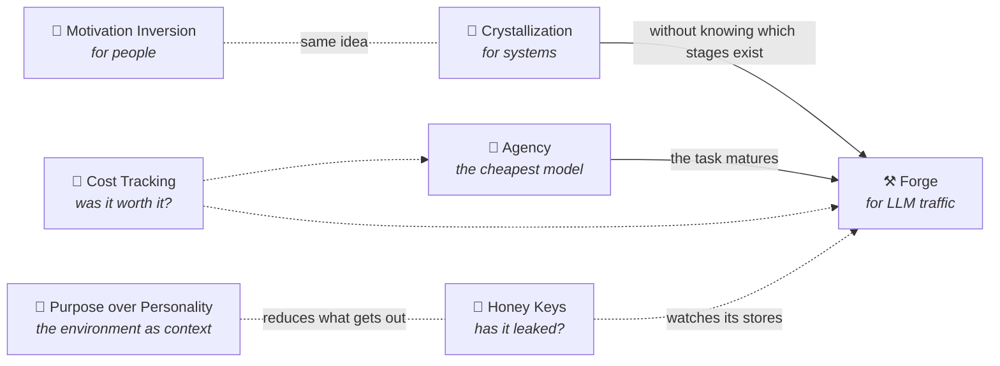

🌐 [Español](https://github.com/AbstractBike/SilvioMaciasSanchez/tree/es) · **English** · [Deutsch](https://github.com/AbstractBike/SilvioMaciasSanchez/tree/de)

# Silvio Macías Sánchez

Patterns for working with artificial intelligence without losing what matters: your ability to act and control over your systems. Plus a few storage system designs.

Each pattern takes a few minutes to read and starts with a one-sentence summary and a quick fact sheet. If you only have a moment, read that.

## The patterns

| Pattern | In one sentence | Reading time |
| --- | --- | --- |
| [**Motivation Inversion**](motivacion/inversion-de-motivacion.md) | An AI that doesn't do the work for you, but helps you do it yourself. | 5 min |
| [**Crystallization**](abstract-architectures/cristalizacion.md) | Ask the AI for the program that solves the problem, not for the answer to each case. | 6 min |
| [**Forge**](abstract-architectures/forja.md) | A proxy in front of the LLM that discovers which tasks repeat and tells you when to crystallize them. | 7 min |
| [**Agency**](abstract-architectures/agencia.md) | Agents that learn, job by job, which is the cheapest model that does its work well. | 6 min |
| [**Cost Tracking**](abstract-architectures/seguimiento-de-costes.md) | Every commit from an AI says which model wrote it and how much it cost. | 6 min |
| [**Honey Keys**](abstract-architectures/llaves-de-miel.md) | A real, harmless key where it should never show up; if it does, whoever issued it alerts you. | 7 min |
| [**Purpose over Personality**](abstract-architectures/proposito-sobre-personalidad.md) | Your agent's environment shouldn't say who you are, but what it's here to do. | 7 min |

### How they relate

They share one idea: **the goal is not the answer, but the capability that remains once the AI steps back.** And they chain together: first the cheapest model that knows how, then no model at all, and the bill recorded so you know whether it was worth it.

- **Do you use AI to learn or create?** Start with [Motivation Inversion](motivacion/inversion-de-motivacion.md).
- **Do you have a pipeline that calls an LLM at every step?** Start with [Crystallization](abstract-architectures/cristalizacion.md).
- **Do you have a lot of LLM traffic and don't know what's in it?** Start with the [Forge](abstract-architectures/forja.md).
- **Do you repeat the same prompt over and over?** Start with the [Agency](abstract-architectures/agencia.md).
- **Are agents committing to your repos and you don't know how much they cost?** Start with [Cost Tracking](abstract-architectures/seguimiento-de-costes.md).
- **Are you worried your agents' context might leak?** Start with [Honey Keys](abstract-architectures/llaves-de-miel.md).
- **Do your agents work on your machine, among your folders?** Start with [Purpose over Personality](abstract-architectures/proposito-sobre-personalidad.md).

### How each pattern is written

All of them follow the same structure, so you know where to look:

1. **In one sentence** and a **fact sheet**: problem, solution, when to use it, and how it's measured.
2. **The idea** and **a quick example**.
3. **When to apply it (and when not to).**
4. **How it works** and **how to implement it.**
5. **Risks and safeguards.**
6. **See also**.

## File systems

| Design | In one sentence |
| --- | --- |
| [**gefs + FDP**](sistemas-de-ficheros/gefs-fdp.md) | Let the 9front file system tell the SSD which blocks die together, so write amplification drops to ≈1 without changing the on-disk format. |

## Languages

The content is available in three languages, each on its own branch, with the same files at the same paths:

| Branch | Language |
| --- | --- |
| [`es`](https://github.com/AbstractBike/SilvioMaciasSanchez/tree/es) | Español (original) |
| [`en`](https://github.com/AbstractBike/SilvioMaciasSanchez/tree/en) | English |
| [`de`](https://github.com/AbstractBike/SilvioMaciasSanchez/tree/de) | Deutsch |

Spanish is the original version; if a translation and the original disagree, the original prevails.

## Use and rights

Free for non-profit research and teaching, citing the author. For commercial use, write to me (I'm very friendly): silvio.macias.sanchez@abstract.bike or info@abstractarchitectures.ltd. Details in [COPYRIGHT.md](COPYRIGHT.md).

---

© 2026 Silvio Macías Sánchez. All rights reserved.
