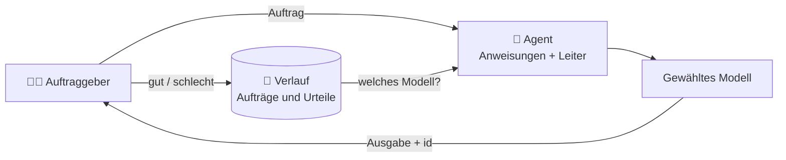

🌐 [Español](https://github.com/AbstractBike/SilvioMaciasSanchez/blob/es/abstract-architectures/agencia.md) · [English](https://github.com/AbstractBike/SilvioMaciasSanchez/blob/en/abstract-architectures/agencia.md) · **Deutsch**

# Muster: Agentur

> **In einem Satz:** Agenten, die Auftrag für Auftrag lernen, welches das günstigste Modell ist, das seine Arbeit gut macht.

| | |
| --- | --- |
| **Problem** | Jede Aufgabe geht „sicherheitshalber" an das leistungsfähigste Modell, und niemand weiß, ob ein günstigeres sie genauso gut erledigen würde. |
| **Lösung** | Ein Agent mit festen Anweisungen und einer Modellleiter; jedes Ergebnis wird bewertet, und der Agent wechselt auf ein günstigeres Modell, sobald es geht. |
| **Nutze es für** | Aufgaben, die sich mit denselben Anweisungen wiederholen: klassifizieren, extrahieren, zusammenfassen, übersetzen, aus einer Vorlage formulieren. |
| **Nutze es nicht für** | Einmalige oder offene Arbeit, bei der es kein „gut" oder „schlecht" zu bewerten gibt. |
| **Gemessen wird es an** | Den Kosten pro Treffer jedes Agenten und daran, wie stark sie mit der Zeit sinken. |

## Die Idee

Die [Schmiede](forja.md) fragt, **ob** für eine Aufgabe überhaupt ein LLM nötig ist, und kristallisiert sie, sobald es nicht mehr nötig ist. Die Agentur fragt, **welches**: Solange eine Aufgabe flüssig bleibt, soll sie das günstigste Modell erledigen, das sie gut macht.

Um das zu wissen, braucht man weder Benchmarks noch Bauchgefühl: Es genügt, **jeden Auftrag und sein Urteil zu speichern**. Mit wenigen Bewertungen weiß die Agentur, welche Modelle für diesen Agenten zuverlässig sind, welche verworfen wurden und an welches der nächste Auftrag geht.

## Ein kurzes Beispiel

Du möchtest deine Dokumente ins Englische und Deutsche übersetzen. Statt sie von Hand oder mit dem teuersten Modell zu übersetzen:

1. Du legst einen Agenten `traductor-markdown` an, mit seinen Anweisungen (Tabellen erhalten, URLs nicht übersetzen, Glossar der Begriffe) und einer Leiter: Haiku → Sonnet → Opus.
2. Du gibst ihm Aufträge. Die ersten gehen an das Standardmodell; hin und wieder geht einer los, um ein günstigeres Modell zu erkunden.
3. Du bewertest jede Übersetzung: **gut** oder **schlecht**.
4. Wenn Haiku deine Dokumente gut übersetzt, weiß der Agent das nach ein paar Urteilen, und die nächsten Aufträge gehen an dieses Modell. Fängt es an zu versagen, steigt er wieder auf.

So wurde dieses Repository übersetzt.

## Wann du es anwendest (und wann nicht)

Wende es an, wenn eine Teilaufgabe **eine Transformation mit festen Anweisungen ist, die du zweimal gleich machen würdest**. Wenn du dich dabei ertappst, wie du immer wieder denselben Prompt einfügst, ist das ein Agent.

Nutze es **nicht** für einmalige oder offene Arbeit: eine Recherche, ein Gespräch, eine Entscheidung. Ohne ein Kriterium für „gut" oder „schlecht" kann die Agentur nichts lernen.

## Wie es funktioniert

1. **Agent.** Ein Name, feste Anweisungen (der *System-Prompt*) und eine **Leiter** von Modellen, vom günstigsten zum leistungsfähigsten.
2. **Auftrag.** Jede Eingabe, die dem Agenten gegeben wird. Sie wird vollständig gespeichert: Modell, Ausgabe oder Fehler, Zeit, Tokens und Urteil.
3. **Urteil.** Wer den Auftrag erteilt, bewertet das Ergebnis: gut oder schlecht. Ein Fehler des Modells zählt ohne Bewertung als schlecht; ein Netzwerkfehler zählt weder dafür noch dagegen.
4. **Klassifizierung.** Anhand der Urteile zur aktuellen Version der Anweisungen ist jedes Modell entweder **offen** (wenige Bewertungen), **zuverlässig** (fast alles gut) oder **verworfen**.
5. **Wahl.** Der nächste Auftrag geht an das **günstigste zuverlässige** Modell. Gibt es keines, geht er an das Standardmodell. Und einer von wenigen Aufträgen geht los, um ein noch günstigeres, noch offenes Modell zu **erkunden**: So sinkt der Preis, wann immer es möglich ist.

Wenn du die Anweisungen änderst, beginnt ein neuer Verlauf: Andere Anweisungen sind eine andere Arbeit.

### Mit der Schmiede

Die beiden Muster lassen sich verketten. Wenn die Agentur ihre Modelle über die [Schmiede](forja.md) anfragt, ist jeder Agent zugleich eine Aufgabe der Schmiede: Seine Stichproben gehen in den Steinbruch, und wenn sich das Modell wiederholt, wird die Aufgabe reif und kristallisiert. Von da an antwortet der Kristall, ohne Tokens. **Zuerst das günstigste Modell, das es kann; danach keines mehr.**

## Wie du es umsetzt

| Baustein | Was es ist |
| --- | --- |
| **Agent** | Name, Anweisungen, Modellleiter und ein Standardmodell. |
| **Auftrag** | Eingabe, Modell, Grund der Wahl, Ausgabe oder Fehler, Zeit, Tokens und Urteil. |
| **Archiv** | Agenten, Aufträge und Urteile, *append-only*: Nichts wird gelöscht. |
| **Richtlinie** | Wie viele Bewertungen nötig sind, welcher Trefferanteil ein Modell zuverlässig macht und wie oft erkundet wird. |
| **Wahl** | Das Modell des nächsten Auftrags, samt Begründung. |

Der Kern ist rein: Er entscheidet anhand des Verlaufs, der ihm übergeben wird, ohne mit Modellen oder Datenbanken zu sprechen. Der Transport (die API der Modelle, das Archiv) wird injiziert.

Referenzimplementierung (MCP-Server in OCaml, Archiv in GreptimeDB und eine schreibgeschützte Webansicht): [AbstractBike/cristales — die Agentur](https://github.com/AbstractBike/cristales/blob/main/doc/agencia.md).

## Risiken und Schutzmaßnahmen

| Risiko | Was passiert | Schutzmaßnahme |
| --- | --- | --- |
| **Keine Urteile** | Niemand bewertet, und die Agentur verlässt das Standardmodell nie. | Jede Ausgabe trägt die id des Auftrags, und die Anweisungen der Agentur verlangen, sie immer zu bewerten. |
| **Nachsichtiges Urteil** | Es wird „gut" markiert, ohne hinzuschauen, und ein schlechtes Modell gilt als zuverlässig. | Mit konkreten Kriterien bewerten (Struktur, Daten, Ton) und den Grund notieren. |
| **Drift** | Ein zuverlässiges Modell fängt bei neuen Eingaben an zu versagen. | Die Urteile zählen weiter: Ein „schlecht" nach dem anderen verwirft es, und die Agentur steigt auf ein anderes Modell um. |
| **Teures Erkunden** | Schlechtere Modelle auszuprobieren kostet fehlgeschlagene Aufträge. | Es wird nur ein Bruchteil erkundet, und nur in Richtung günstigerer Modelle. |

## Die grundlegende Spannung

Die Agentur macht, was eine gute Teamleitung machen würde: Sie gibt der teuersten Person nicht die Arbeit, die eine andere genauso gut erledigt, und sie weiß das, weil sie Buch darüber führt, wie jeder Auftrag ausgegangen ist. Der Unterschied ist, dass diese Buchführung hier aufgeschrieben ist, und damit ist der nächste Schritt offensichtlich: Wenn das günstigste Modell es immer gleich macht, braucht es gar keines mehr.

## Siehe auch

- [Schmiede](forja.md): Die Aufgabe, die die Agentur mit dem günstigsten Modell erledigt, kristallisiert am Ende.
- [Kostenverfolgung](seguimiento-de-costes.md): Was jeder Auftrag gekostet hat, festgehalten im git-Verlauf.
- [Kristallisation](cristalizacion.md): Das Ziel jeder stabilen Aufgabe.

---

© 2026 Silvio Macías Sánchez. Alle Rechte vorbehalten. Frei für Forschung und gemeinnützige Lehre unter Nennung des Autors; für die kommerzielle Nutzung schreib mir an silvio.macias.sanchez@abstract.bike oder info@abstractarchitectures.ltd. Siehe [COPYRIGHT.md](../COPYRIGHT.md).
