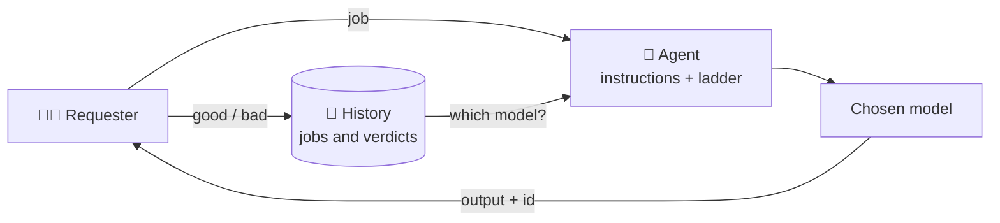

🌐 [Español](https://github.com/AbstractBike/SilvioMaciasSanchez/blob/es/abstract-architectures/agencia.md) · **English** · [Deutsch](https://github.com/AbstractBike/SilvioMaciasSanchez/blob/de/abstract-architectures/agencia.md)

# Pattern: Agency

> **In one sentence:** agents that learn, job by job, which is the cheapest model that does its work well.

| | |
| --- | --- |
| **Problem** | Every task is sent to the most capable model "just in case", and nobody knows whether a cheaper one would do it just as well. |
| **Solution** | An agent with fixed instructions and a ladder of models; each result is judged and the agent moves down to a cheaper model when it can. |
| **Use it for** | Tasks that repeat with the same instructions: classifying, extracting, summarizing, translating, drafting from a template. |
| **Don't use it for** | One-off or open-ended work, where there is no "good" or "bad" to judge. |
| **Measured by** | The cost per success of each agent, and how much it drops over time. |

## The idea

The [Forge](forja.md) asks **whether** a task needs an LLM at all and, once it no longer does, crystallizes it. The agency asks **which one**: as long as a task is still liquid, let the cheapest model that does it well handle it.

To find out you don't need benchmarks or gut feeling: all you need is to **store every job and its verdict**. With just a few judgments, the agency knows which models are reliable for that agent, which are discarded, and which one to send the next job to.

## A quick example

You want to translate your documents into English and German. Instead of translating them by hand or with the most expensive model:

1. You create an agent `traductor-markdown` with its instructions (keep tables, don't translate URLs, glossary of terms) and a ladder: Haiku → Sonnet → Opus.
2. You give it jobs. The first ones go to the default model; every so often, one goes to explore a cheaper model.
3. You judge each translation: **good** or **bad**.
4. If Haiku translates your documents well, after a handful of verdicts the agent knows it and the following jobs go to it. If it starts to fail, the agent moves back up.

That's how this repository was translated.

## When to apply it (and when not to)

Apply it when a subtask is **a transformation with fixed instructions that you would do the same way twice**. If you catch yourself pasting the same prompt over and over, that's an agent.

Do **not** use it for one-off or open-ended work: a piece of research, a conversation, a decision. Without a criterion of "good" or "bad", the agency can't learn anything.

## How it works

1. **Agent.** A name, fixed instructions (the *system prompt*) and a **ladder** of models, from cheapest to most capable.
2. **Job.** Every input given to the agent. It is stored in full: model, output or error, time, tokens and verdict.
3. **Verdict.** The requester judges the result: good or bad. A model error counts as bad without being judged; a network failure counts neither for nor against.
4. **Classification.** With the verdicts for the current version of the instructions, each model ends up **untested** (few judgments), **reliable** (almost all good) or **discarded**.
5. **Choice.** The next job goes to the **cheapest reliable model**. If there is none, to the default model. And one in every few jobs goes to **explore** a cheaper model that is still untested: that's how the price comes down when it can.

Changing the instructions starts a new history: different instructions are a different job.

### With the Forge

The two patterns chain together. If the agency requests its models through the [Forge](forja.md), each agent is also a task of the forge: its samples go to the quarry and, if the model's output repeats, the task matures and crystallizes. From then on the crystal answers, with no tokens. **First the cheapest model that knows; then, none at all.**

## How to implement it

| Piece | What it is |
| --- | --- |
| **Agent** | Name, instructions, ladder of models and a default one. |
| **Job** | Input, model, reason for the choice, output or error, time, tokens and verdict. |
| **Archive** | Agents, jobs and verdicts, *append-only*: nothing is deleted. |
| **Policy** | How many judgments are needed, what fraction of successes makes a model reliable, and how often to explore. |
| **Choice** | The model for the next job, with its reason. |

The core is pure: it decides from the history it is given, without talking to models or databases. The transport (the models' API, the archive) is injected.

Reference implementation (MCP server in OCaml, archive in GreptimeDB and a read-only web view): [AbstractBike/cristales — la agencia](https://github.com/AbstractBike/cristales/blob/main/doc/agencia.md).

## Risks and safeguards

| Risk | What happens | Safeguard |
| --- | --- | --- |
| **No verdicts** | Nobody judges, and the agency never leaves the default model. | Every output carries the job id, and the agency's instructions always ask for it to be judged. |
| **Lenient judging** | Jobs get marked "good" without looking, and a bad model passes as reliable. | Judge with concrete criteria (structure, data, tone) and note the reason. |
| **Drift** | A reliable model starts to fail on new inputs. | Verdicts keep counting: one "bad" after another discards it and the agency moves up a model. |
| **Costly exploration** | Trying worse models costs failed jobs. | Only a fraction is explored, and only toward cheaper models. |

## The underlying tension

The agency does what a good team lead would do: it doesn't give the most expensive person work that someone else does just as well, and it knows this because it keeps count of how each job turned out. The difference is that here the count is written down, and with it the next step is obvious: when the cheapest model already does it the same way every time, none is needed anymore.

## See also

- [Forge](forja.md): the task that the agency does with the cheapest model ends up crystallizing.
- [Cost Tracking](seguimiento-de-costes.md): how much each job cost, recorded in the git history.
- [Crystallization](cristalizacion.md): the destination of every stable task.

---

© 2026 Silvio Macías Sánchez. All rights reserved. Free for non-profit research and teaching, citing the author; for commercial use, write to me at silvio.macias.sanchez@abstract.bike or info@abstractarchitectures.ltd. See [COPYRIGHT.md](../COPYRIGHT.md).
