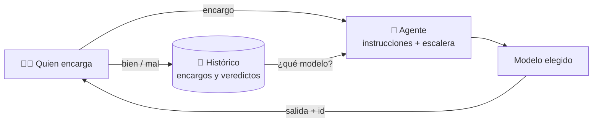

🌐 **Español** · [English](https://github.com/AbstractBike/SilvioMaciasSanchez/blob/en/abstract-architectures/agencia.md) · [Deutsch](https://github.com/AbstractBike/SilvioMaciasSanchez/blob/de/abstract-architectures/agencia.md)

# Patrón: Agencia

> **En una frase:** agentes que aprenden, encargo a encargo, cuál es el modelo más barato que hace bien su trabajo.

| | |
| --- | --- |
| **Problema** | Cada tarea se manda al modelo más capaz "por si acaso", y nadie sabe si uno más barato lo haría igual de bien. |
| **Solución** | Un agente con instrucciones fijas y una escalera de modelos; se juzga cada resultado y el agente baja de modelo cuando puede. |
| **Úsalo para** | Tareas que se repiten con las mismas instrucciones: clasificar, extraer, resumir, traducir, redactar desde plantilla. |
| **No lo uses para** | Trabajo de una sola vez o abierto, donde no hay un "bien" o "mal" que juzgar. |
| **Se mide por** | El coste por acierto de cada agente, y cuánto baja con el tiempo. |

## La idea

La [Forja](forja.md) pregunta **si** hace falta un LLM para una tarea y, cuando deja de hacer falta, la cristaliza. La agencia pregunta **cuál**: mientras una tarea siga siendo líquida, que la haga el modelo más barato que la hace bien.

Para saberlo no hacen falta benchmarks ni intuición: basta con **guardar cada encargo y su veredicto**. Con unos pocos juicios, la agencia sabe qué modelos son fiables para ese agente, cuáles están descartados y a cuál mandar el siguiente encargo.

## Un ejemplo rápido

Quieres traducir tus documentos a inglés y alemán. En vez de traducirlos a mano o con el modelo más caro:

1. Creas un agente `traductor-markdown` con sus instrucciones (conservar tablas, no traducir URLs, glosario de términos) y una escalera: Haiku → Sonnet → Opus.
2. Le haces encargos. Los primeros van al modelo por defecto; de vez en cuando, uno va a explorar un modelo más barato.
3. Juzgas cada traducción: **bien** o **mal**.
4. Si Haiku traduce bien tus documentos, tras unos cuantos veredictos el agente lo sabe y los siguientes encargos le llegan a él. Si empieza a fallar, vuelve a subir.

Así se tradujo este repositorio.

## Cuándo aplicarlo (y cuándo no)

Aplícalo cuando una subtarea es **una transformación con instrucciones fijas que harías igual dos veces**. Si te ves pegando el mismo prompt una y otra vez, eso es un agente.

**No** lo uses para el trabajo único o abierto: una investigación, una conversación, una decisión. Sin un criterio de "bien" o "mal", la agencia no puede aprender nada.

## Cómo funciona

1. **Agente.** Un nombre, unas instrucciones fijas (el *system prompt*) y una **escalera** de modelos, del más barato al más capaz.
2. **Encargo.** Cada entrada que se le da al agente. Se guarda entero: modelo, salida o error, tiempo, tokens y veredicto.
3. **Veredicto.** Quien encarga juzga el resultado: bien o mal. Un error del modelo cuenta como mal sin juzgarlo; un fallo de red no cuenta ni a favor ni en contra.
4. **Clasificación.** Con los veredictos de la versión actual de las instrucciones, cada modelo queda **por ver** (pocos juicios), **fiable** (casi todos bien) o **descartado**.
5. **Elección.** El siguiente encargo va al **más barato fiable**. Si no hay ninguno, al modelo por defecto. Y uno de cada pocos encargos va a **explorar** un modelo más barato todavía por ver: así baja de precio cuando puede.

Cambiar las instrucciones empieza un histórico nuevo: otras instrucciones son otro trabajo.

### Con la Forja

Los dos patrones se encadenan. Si la agencia pide sus modelos a través de la [Forja](forja.md), cada agente es también una tarea de la forja: sus muestras van a la cantera y, si el modelo se repite, la tarea madura y se cristaliza. Desde entonces responde el cristal, sin tokens. **Primero el modelo más barato que sabe; luego, ninguno.**

## Cómo implementarlo

| Pieza | Qué es |
| --- | --- |
| **Agente** | Nombre, instrucciones, escalera de modelos y uno por defecto. |
| **Encargo** | Entrada, modelo, motivo de la elección, salida o error, tiempo, tokens y veredicto. |
| **Archivo** | Agentes, encargos y veredictos, *append-only*: nada se borra. |
| **Política** | Cuántos juicios hacen falta, qué fracción de aciertos hace fiable a un modelo y cada cuánto se explora. |
| **Elección** | El modelo del siguiente encargo, con su motivo. |

El núcleo es puro: decide con el histórico que se le da, sin hablar con modelos ni bases de datos. El transporte (la API de los modelos, el archivo) se inyecta.

Implementación de referencia (servidor MCP en OCaml, archivo en GreptimeDB y una vista web de solo lectura): [AbstractBike/cristales — la agencia](https://github.com/AbstractBike/cristales/blob/main/doc/agencia.md).

## Riesgos y salvaguardas

| Riesgo | Qué pasa | Salvaguarda |
| --- | --- | --- |
| **Sin veredictos** | Nadie juzga, y la agencia nunca sale del modelo por defecto. | Cada salida lleva el id del encargo, y las instrucciones de la agencia piden juzgarlo siempre. |
| **Juicio complaciente** | Se marca "bien" sin mirar, y un modelo malo pasa por fiable. | Juzgar con criterios concretos (estructura, datos, tono) y anotar el motivo. |
| **Deriva** | Un modelo fiable empieza a fallar con entradas nuevas. | Los veredictos siguen contando: un "mal" tras otro lo descarta y la agencia sube de modelo. |
| **Exploración cara** | Probar modelos peores cuesta encargos fallidos. | Se explora solo una fracción, y solo hacia modelos más baratos. |

## La tensión de fondo

La agencia hace lo que haría un buen jefe de equipo: no le da a la persona más cara el trabajo que otra hace igual de bien, y lo sabe porque lleva la cuenta de cómo salió cada encargo. La diferencia es que aquí la cuenta está escrita, y con ella el siguiente paso es obvio: cuando el modelo más barato ya lo hace siempre igual, ya no hace falta ninguno.

## Ver también

- [Forja](forja.md): la tarea que la agencia hace con el modelo más barato acaba cristalizando.
- [Seguimiento de costes](seguimiento-de-costes.md): cuánto costó cada encargo, apuntado en el historial de git.
- [Cristalización](cristalizacion.md): el destino de toda tarea estable.

---

© 2026 Silvio Macías Sánchez. Todos los derechos reservados. Libre para investigación y docencia sin ánimo de lucro, citando al autor; para uso comercial, escríbeme a silvio.macias.sanchez@abstract.bike o info@abstractarchitectures.ltd. Ver [COPYRIGHT.md](../COPYRIGHT.md).
