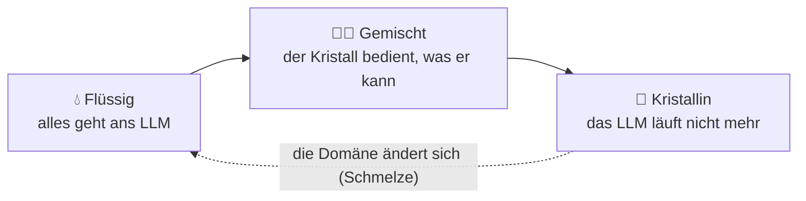

🌐 [Español](https://github.com/AbstractBike/SilvioMaciasSanchez/blob/es/abstract-architectures/cristalizacion.md) · [English](https://github.com/AbstractBike/SilvioMaciasSanchez/blob/en/abstract-architectures/cristalizacion.md) · **Deutsch**

# Muster: Kristallisation

> **In einem Satz:** Bitte die KI um das Programm, das das Problem löst, nicht um die Antwort für jeden einzelnen Fall.

| | |
| --- | --- |
| **Problem** | Ein LLM bei jedem Aufruf ist teuer, langsam, liefert nicht exakt dasselbe und lässt sich nicht auditieren. |
| **Lösung** | Einmal nach der Methode fragen (Code mit Tests) und diese Methode statt des Modells ausführen. |
| **Verwende es für** | Stufen mit stabiler Struktur: extrahieren, klassifizieren, normalisieren, validieren, transformieren. |
| **Verwende es nicht für** | Alles, was von Natur aus offen ist: freier Text, Gespräche, subjektive Urteile. |
| **Gemessen wird es am** | Kristallisationsgrad: dem Anteil der Eingaben, die ohne LLM gelöst werden. |

## Die Idee

Angeln beibringen, statt Fisch zu geben. Statt *„klassifiziere diese E-Mail"* heißt es *„schreibe den E-Mail-Klassifikator"*. Zurück kommt keine Antwort, sondern eine Methode – ein Programm, eine Grammatik, eine Regel, eine Abfrage –, die aufgeschrieben bleibt und allein antwortet, ohne das Modell noch einmal aufzurufen.

Ein LLM, das bei jedem Aufruf läuft, ist **flüssig**: Es nimmt die Form jeder Eingabe an, kostet bei jeder Nutzung, liefert nicht exakt dasselbe und lässt sich nicht auditieren. Was es liefert, wenn du es um die Methode bittest, ist **Kristall**: eine feste, deterministische, günstige, versionierte Struktur mit Tests. Die KI ist nicht mehr der Interpreter, der dein Problem ausführt, sondern der Compiler, der dir das Programm schreibt, das es ausführt.

## Ein kurzes Beispiel

Ein Shop erhält täglich 10.000 Adressen, die auf beliebige Weise geschrieben sind, und muss daraus Postleitzahl, Stadt und Land extrahieren.

| Flüssig | Kristall |
| --- | --- |
| Jede Adresse geht an das LLM: 10.000 Aufrufe pro Tag. | Dem LLM werden 200 echte Adressen übergeben und es wird um *den Parser* gebeten. |
| Kosten, Latenz und jedes Mal eine etwas andere Antwort. | Eine Funktion mit Tests im Repository, die in Mikrosekunden antwortet. |
| Wenn es sich irrt, merkt es niemand. | Was der Parser nicht lösen kann, markiert er als *Defekt* und es geht an das LLM; diese Fälle speisen die nächste Version. |

## KI-Pipelines kristallisieren

Eine KI-Pipeline ist eine Kette von Stufen, die ein Modell aufrufen: klassifizieren, extrahieren, normalisieren, routen, zusammenfassen. Fast keine davon braucht bei jeder Ausführung Intelligenz; sie brauchte sie **einmal**, um das Problem zu verstehen. Eine Pipeline zu kristallisieren heißt, das LLM Stufe für Stufe aus dem Ausführungspfad zu nehmen, und zwar in drei Phasen:

- **Flüssig.** Die Stufe ruft bei jeder Eingabe das LLM auf. So beginnt alles, und das ist in Ordnung: Es ist der schnellste Weg herauszufinden, ob das Problem lösbar ist. Vom ersten Tag an wird jeder Aufruf protokolliert.
- **Gemischt.** Ein Kristall bedient, was er kann; was er nicht kann, meldet er als *Defekt*, es fällt ans LLM und wird protokolliert.
- **Kristallin.** Der Kristall deckt alles ab. Das LLM läuft nicht mehr; es wird nur noch gerufen, um neu zu *kristallisieren*, wenn sich die Domäne ändert.

Die Pipeline lernt, aber das Gelernte bleibt als Code festgehalten, nicht als Gewichte oder Kontext.

## Wann du es anwendest (und wann nicht)

Wende es an, wenn die Stufe eine **stabile Struktur** hat: Felder extrahieren, in eine geschlossene Menge klassifizieren, Formate normalisieren, validieren, zwischen Schemata transformieren.

> **Faustregel:** Wenn du bei zweimaliger Anfrage an die KI dieselbe Antwort erwartest, sollte diese Stufe ein Kristall sein.

Erzwinge es **nicht** bei dem, was von Natur aus offen ist: freien Text verfassen, Gespräche führen, subjektive Qualität beurteilen. Trotzdem kristallisiert meist *ein Teil* – die Textvorlage, die Rubrik des Urteils, der Gesprächsbaum – und das Flüssige bleibt auf die Lücke beschränkt, die es wirklich braucht.

## Wie es funktioniert

Der Zyklus hat in jedem Schritt einen eigenen Namen:

1. **Saatkristall.** Das Minimum, damit ein Kristall wachsen kann: das Problem in einem Satz, echte Beispiele für Ein- und Ausgabe (auch die seltsamen), die Invarianten, die jede Ausgabe erfüllen muss, und was *außerhalb der Domäne* liegen soll.
2. **Keimbildung.** Dem LLM wird die Methode abverlangt, nicht die Antwort. Zurück kommen Code, Tests und die explizite Liste der Fälle, die die Methode nicht abdeckt. Kann es keine allgemeine Methode liefern, ist die Stufe nicht reif: Sie bleibt flüssig und es werden mehr Beispiele gesammelt.
3. **Kristallgitter.** Die Tests und Invarianten, die die Struktur definieren. Ein Kristall ohne Gitter ist nur generierter Code; mit Gitter ist er ein Baustein, dem man vertrauen kann. Das Gitter wächst nur: Jede Version des Kristalls besteht das gesamte Gitter der vorherigen.
4. **Wachstum.** Die in der gemischten Phase protokollierten Defekte werden zum Saatkristall der nächsten Keimbildung. So steigt der **Kristallisationsgrad** – der Anteil der Eingaben, die ohne LLM gelöst werden –, die Kennzahl, auf die es ankommt.
5. **Schmelze.** Fällt der Grad plötzlich ab, hat sich die Domäne geändert. Die Stufe wird ohne Drama wieder flüssig; Saatkristall und alte Herkunft bleiben im Repository für die nächste Keimbildung.

### Glossar

| Begriff | Was er bedeutet |
| --- | --- |
| Flüssig | Das LLM läuft bei jeder Eingabe. |
| Kristall | Die Methode, die das LLM geschrieben hat: deterministischer, versionierter Code mit Tests. |
| Defekt | Eine Eingabe, bei der der Kristall erkennt, dass er sie nicht lösen kann. Lieber ein Defekt als eine erfundene Antwort. |
| Saatkristall | Problem, Beispiele, Invarianten und Grenzen, aus denen der Kristall angefordert wird. |
| Keimbildung | Der Moment, in dem das LLM um die Methode gebeten wird. |
| Kristallgitter | Die Tests und Invarianten, die der Kristall immer erfüllen muss. |
| Kristallisationsgrad | Der Anteil der Eingaben, die ohne Aufruf des LLM gelöst werden. |
| Schmelze | Die Rückkehr in den flüssigen Zustand, weil sich die Domäne geändert hat. |

## Wie du es umsetzt

Die Kernanweisung der Keimbildung könnte etwa so lauten:

> Ich möchte nicht, dass du diese Fälle löst. Ich möchte das Programm, das sie alle löst, damit ich dich nicht noch einmal fragen muss. Liefere eine reine Funktion – ohne Netzwerk, Uhr oder Zufall –, die für jede Eingabe ein Ergebnis oder einen Defekt mit Begründung zurückgibt; ein Defekt ist mir lieber als eine erfundene Antwort. Füge Tests bei, die alle Beispiele abdecken und die Invarianten prüfen, sowie die Liste der Fälle, die deine Methode nicht abdeckt. Wenn das Problem keine allgemeine Methode zulässt, sag es und erkläre, welche Beispiele fehlen würden; gib mir kein Programm, das im Kern nur eine Tabelle der Beispiele ist.

Referenzimplementierung (OCaml-Bibliothek mit kombinierbaren flüssigen, gemischten und kristallinen Stufen, vollständigem Protokoll und einem Beispielkristall): [AbstractBike/cristales](https://github.com/AbstractBike/cristales).

## Risiken und Schutzmaßnahmen

| Risiko | Was passiert | Schutzmaßnahme |
| --- | --- | --- |
| **Unreinheit** | Der Kristall behandelt eine Eingabe *falsch*, ohne es zu merken, statt sie als Defekt zu melden. Das ist schlimmer als das LLM: Er gibt eine falsche Antwort mit dem Anschein von Gewissheit. | Das Gitter: Invarianten, die über das gesamte Protokoll geprüft werden und nicht nur über die Beispiele, sowie der Abgleich mit dem, was das flüssige System vor dem Erstarren geantwortet hat. |
| **Überanpassung an den Saatkristall** | Eine „Methode", die in Wirklichkeit die Beispiele auswendig lernt. | Allgemeine Invarianten verlangen und mit Eingaben testen, die nicht im Saatkristall enthalten waren. |

## Die zugrunde liegende Spannung

Dieses Muster nutzt KI, um KI *nicht mehr zu nutzen*. Es ist das Spiegelbild der [Motivationsumkehr](../motivacion/inversion-de-motivacion.md), nur auf Maschinen angewandt: Dort hält die KI die Lösung zurück, damit du handelst; hier bittest du sie um die Methode, damit das System allein handelt. In beiden Fällen ist das Ziel nicht die Antwort, sondern die Fähigkeit, die bleibt, wenn sich die KI zurückzieht.

## Siehe auch

- [Schmiede](forja.md): kristallisieren, ohne vorher zu wissen, welche Stufen es gibt; der Traffic selbst sagt es dir.
- [Motivationsumkehr](../motivacion/inversion-de-motivacion.md): dieselbe Idee, auf Menschen angewandt.

---

© 2026 Silvio Macías Sánchez. Alle Rechte vorbehalten. Frei für Forschung und gemeinnützige Lehre unter Nennung des Autors; für die kommerzielle Nutzung schreib an silvio.macias.sanchez@abstract.bike oder info@abstractarchitectures.ltd. Siehe [COPYRIGHT.md](../COPYRIGHT.md).
