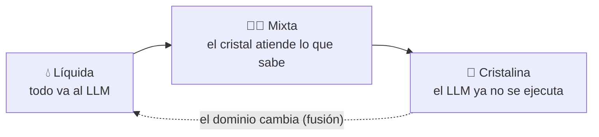

🌐 **Español** · [English](https://github.com/AbstractBike/SilvioMaciasSanchez/blob/en/abstract-architectures/cristalizacion.md) · [Deutsch](https://github.com/AbstractBike/SilvioMaciasSanchez/blob/de/abstract-architectures/cristalizacion.md)

# Patrón: Cristalización

> **En una frase:** pídele a la IA el programa que resuelve el problema, no la respuesta a cada caso.

| | |
| --- | --- |
| **Problema** | Un LLM en cada llamada es caro, lento, no repite exactamente y no se puede auditar. |
| **Solución** | Pedirle una vez el método (código con pruebas) y ejecutar ese método en lugar del modelo. |
| **Úsalo para** | Etapas con estructura estable: extraer, clasificar, normalizar, validar, transformar. |
| **No lo uses para** | Lo abierto por naturaleza: texto libre, conversación, juicio subjetivo. |
| **Se mide por** | El grado de cristalización: la fracción de entradas resueltas sin LLM. |

## La idea

Enseñar a pescar en vez de dar pescado. En lugar de *"clasifica este correo"*, *"escribe el clasificador de correos"*. Lo que vuelve no es una respuesta, sino un método —un programa, una gramática, una regla, una consulta— que queda escrito y responde solo, sin volver a llamar al modelo.

Un LLM que se ejecuta en cada llamada es **líquido**: toma la forma de cada entrada, cuesta en cada uso, no repite exactamente y no se puede auditar. Lo que produce cuando le pides el método es **cristal**: una estructura fija, determinista, barata, versionada y con pruebas. La IA deja de ser el intérprete que ejecuta tu problema y se convierte en el compilador que te escribe el programa que lo ejecuta.

## Un ejemplo rápido

Una tienda recibe 10.000 direcciones al día escritas de cualquier manera y necesita extraer código postal, ciudad y país.

| Líquido | Cristal |
| --- | --- |
| Cada dirección se manda al LLM: 10.000 llamadas al día. | Se le pasan al LLM 200 direcciones reales y se le pide *el parser*. |
| Coste, latencia y alguna respuesta distinta cada vez. | Una función con pruebas, en el repositorio, que responde en microsegundos. |
| Si se equivoca, nadie se entera. | Lo que no sabe resolver lo marca como *defecto* y va al LLM; esos casos alimentan la siguiente versión. |

## Las pipelines de IA se cristalizan

Una pipeline de IA es una cadena de etapas que llaman a un modelo: clasificar, extraer, normalizar, enrutar, resumir. Casi ninguna necesita inteligencia en cada ejecución; la necesitó **una vez**, para entender el problema. Cristalizar la pipeline es sacar al LLM del camino de ejecución, etapa a etapa, pasando por tres fases:

- **Líquida.** La etapa llama al LLM en cada entrada. Así nace todo, y está bien: es la forma más rápida de saber si el problema tiene solución. Desde el primer día se registra cada llamada.
- **Mixta.** Un cristal atiende lo que sabe; lo que no sabe lo declara como *defecto*, cae al LLM y queda registrado.
- **Cristalina.** El cristal lo cubre todo. El LLM ya no se ejecuta; solo se le convoca para *recristalizar* cuando el dominio cambia.

La pipeline aprende, pero lo aprendido queda escrito como código, no como pesos ni como contexto.

## Cuándo aplicarlo (y cuándo no)

Aplícalo cuando la etapa tiene **estructura estable**: extraer campos, clasificar en un conjunto cerrado, normalizar formatos, validar, transformar entre esquemas.

> **Regla práctica:** si al pedirle el resultado a la IA dos veces esperas la misma respuesta, esa etapa debería ser un cristal.

**No** lo fuerces en lo que es abierto por naturaleza: redactar texto libre, conversar, juzgar calidad subjetiva. Aun así, suele cristalizar *una parte* —la plantilla del texto, la rúbrica del juicio, el árbol de la conversación— y el líquido queda acotado al hueco que de verdad lo necesita.

## Cómo funciona

El ciclo tiene nombre propio en cada paso:

1. **Semilla.** Lo mínimo para que crezca un cristal: el problema en una frase, ejemplos reales de entrada y salida (incluidos los raros), las invariantes que toda salida debe cumplir y lo que debe quedar *fuera de dominio*.
2. **Nucleación.** Se le pide al LLM el método, no la respuesta. Lo que vuelve es código, pruebas y la lista explícita de casos que el método no cubre. Si no puede dar un método general, la etapa no está madura: sigue líquida y se recogen más ejemplos.
3. **Red cristalina.** Las pruebas e invariantes que definen la estructura. Un cristal sin red es solo código generado; con red, es una pieza en la que se puede confiar. La red solo crece: cada versión del cristal pasa la red entera de la anterior.
4. **Crecimiento.** Los defectos registrados en fase mixta se convierten en semilla de la siguiente nucleación. Así sube el **grado de cristalización** —la fracción de entradas resueltas sin LLM—, que es la métrica que manda.
5. **Fusión.** Si el grado cae de golpe, el dominio ha cambiado. La etapa vuelve a líquida sin dramas; la semilla y la procedencia antiguas siguen en el repositorio para la próxima nucleación.

### Glosario

| Término | Qué significa |
| --- | --- |
| Líquido | El LLM ejecutándose en cada entrada. |
| Cristal | El método que escribió el LLM: código determinista, versionado y con pruebas. |
| Defecto | Una entrada que el cristal reconoce que no sabe resolver. Mejor un defecto que una respuesta inventada. |
| Semilla | Problema, ejemplos, invariantes y límites a partir de los que se pide el cristal. |
| Nucleación | El momento en que se le pide al LLM el método. |
| Red cristalina | Las pruebas e invariantes que el cristal debe cumplir siempre. |
| Grado de cristalización | La fracción de entradas resueltas sin llamar al LLM. |
| Fusión | Volver a líquido porque el dominio ha cambiado. |

## Cómo implementarlo

La instrucción núcleo de la nucleación sería algo así:

> No quiero que resuelvas estos casos. Quiero el programa que los resuelve todos, para no tener que volver a preguntarte. Entrega una función pura —sin red, reloj ni aleatoriedad— que para cada entrada devuelva un resultado o un defecto con su motivo; prefiero un defecto a una respuesta inventada. Incluye pruebas que cubran todos los ejemplos y comprueben las invariantes, y la lista de casos que tu método no cubre. Si el problema no admite un método general, dilo y explica qué ejemplos faltarían; no me des un programa que en el fondo sea una tabla de los ejemplos.

Implementación de referencia (librería OCaml de etapas líquidas, mixtas y cristalinas componibles, protocolo completo y un cristal de ejemplo): [AbstractBike/cristales](https://github.com/AbstractBike/cristales).

## Riesgos y salvaguardas

| Riesgo | Qué pasa | Salvaguarda |
| --- | --- | --- |
| **Impureza** | El cristal trata *mal* una entrada sin darse cuenta, en lugar de declararla defecto. Es peor que el LLM: da una respuesta equivocada con aspecto de certeza. | La red: invariantes comprobadas sobre todo el registro, no solo sobre los ejemplos, y contraste con lo que respondía el líquido antes de solidificar. |
| **Sobreajuste a la semilla** | Un "método" que en realidad memoriza los ejemplos. | Exigir invariantes generales y probar con entradas que no estaban en la semilla. |

## La tensión de fondo

Este patrón usa la IA para *dejar de usar* la IA. Es el reflejo de la [Inversión de Motivación](../motivacion/inversion-de-motivacion.md), pero aplicado a las máquinas: allí la IA retiene la solución para que tú actúes; aquí le pides el método para que el sistema actúe solo. En ambos casos el objetivo no es la respuesta, sino la capacidad que queda cuando la IA se retira.

## Ver también

- [Forja](forja.md): cristalizar sin saber de antemano qué etapas hay; el propio tráfico te lo dice.
- [Seguimiento de costes](seguimiento-de-costes.md): saber si cristalizar salió a cuenta.
- [Inversión de Motivación](../motivacion/inversion-de-motivacion.md): la misma idea aplicada a las personas.

---

© 2026 Silvio Macías Sánchez. Todos los derechos reservados. Libre para investigación y docencia sin ánimo de lucro, citando al autor; para uso comercial, escríbeme a silvio.macias.sanchez@abstract.bike o info@abstractarchitectures.ltd. Ver [COPYRIGHT.md](../COPYRIGHT.md).
