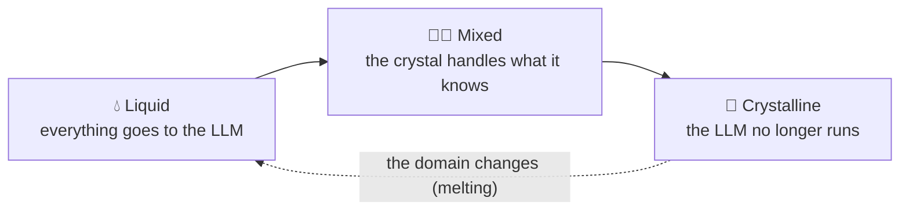

🌐 [Español](https://github.com/AbstractBike/SilvioMaciasSanchez/blob/es/abstract-architectures/cristalizacion.md) · **English** · [Deutsch](https://github.com/AbstractBike/SilvioMaciasSanchez/blob/de/abstract-architectures/cristalizacion.md)

# Pattern: Crystallization

> **In one sentence:** ask the AI for the program that solves the problem, not the answer to each case.

| | |
| --- | --- |
| **Problem** | An LLM on every call is expensive, slow, doesn't repeat exactly, and can't be audited. |
| **Solution** | Ask it once for the method (code with tests) and run that method instead of the model. |
| **Use it for** | Stages with a stable structure: extracting, classifying, normalizing, validating, transforming. |
| **Don't use it for** | Things that are open by nature: free text, conversation, subjective judgment. |
| **Measured by** | The degree of crystallization: the fraction of inputs resolved without an LLM. |

## The idea

Teach someone to fish instead of handing them a fish. Instead of *"classify this email"*, say *"write the email classifier"*. What comes back is not an answer but a method (a program, a grammar, a rule, a query) that is written down and answers on its own, without calling the model again.

An LLM that runs on every call is **liquid**: it takes the shape of each input, it costs something on every use, it doesn't repeat exactly, and it can't be audited. What it produces when you ask for the method is **crystal**: a fixed, deterministic, cheap structure that is versioned and tested. The AI stops being the interpreter that executes your problem and becomes the compiler that writes you the program that executes it.

## A quick example

A shop receives 10,000 addresses a day, written in all sorts of ways, and needs to extract postal code, city, and country.

| Liquid | Crystal |
| --- | --- |
| Every address is sent to the LLM: 10,000 calls a day. | You give the LLM 200 real addresses and ask for *the parser*. |
| Cost, latency, and occasionally a different answer each time. | A function with tests, in the repository, that responds in microseconds. |
| If it gets something wrong, nobody notices. | Whatever it can't resolve is flagged as a *defect* and goes to the LLM; those cases feed the next version. |

## AI pipelines crystallize

An AI pipeline is a chain of stages that call a model: classify, extract, normalize, route, summarize. Almost none of them need intelligence on every run; they needed it **once**, to understand the problem. Crystallizing the pipeline means taking the LLM out of the execution path, stage by stage, going through three phases:

- **Liquid.** The stage calls the LLM on every input. Everything starts this way, and that's fine: it's the fastest way to find out whether the problem has a solution. Every call is logged from day one.
- **Mixed.** A crystal handles what it knows; whatever it doesn't know it declares as a *defect*, falls back to the LLM, and is recorded.
- **Crystalline.** The crystal covers everything. The LLM no longer runs; it is only called to *recrystallize* when the domain changes.

The pipeline learns, but what it learns is written down as code, not as weights or context.

## When to apply it (and when not to)

Apply it when the stage has a **stable structure**: extracting fields, classifying into a closed set, normalizing formats, validating, transforming between schemas.

> **Rule of thumb:** if you ask the AI for the result twice and expect the same answer, that stage should be a crystal.

**Don't** force it onto things that are open by nature: writing free text, holding a conversation, judging subjective quality. Even so, *part* of them can usually crystallize (the text template, the judgment rubric, the conversation tree), and the liquid part stays confined to the gap that truly needs it.

## How it works

The cycle has a specific name at each step:

1. **Seed.** The minimum needed for a crystal to grow: the problem in one sentence, real examples of input and output (including the rare ones), the invariants every output must satisfy, and what must remain *out of domain*.
2. **Nucleation.** The LLM is asked for the method, not the answer. What comes back is code, tests, and an explicit list of the cases the method doesn't cover. If it can't give a general method, the stage isn't mature: it stays liquid and more examples are gathered.
3. **Crystal lattice.** The tests and invariants that define the structure. A crystal without a lattice is just generated code; with one, it's a piece you can trust. The lattice only grows: each version of the crystal must pass the entire lattice of the previous one.
4. **Growth.** Defects recorded in the mixed phase become the seed for the next nucleation. This is how the **degree of crystallization** rises (the fraction of inputs resolved without an LLM), which is the metric that matters.
5. **Melting.** If the degree drops suddenly, the domain has changed. The stage goes back to liquid without drama; the old seed and provenance remain in the repository for the next nucleation.

### Glossary

| Term | What it means |
| --- | --- |
| Liquid | The LLM running on every input. |
| Crystal | The method the LLM wrote: deterministic code, versioned and tested. |
| Defect | An input the crystal recognizes it can't resolve. A defect is better than an invented answer. |
| Seed | The problem, examples, invariants, and limits from which the crystal is requested. |
| Nucleation | The moment the LLM is asked for the method. |
| Crystal lattice | The tests and invariants the crystal must always satisfy. |
| Degree of crystallization | The fraction of inputs resolved without calling the LLM. |
| Melting | Going back to liquid because the domain has changed. |

## How to implement it

The core instruction for nucleation would be something like this:

> I don't want you to solve these cases. I want the program that solves all of them, so I don't have to ask you again. Deliver a pure function (no network, clock, or randomness) that, for each input, returns either a result or a defect with its reason; I'd rather have a defect than an invented answer. Include tests that cover all the examples and check the invariants, and the list of cases your method doesn't cover. If the problem doesn't admit a general method, say so and explain which examples would be missing; don't give me a program that is basically a table of the examples.

Reference implementation (an OCaml library of composable liquid, mixed, and crystalline stages, the full protocol, and an example crystal): [AbstractBike/cristales](https://github.com/AbstractBike/cristales).

## Risks and safeguards

| Risk | What happens | Safeguard |
| --- | --- | --- |
| **Impurity** | The crystal mishandles an input without realizing it, instead of declaring it a defect. It's worse than the LLM: it gives a wrong answer that looks certain. | The lattice: invariants checked across the whole record, not just the examples, and cross-checking against what the liquid answered before solidifying. |
| **Overfitting to the seed** | A "method" that in fact memorizes the examples. | Require general invariants and test with inputs that were not in the seed. |

## The underlying tension

This pattern uses AI to *stop using* AI. It mirrors [Motivation Inversion](../motivacion/inversion-de-motivacion.md), but applied to machines: there, the AI withholds the solution so that you act; here, you ask it for the method so that the system acts on its own. In both cases the goal is not the answer, but the capability that remains once the AI steps back.

## See also

- [Forge](forja.md): crystallizing without knowing in advance which stages exist; the traffic itself tells you.
- [Motivation Inversion](../motivacion/inversion-de-motivacion.md): the same idea applied to people.

---

© 2026 Silvio Macías Sánchez. All rights reserved. Free for non-profit research and teaching, citing the author; for commercial use, write to silvio.macias.sanchez@abstract.bike or info@abstractarchitectures.ltd. See [COPYRIGHT.md](../COPYRIGHT.md).
