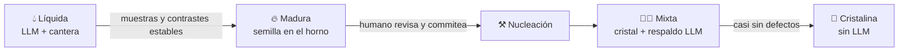

🌐 **Español** · [English](https://github.com/AbstractBike/SilvioMaciasSanchez/blob/en/abstract-architectures/forja.md) · [Deutsch](https://github.com/AbstractBike/SilvioMaciasSanchez/blob/de/abstract-architectures/forja.md)

# Patrón: Forja

> **En una frase:** un proxy delante del LLM que descubre qué tareas se repiten y te avisa cuándo cristalizarlas.

| | |
| --- | --- |
| **Problema** | Mucho tráfico de LLM, de muchas aplicaciones, y nadie sabe bien qué contiene ni por dónde empezar a [cristalizar](cristalizacion.md). |
| **Solución** | Un proxy que agrupa las peticiones en tareas, guarda muestras y declara madura una tarea cuando el modelo se repite. |
| **Úsalo para** | Inventariar y endurecer tráfico de LLM sin tocar a los clientes (solo cambia la URL base). |
| **No lo uses para** | Etapas que ya conoces (cristalízalas directamente) o tráfico casi todo conversacional o agéntico. |
| **Se mide por** | El grado de cristalización de todo el tráfico, medido en el propio proxy. |

## La idea

La [Cristalización](cristalizacion.md) parte de que sabes cuáles son las etapas de tu pipeline. La forja es la misma idea **sin saberlo de antemano**: un proxy delante del LLM que ve pasar el tráfico, descubre qué tareas se repiten, avisa cuando una está madura para cristalizar y, una vez cristalizada, la atiende él mismo sin llamar al modelo. Los clientes no cambian nada salvo la URL base; el sistema se va endureciendo debajo de ellos.

## Un ejemplo rápido

Una empresa tiene una docena de scripts y servicios que llaman al mismo modelo. Pone la forja delante y, al cabo de una semana, la forja informa:

- *"Extraer datos de ofertas de empleo"*: 1.244 muestras, el modelo repite la respuesta en 13 campos → **madura**.
- *"Resumir tickets de soporte"*: el modelo contesta distinto cada vez → **sigue líquida**.
- Conversaciones del chatbot → **pasan directas**, la forja no las toca.

Alguien nuclea el cristal de la primera tarea, lo revisa y lo commitea. Desde ese momento esas peticiones las responde el proxy, sin tokens.

## Caña, no pescado

La tentación de un proxy así es **cachear respuestas**: si ya vi esta entrada, devuelvo lo que dijo el LLM. Eso es guardar pescado. Solo acierta con entradas idénticas, crece sin fin y congela por igual los aciertos y los errores del modelo.

La forja no guarda respuestas para devolverlas. Guarda **muestras** para pedir, cuando haya bastantes, *el programa* que las produce. Lo que atiende después es código: generaliza a entradas que nunca vio, se revisa en un `git diff` y dice cuándo no sabe.

## Qué es una tarea

No todo el tráfico se puede cristalizar. Una petición es una **tarea** cuando es una función de texto a texto con instrucciones fijas: unas instrucciones de sistema que no cambian (la *plantilla*) aplicadas a una *entrada* que sí cambia, en un solo turno, sin herramientas. Misma plantilla, misma tarea; el cliente puede además ponerle nombre.

Lo demás —conversaciones, agentes con herramientas, respuestas en streaming— pasa al LLM sin tocar. Es lo abierto por naturaleza, y la forja no intenta cristalizarlo.

## Cuándo aplicarlo (y cuándo no)

Aplícalo cuando hay **mucho tráfico de LLM y nadie sabe bien qué contiene**: varias aplicaciones, scripts y pipelines llamando al mismo modelo, cada una con sus prompts. La forja hace el inventario por ti y te dice por dónde empezar a cristalizar, con datos en lugar de intuición.

**No** lo uses si ya conoces tus etapas: cristalízalas directamente, sin intermediario. Tampoco tiene sentido si casi todo el tráfico es conversacional o agéntico: la forja lo dejará pasar entero y solo añadirá un salto de red.

## Cómo funciona

Cada tarea recorre el mismo ciclo, y la forja sabe en qué punto está cada una:

1. **Líquida.** No hay cristal: la petición va al LLM y el par entrada → salida se guarda en la **cantera**. De vez en cuando la misma petición se hace **dos veces**, en paralelo, para medir si el modelo se repite.
2. **Madura.** Con suficientes muestras y suficientes contrastes en los que el LLM dio la misma respuesta, la forja declara la tarea madura y deja preparadas su semilla —plantilla y muestras reales— y el prompt de nucleación. Es la regla práctica de la Cristalización convertida en medida: *si al pedirle el resultado dos veces esperas la misma respuesta, esa etapa debería ser un cristal*. Un modelo que se contradice no tiene un método que dar, y esa tarea no madura.
3. **Nucleación.** Fuera del proxy, nunca en caliente: se le pide al LLM el método, se revisa lo que devuelve, se completa la red cristalina y se commitea. La forja no compila ni carga código generado por su cuenta: el cristal es tuyo desde que se commitea, no antes.
4. **Mixta.** El cristal entra en la **vitrina** del proxy. Lo que sabe lo responde él —sin tokens, sin red, sin coste—; lo que no, lo declara defecto, cae al LLM y queda en la cantera con su motivo: son las semillas de la siguiente versión.
5. **Cristalina.** Cuando el cristal lo cubre casi todo, el respaldo se retira. Un defecto ya no llama al LLM: es un error explícito con su motivo. El modelo ha salido del camino.

Cada respuesta dice quién la dio —cristal, LLM, defecto o paso directo—, así que el **grado de cristalización** de todo el tráfico se mide sin instrumentar a los clientes.

## Cómo implementarlo

Las piezas, separadas para que el núcleo sea puro y el transporte intercambiable:

| Pieza | Qué hace |
| --- | --- |
| **Tarea** | Identifica plantilla y entrada en cada petición. |
| **Cantera** | Registro *append-only* de lo que resolvió el LLM, con contrastes y defectos; sobrevive a los reinicios, así que la madurez también. |
| **Madurez** | La política que decide cuándo una tarea está lista (mínimo de muestras, de contrastes y de estabilidad). |
| **Horno** | Donde quedan la semilla y el prompt de nucleación de cada tarea madura, esperando a un humano. |
| **Vitrina** | Los cristales ya revisados, cada uno en fase mixta o cristalina. |
| **Proxy** | Habla la misma API del LLM por los dos lados; las credenciales pasan tal cual y no se guardan. |

El núcleo solo *decide* (cristal, LLM o paso) y *aprende* (registra y evalúa madurez); no habla HTTP ni llama al modelo.

Implementación de referencia (proxy OCaml para la Messages API de Anthropic, cantera en GreptimeDB y módulo NixOS): [AbstractBike/cristales — la forja](https://github.com/AbstractBike/cristales/blob/main/doc/forja.md).

## Riesgos y salvaguardas

| Riesgo | Qué pasa | Salvaguarda |
| --- | --- | --- |
| **Ser una caché con otro nombre** | Guardar salidas y servirlas porque "ya las vio". | Estructural: la forja solo sirve código commiteado, nunca muestras. |
| **Nucleación automática** | Cerrar el ciclo sin nadie en medio, cargando en caliente lo que escribió el modelo. Es tentador y es justo el error que el patrón evita. | La revisión humana y el commit son el punto en el que el líquido se vuelve cristal. |
| **Privacidad de la cantera** | Guarda entradas reales, así que hereda la sensibilidad del tráfico. | Tratarla con el mismo cuidado que el tráfico que la alimenta. |
| **Coste del contraste** | Medir la estabilidad cuesta llamadas extra. | Contrastar solo una fracción, y solo mientras la tarea es líquida. |

## La tensión de fondo

Es la misma que en la Cristalización, llevada un paso más allá: allí decides tú qué sacar del LLM; aquí es el propio tráfico el que te lo dice. La forja es un intermediario cuyo éxito se mide en cuántas veces deja de hacer de intermediario.

## Ver también

- [Cristalización](cristalizacion.md): el patrón base; qué es un cristal y cómo se nuclea.
- [Agencia](agencia.md): mientras una tarea siga líquida, que la haga el modelo más barato que la hace bien.
- [Inversión de Motivación](../motivacion/inversion-de-motivacion.md): la misma idea de fondo, aplicada a las personas.

---

© 2026 Silvio Macías Sánchez. Todos los derechos reservados. Libre para investigación y docencia sin ánimo de lucro, citando al autor; para uso comercial, escríbeme a silvio.macias.sanchez@abstract.bike o info@abstractarchitectures.ltd. Ver [COPYRIGHT.md](../COPYRIGHT.md).
