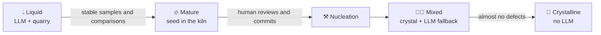

🌐 [Español](https://github.com/AbstractBike/SilvioMaciasSanchez/blob/es/abstract-architectures/forja.md) · **English** · [Deutsch](https://github.com/AbstractBike/SilvioMaciasSanchez/blob/de/abstract-architectures/forja.md)

# Pattern: Forge

> **In one sentence:** a proxy in front of the LLM that discovers which tasks repeat and tells you when to crystallize them.

| | |
| --- | --- |
| **Problem** | Lots of LLM traffic, from many applications, and nobody really knows what it contains or where to start [crystallizing](cristalizacion.md). |
| **Solution** | A proxy that groups requests into tasks, stores samples, and declares a task mature when the model repeats itself. |
| **Use it for** | Taking inventory of LLM traffic and hardening it without touching the clients (only the base URL changes). |
| **Don't use it for** | Stages you already know (crystallize them directly) or traffic that is mostly conversational or agentic. |
| **Measured by** | The degree of crystallization of all the traffic, measured in the proxy itself. |

## The idea

[Crystallization](cristalizacion.md) starts from the premise that you know what the stages of your pipeline are. The Forge is the same idea **without knowing it beforehand**: a proxy in front of the LLM that watches the traffic go by, discovers which tasks repeat, tells you when one is mature enough to crystallize and, once it is crystallized, serves it itself without calling the model. Clients change nothing except the base URL; the system hardens beneath them.

## A quick example

A company has a dozen scripts and services that call the same model. It puts the Forge in front, and after a week the Forge reports:

- *"Extract data from job postings"*: 1,244 samples, the model repeats the answer across 13 fields → **mature**.
- *"Summarize support tickets"*: the model answers differently every time → **still liquid**.
- Chatbot conversations → **pass straight through**, the Forge doesn't touch them.

Someone nucleates the crystal for the first task, reviews it, and commits it. From that moment on, those requests are answered by the proxy, with zero tokens.

## A fishing rod, not a fish

The temptation with a proxy like this is to **cache responses**: if I've already seen this input, I return what the LLM said. That is storing fish. It only hits on identical inputs, grows endlessly, and freezes the model's hits and mistakes alike.

The Forge doesn't store responses to hand them back. It stores **samples** so that, once there are enough, it can ask for *the program* that produces them. What it serves afterward is code: it generalizes to inputs it has never seen, it can be reviewed in a `git diff`, and it tells you when it doesn't know.

## What a task is

Not all traffic can be crystallized. A request is a **task** when it is a text-to-text function with fixed instructions: system instructions that don't change (the *template*) applied to an *input* that does, in a single turn, with no tools. Same template, same task; the client can also give it a name.

Everything else (conversations, agents with tools, streaming responses) goes through to the LLM untouched. That is what is open-ended by nature, and the Forge doesn't try to crystallize it.

## When to apply it (and when not to)

Apply it when there is **a lot of LLM traffic and nobody really knows what it contains**: several applications, scripts, and pipelines calling the same model, each with its own prompts. The Forge takes the inventory for you and tells you where to start crystallizing, with data instead of intuition.

Do **not** use it if you already know your stages: crystallize them directly, with no middleman. It also makes no sense if almost all the traffic is conversational or agentic: the Forge will let it all pass through and will only add a network hop.

## How it works

Every task goes through the same cycle, and the Forge knows where each one stands:

1. **Liquid.** There is no crystal: the request goes to the LLM and the input → output pair is stored in the **quarry**. Every so often the same request is made **twice**, in parallel, to measure whether the model repeats itself.
2. **Mature.** With enough samples and enough comparisons in which the LLM gave the same answer, the Forge declares the task mature and prepares its seed (template and real samples) and the nucleation prompt. It is the rule of thumb of Crystallization turned into a measurement: *if you expect the same answer when you ask for the result twice, that stage should be a crystal*. A model that contradicts itself has no method to give, and that task doesn't mature.
3. **Nucleation.** Outside the proxy, never live: you ask the LLM for the method, review what it returns, complete the crystal lattice, and commit. The Forge doesn't compile or load generated code on its own: the crystal is yours from the moment it is committed, not before.
4. **Mixed.** The crystal enters the proxy's **showcase**. What it knows, it answers itself (no tokens, no network, no cost); what it doesn't, it declares a defect, falls back to the LLM, and stays in the quarry with its reason: these are the seeds of the next version.
5. **Crystalline.** When the crystal covers almost everything, the fallback is retired. A defect no longer calls the LLM: it is an explicit error with its reason. The model has left the path.

Every response says who gave it (crystal, LLM, defect, or direct pass-through), so the **degree of crystallization** of all the traffic is measured without instrumenting the clients.

## How to implement it

The pieces, kept separate so the core is pure and the transport is interchangeable:

| Piece | What it does |
| --- | --- |
| **Task** | Identifies template and input in each request. |
| **Quarry** | *Append-only* log of what the LLM resolved, with comparisons and defects; it survives restarts, so maturity does too. |
| **Maturity** | The policy that decides when a task is ready (minimum samples, comparisons, and stability). |
| **Kiln** | Where the seed and the nucleation prompt of each mature task are kept, waiting for a human. |
| **Showcase** | The already reviewed crystals, each one in mixed or crystalline phase. |
| **Proxy** | Speaks the same LLM API on both sides; credentials pass through as they are and are not stored. |

The core only *decides* (crystal, LLM, or pass-through) and *learns* (records and evaluates maturity); it doesn't speak HTTP or call the model.

Reference implementation (OCaml proxy for Anthropic's Messages API, quarry in GreptimeDB, and a NixOS module): [AbstractBike/cristales — the Forge](https://github.com/AbstractBike/cristales/blob/main/doc/forja.md).

## Risks and safeguards

| Risk | What happens | Safeguard |
| --- | --- | --- |
| **Being a cache by another name** | Storing outputs and serving them because "it's already seen them". | Structural: the Forge only serves committed code, never samples. |
| **Automatic nucleation** | Closing the loop with nobody in between, hot-loading whatever the model wrote. It's tempting and it is exactly the mistake the pattern avoids. | Human review and the commit are the point where the liquid becomes crystal. |
| **Quarry privacy** | It stores real inputs, so it inherits the sensitivity of the traffic. | Treat it with the same care as the traffic that feeds it. |
| **Cost of comparison** | Measuring stability costs extra calls. | Compare only a fraction, and only while the task is liquid. |

## The underlying tension

It is the same one as in Crystallization, taken a step further: there you decide what to take out of the LLM; here the traffic itself tells you. The Forge is an intermediary whose success is measured by how often it stops being an intermediary.

## See also

- [Crystallization](cristalizacion.md): the base pattern; what a crystal is and how it is nucleated.
- [Agency](agencia.md): while a task is still liquid, let the cheapest model that does it well handle it.
- [Motivation Inversion](../motivacion/inversion-de-motivacion.md): the same underlying idea, applied to people.

---

© 2026 Silvio Macías Sánchez. All rights reserved. Free for non-profit research and teaching, citing the author; for commercial use, write to silvio.macias.sanchez@abstract.bike or info@abstractarchitectures.ltd. See [COPYRIGHT.md](../COPYRIGHT.md).
