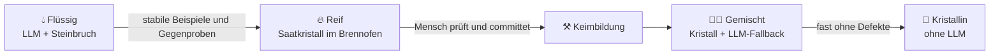

🌐 [Español](https://github.com/AbstractBike/SilvioMaciasSanchez/blob/es/abstract-architectures/forja.md) · [English](https://github.com/AbstractBike/SilvioMaciasSanchez/blob/en/abstract-architectures/forja.md) · **Deutsch**

# Muster: Schmiede

> **In einem Satz:** ein Proxy vor dem LLM, der herausfindet, welche Aufgaben sich wiederholen, und dir sagt, wann du sie kristallisieren solltest.

| | |
| --- | --- |
| **Problem** | Viel LLM-Traffic, aus vielen Anwendungen, und niemand weiß genau, was darin steckt oder wo man mit der [Kristallisation](cristalizacion.md) anfangen soll. |
| **Lösung** | Ein Proxy, der die Anfragen zu Aufgaben gruppiert, Beispiele speichert und eine Aufgabe für reif erklärt, sobald sich das Modell wiederholt. |
| **Einsetzen für** | Den LLM-Traffic inventarisieren und härten, ohne die Clients anzufassen (nur die Basis-URL ändert sich). |
| **Nicht einsetzen für** | Stufen, die du schon kennst (kristallisiere sie direkt), oder Traffic, der fast nur aus Konversationen oder Agenten besteht. |
| **Gemessen an** | Dem Kristallisationsgrad des gesamten Traffics, gemessen im Proxy selbst. |

## Die Idee

Die [Kristallisation](cristalizacion.md) geht davon aus, dass du die Stufen deiner Pipeline kennst. Die Schmiede ist dieselbe Idee, **nur ohne dieses Vorwissen**: ein Proxy vor dem LLM, der den Traffic vorbeiziehen sieht, herausfindet, welche Aufgaben sich wiederholen, Bescheid gibt, wenn eine reif zum Kristallisieren ist, und sie nach der Kristallisation selbst bedient, ohne das Modell aufzurufen. Die Clients ändern nichts außer der Basis-URL; das System härtet sich unter ihnen nach und nach.

## Ein kurzes Beispiel

Ein Unternehmen hat ein Dutzend Skripte und Dienste, die dasselbe Modell aufrufen. Es schaltet die Schmiede davor, und nach einer Woche meldet sie:

- *„Daten aus Stellenanzeigen extrahieren"*: 1.244 Beispiele, das Modell wiederholt die Antwort in 13 Feldern → **reif**.
- *„Support-Tickets zusammenfassen"*: das Modell antwortet jedes Mal anders → **bleibt flüssig**.
- Chatbot-Konversationen → **laufen direkt durch**, die Schmiede rührt sie nicht an.

Jemand lässt den Kristall der ersten Aufgabe keimen, prüft ihn und committet ihn. Ab diesem Moment beantwortet der Proxy diese Anfragen selbst, ohne Tokens.

## Angel, kein Fisch

Die Versuchung bei einem solchen Proxy ist, **Antworten zu cachen**: Habe ich diese Eingabe schon gesehen, gebe ich zurück, was das LLM gesagt hat. Das heißt, Fisch zu speichern. Es funktioniert nur bei identischen Eingaben, wächst endlos und friert Treffer und Fehler des Modells gleichermaßen ein.

Die Schmiede speichert keine Antworten, um sie zurückzugeben. Sie speichert **Beispiele**, um, sobald es genug sind, *das Programm* anzufordern, das sie erzeugt. Was sie danach bedient, ist Code: Er verallgemeinert auf Eingaben, die er nie gesehen hat, lässt sich in einem `git diff` prüfen und sagt, wann er etwas nicht weiß.

## Was eine Aufgabe ist

Nicht jeder Traffic lässt sich kristallisieren. Eine Anfrage ist eine **Aufgabe**, wenn sie eine Text-zu-Text-Funktion mit festen Anweisungen ist: System-Anweisungen, die sich nicht ändern (die *Vorlage*), angewandt auf eine *Eingabe*, die sich ändert, in einem einzigen Turn, ohne Tools. Gleiche Vorlage, gleiche Aufgabe; der Client kann ihr zusätzlich einen Namen geben.

Alles andere – Konversationen, Agenten mit Tools, Streaming-Antworten – geht unberührt ans LLM. Das ist von Natur aus offen, und die Schmiede versucht nicht, es zu kristallisieren.

## Wann du es anwendest (und wann nicht)

Wende es an, wenn es **viel LLM-Traffic gibt und niemand genau weiß, was darin steckt**: mehrere Anwendungen, Skripte und Pipelines, die dasselbe Modell aufrufen, jede mit eigenen Prompts. Die Schmiede erstellt das Inventar für dich und sagt dir, wo du mit dem Kristallisieren anfangen solltest – mit Daten statt Bauchgefühl.

Nutze es **nicht**, wenn du deine Stufen schon kennst: kristallisiere sie direkt, ohne Zwischenstation. Auch wenn fast der gesamte Traffic aus Konversationen oder Agenten besteht, lohnt es sich nicht: Die Schmiede lässt ihn komplett durch und fügt nur einen Netzwerk-Hop hinzu.

## Wie es funktioniert

Jede Aufgabe durchläuft denselben Zyklus, und die Schmiede weiß, wo jede gerade steht:

1. **Flüssig.** Es gibt keinen Kristall: Die Anfrage geht ans LLM, und das Paar Eingabe → Ausgabe landet im **Steinbruch**. Hin und wieder wird dieselbe Anfrage **zweimal** parallel gestellt, um zu messen, ob sich das Modell wiederholt.
2. **Reif.** Mit genügend Beispielen und genügend Gegenproben, in denen das LLM dieselbe Antwort gab, erklärt die Schmiede die Aufgabe für reif und legt ihren Saatkristall – Vorlage und echte Beispiele – sowie den Prompt für die Keimbildung bereit. Das ist die Faustregel der Kristallisation als Messwert: *Wenn du bei zweimaliger Abfrage dieselbe Antwort erwartest, sollte diese Stufe ein Kristall sein.* Ein Modell, das sich widerspricht, hat keine Methode zu liefern, und diese Aufgabe wird nicht reif.
3. **Keimbildung.** Außerhalb des Proxys, nie im laufenden Betrieb: Man bittet das LLM um die Methode, prüft, was es liefert, vervollständigt das Kristallgitter und committet. Die Schmiede kompiliert oder lädt generierten Code nicht auf eigene Faust: Der Kristall gehört dir ab dem Commit, nicht früher.
4. **Gemischt.** Der Kristall kommt in die **Vitrine** des Proxys. Was er kann, beantwortet er selbst – ohne Tokens, ohne Netzwerk, ohne Kosten; was nicht, erklärt er zum Defekt, fällt ans LLM zurück und landet mit seinem Grund im Steinbruch: Das sind die Saatkristalle der nächsten Version.
5. **Kristallin.** Wenn der Kristall fast alles abdeckt, wird der Fallback entfernt. Ein Defekt ruft das LLM nicht mehr auf: Er ist ein expliziter Fehler mit Begründung. Das Modell ist aus dem Pfad verschwunden.

Jede Antwort sagt, wer sie gegeben hat – Kristall, LLM, Defekt oder direkter Durchlauf –, sodass sich der **Kristallisationsgrad** des gesamten Traffics messen lässt, ohne die Clients zu instrumentieren.

## Wie du es umsetzt

Die Bausteine, getrennt, damit der Kern rein bleibt und der Transport austauschbar ist:

| Baustein | Was er tut |
| --- | --- |
| **Aufgabe** | Erkennt Vorlage und Eingabe in jeder Anfrage. |
| **Steinbruch** | *Append-only*-Protokoll dessen, was das LLM gelöst hat, mit Gegenproben und Defekten; überlebt Neustarts, die Reife also auch. |
| **Reife** | Die Richtlinie, die entscheidet, wann eine Aufgabe bereit ist (Minimum an Beispielen, Gegenproben und Stabilität). |
| **Brennofen** | Wo Saatkristall und Keimbildungs-Prompt jeder reifen Aufgabe liegen und auf einen Menschen warten. |
| **Vitrine** | Die bereits geprüften Kristalle, jeder in der gemischten oder kristallinen Phase. |
| **Proxy** | Spricht auf beiden Seiten dieselbe LLM-API; die Credentials werden unverändert durchgereicht und nicht gespeichert. |

Der Kern *entscheidet* nur (Kristall, LLM oder Durchlauf) und *lernt* (protokolliert und bewertet die Reife); er spricht kein HTTP und ruft das Modell nicht auf.

Referenzimplementierung (OCaml-Proxy für die Messages API von Anthropic, Steinbruch in GreptimeDB und NixOS-Modul): [AbstractBike/cristales — la forja](https://github.com/AbstractBike/cristales/blob/main/doc/forja.md).

## Risiken und Schutzmaßnahmen

| Risiko | Was passiert | Schutzmaßnahme |
| --- | --- | --- |
| **Ein Cache unter anderem Namen sein** | Ausgaben speichern und ausliefern, weil man sie „schon gesehen hat". | Strukturell: Die Schmiede liefert nur committeten Code aus, nie Beispiele. |
| **Automatische Keimbildung** | Den Zyklus ohne jemanden dazwischen schließen und im laufenden Betrieb laden, was das Modell geschrieben hat. Verlockend, und genau der Fehler, den das Muster vermeidet. | Menschliche Prüfung und Commit sind der Punkt, an dem aus Flüssigem Kristall wird. |
| **Privatsphäre des Steinbruchs** | Er speichert echte Eingaben und erbt daher die Sensibilität des Traffics. | Mit derselben Sorgfalt behandeln wie den Traffic, der ihn speist. |
| **Kosten der Gegenprobe** | Stabilität zu messen kostet zusätzliche Aufrufe. | Nur einen Bruchteil gegenprüfen, und nur solange die Aufgabe flüssig ist. |

## Die grundlegende Spannung

Es ist dieselbe wie bei der Kristallisation, nur einen Schritt weitergedacht: Dort entscheidest du, was du aus dem LLM herausnimmst; hier sagt dir das der Traffic selbst. Die Schmiede ist ein Vermittler, dessen Erfolg sich daran misst, wie oft er aufhört, Vermittler zu sein.

## Siehe auch

- [Kristallisation](cristalizacion.md): das Basismuster; was ein Kristall ist und wie er keimt.
- [Agentur](agencia.md): Solange eine Aufgabe noch flüssig ist, soll sie das günstigste Modell erledigen, das sie gut macht.
- [Motivationsumkehr](../motivacion/inversion-de-motivacion.md): dieselbe Grundidee, auf Menschen angewandt.

---

© 2026 Silvio Macías Sánchez. Alle Rechte vorbehalten. Frei für Forschung und Lehre ohne Gewinnabsicht, unter Nennung des Autors; für kommerzielle Nutzung schreib an silvio.macias.sanchez@abstract.bike oder info@abstractarchitectures.ltd. Siehe [COPYRIGHT.md](../COPYRIGHT.md).
