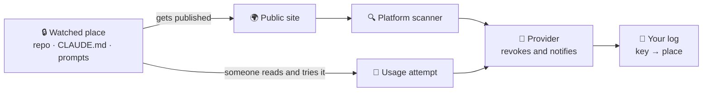

🌐 [Español](https://github.com/AbstractBike/SilvioMaciasSanchez/blob/es/abstract-architectures/llaves-de-miel.md) · **English** · [Deutsch](https://github.com/AbstractBike/SilvioMaciasSanchez/blob/de/abstract-architectures/llaves-de-miel.md)

# Pattern: Honey Keys

> **In one sentence:** leave a real, harmless key where it should never leave; if it does, the provider that issued it tells you.

| | |
| --- | --- |
| **Problem** | A private repository, an AI agent's context, or a prompt store leaks, and nobody finds out. |
| **Solution** | Place a real, permissionless key from a provider that already watches for leaks in each spot. If it shows up in public or someone uses it, their alarm goes off. |
| **Use it for** | Watching private repositories, `CLAUDE.md` and agent configuration, transcripts, and prompt stores. |
| **Don't use it for** | Replacing secrets management, or on systems that aren't yours. |
| **Measured by** | Knowing **what** leaked, and when, without building any alarm of your own. |

## The idea

The providers that issue keys (AWS, Anthropic, OpenAI, Google, Slack, Stripe, GitHub…) and the platforms where code gets published (GitHub, GitLab, npm, PyPI, Hugging Face…) have, between them, already set up a leak detector: the platforms **scan whatever becomes public** and, when they find a key, notify the provider, who **revokes it and emails its owner**.

That email is an alarm nobody has to build or maintain. A **honeypot key** takes advantage of it: it is a real key, in your name and harmless, deliberately left somewhere it should never leave. If that place gets published, leaks, or someone tries the key, the alarm goes off by itself.

It's the same idea as the [Forge](forja.md), turned around: don't build what already exists, but position yourself in the path of those who already do.

## A quick example

You have three places to watch: your infrastructure's private repository, your agents' `CLAUDE.md`, and the database where you store prompts.

1. You create a separate account with a provider, with no data and no permissions, and issue **three keys**, one per place.
2. You note down in your secrets manager, far from those places: *"key …a1f3 → infra repo"*, *"…7c22 → CLAUDE.md"*, *"…e90b → prompt database"*.
3. Months later, someone pastes a session transcript into a public issue. An hour later you get an email from the provider: *"we have revoked your key …7c22, it appeared at github.com/…"*.
4. You check your log: **the agents' context has leaked**, and you know where. You rotate the key and go see what else got out.

## When to apply it (and when not to)

Apply it where a leak would be **silent**: private repositories, unpublished branches, the context AI agents carry (their instructions, their memory, the configuration of their MCP servers), transcripts that leave the computer, and stores of prompts and responses.

Do **not** use it as a substitute for not leaking: the real keys stay in the secrets manager. And **only on what's yours**: keys from your accounts on your systems.

## How it works

### Two triggers

| Trigger | What sets it off | What it tells you |
| --- | --- | --- |
| **Publication** | The key appears on a public site that gets scanned. | That the content carrying it **has become public**, and where. |
| **Use** | Someone tries to use the key. | That someone **has read** the content and gone after the key, even if it was never published. |

The first catches slip-ups: a repo that goes public, a transcript pasted where it shouldn't be. The second catches readers: an attacker with access, a stolen backup, an agent that a prompt injection convinces to send its context elsewhere.

### One key per place

What turns the honey into a diagnosis is that **each place carries its own key**. The alarm says which key went off; your private log says which place it was. That way you know **what** leaked, not just **that** something leaked.

- The key → place log is kept **away from the keys** (in the secrets manager), so an attacker doesn't know which ones to ignore.
- You note what the provider cites in its notice (the id or the last characters), never the whole key.
- When one goes off, it gets **rotated**: another is issued for the same place.

### Keep it harmless

The key has to be real so scanners recognize it, but it must be worth nothing: in a **separate account**, with **no permissions** or a **spending limit of zero**, and unrelated to your real keys. If a provider doesn't allow that, it's not suitable for honeypot keys.

### Do you tell the agent?

A key in `CLAUDE.md` is read by an agent, and a helpful agent may try to use it.

- **Telling it** ("these keys are honeypot keys, don't use them"): the publication trigger stays intact, but an attacker who reads the notice will ignore the key.
- **Not telling it**: the use trigger stays intact, at the cost of some false positives that the provider's usage log gives away (they came from your own machine).

The sensible approach: tell it where your agents work, don't tell it where only a person should be reading.

## Risks and safeguards

| Risk | What happens | Safeguard |
| --- | --- | --- |
| **Key with power** | The honeypot key is good for something and the leak becomes an attack. | Separate account, no permissions, zero spending. If that's not possible, that provider isn't suitable. |
| **Log leaked with the keys** | The attacker knows which ones are honeypots and avoids them. | The log lives in the secrets manager, never in the watched place. |
| **Places nobody scans** | A transcript on some random pastebin doesn't trigger publication. | The use trigger is still there; and it's wise to spread keys across different providers. |
| **Push protection** | The platform blocks the push carrying the key. | Allow that specific key; as a bonus, you confirm the protection works. |

## The underlying tension

A honeypot key prevents nothing: it warns you that something has **already** gotten out. It's an alarm, not a lock. Its value lies in how cheap it is: one key per place, one line in a log, and the sector's entire scanning network working for you without knowing it.

## See also

- [Forge](forja.md) and [Agency](agencia.md): their prompt stores are good places for a honeypot key.
- Technical write-up, with its variants and its timestamp: [AbstractBike/cristales — llaves de miel](https://github.com/AbstractBike/cristales/blob/main/doc/llaves-de-miel.md).

---

© 2026 Silvio Macías Sánchez. All rights reserved. Free for non-profit research and teaching, citing the author; for commercial use, write to silvio.macias.sanchez@abstract.bike or info@abstractarchitectures.ltd. See [COPYRIGHT.md](../COPYRIGHT.md).
