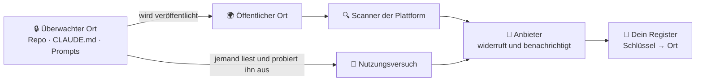

🌐 [Español](https://github.com/AbstractBike/SilvioMaciasSanchez/blob/es/abstract-architectures/llaves-de-miel.md) · [English](https://github.com/AbstractBike/SilvioMaciasSanchez/blob/en/abstract-architectures/llaves-de-miel.md) · **Deutsch**

# Muster: Honigschlüssel

> **In einem Satz:** Lege einen echten, harmlosen Schlüssel dort ab, wo er niemals herauskommen sollte; wenn er doch auftaucht, meldet sich der Aussteller bei dir.

| | |
| --- | --- |
| **Problem** | Ein privates Repository, der Kontext eines KI-Agenten oder ein Prompt-Speicher werden geleakt, und niemand merkt es. |
| **Lösung** | An jeder Stelle einen echten Schlüssel ohne Berechtigungen platzieren, und zwar von einem Anbieter, der bereits nach Leaks Ausschau hält. Taucht er öffentlich auf oder benutzt ihn jemand, schlägt dessen Alarm an. |
| **Nutze es für** | Die Überwachung privater Repositories, von `CLAUDE.md` und Agentenkonfigurationen, von Transkripten und Prompt-Speichern. |
| **Nutze es nicht für** | Als Ersatz für das Secrets-Management oder in Systemen, die dir nicht gehören. |
| **Gemessen wird es daran** | Dass du weißt, **was** geleakt wurde und wann, ohne einen eigenen Alarm zu bauen. |

## Die Idee

Die Anbieter, die Schlüssel ausstellen (AWS, Anthropic, OpenAI, Google, Slack, Stripe, GitHub …), und die Plattformen, auf denen Code veröffentlicht wird (GitHub, GitLab, npm, PyPI, Hugging Face …), haben gemeinsam bereits einen Leak-Detektor aufgebaut: Die Plattformen **scannen alles, was öffentlich wird**, und wenn sie einen Schlüssel finden, benachrichtigen sie den Anbieter, der ihn **widerruft und dem Besitzer schreibt**.

Diese E-Mail ist ein Alarm, den niemand bauen oder warten muss. Ein **Honigschlüssel** (*Honeypot Key*) nutzt ihn aus: Es ist ein echter, auf deinen Namen ausgestellter, harmloser Schlüssel, der absichtlich an einem Ort liegt, von dem er nie wegkommen sollte. Wird dieser Ort veröffentlicht, geleakt oder probiert jemand den Schlüssel aus, schlägt der Alarm von selbst an.

Es ist dieselbe Idee wie bei der [Schmiede](forja.md), nur umgekehrt: nicht bauen, was schon existiert, sondern sich in den Weg derer stellen, die es bereits tun.

## Ein kurzes Beispiel

Du hast drei Orte zu überwachen: das private Repository deiner Infrastruktur, die `CLAUDE.md` deiner Agenten und die Datenbank, in der du die Prompts speicherst.

1. Du legst bei einem Anbieter ein separates Konto ohne Daten und ohne Berechtigungen an und stellst **drei Schlüssel** aus, einen pro Ort.
2. Du notierst in deinem Secrets-Manager, weit weg von diesen Orten: *„Schlüssel …a1f3 → Infra-Repo"*, *„…7c22 → CLAUDE.md"*, *„…e90b → Prompt-Datenbank"*.
3. Monate später fügt jemand ein Transkript einer Sitzung in ein öffentliches Issue ein. Eine Stunde danach erhältst du eine E-Mail des Anbieters: *„Wir haben deinen Schlüssel …7c22 widerrufen, er ist auf github.com/… aufgetaucht"*.
4. Du schaust in dein Register: **Der Kontext der Agenten wurde geleakt**, und du weißt, wo. Du rotierst den Schlüssel und siehst nach, was sonst noch herausgekommen ist.

## Wann du es einsetzt (und wann nicht)

Setze es dort ein, wo ein Leak **unbemerkt** bliebe: private Repositories, unveröffentlichte Branches, der Kontext, den KI-Agenten mit sich tragen (ihre Anweisungen, ihr Gedächtnis, die Konfiguration ihrer MCP-Server), Transkripte, die den Rechner verlassen, sowie Speicher für Prompts und Antworten.

Nutze es **nicht** als Ersatz dafür, nichts zu leaken: Die echten Schlüssel bleiben im Secrets-Manager. Und **nur bei dem, was dir gehört**: Schlüssel deiner Konten in deinen Systemen.

## Wie es funktioniert

### Zwei Auslöser

| Auslöser | Was ihn auslöst | Was er dir sagt |
| --- | --- | --- |
| **Veröffentlichung** | Der Schlüssel taucht an einem öffentlichen Ort auf, der gescannt wird. | Dass der Inhalt, der ihn enthielt, **öffentlich geworden ist**, und wo. |
| **Nutzung** | Jemand versucht, den Schlüssel zu benutzen. | Dass jemand den Inhalt **gelesen** hat und hinter dem Schlüssel her war, auch wenn er nie veröffentlicht wurde. |

Der erste erkennt Versehen: ein Repo, das öffentlich wird, ein Transkript, das dort eingefügt wurde, wo es nicht hingehörte. Der zweite erkennt Leser: einen Angreifer mit Zugriff, ein gestohlenes Backup, einen Agenten, den eine Prompt-Injection dazu bringt, seinen Kontext an einen anderen Ort zu schicken.

### Ein Schlüssel pro Ort

Was den Honig zur Diagnose macht, ist, dass **jeder Ort seinen eigenen Schlüssel trägt**. Der Alarm sagt, welcher Schlüssel angeschlagen hat; dein privates Register sagt, von welchem Ort er stammte. So weißt du, **was** geleakt wurde, nicht nur, **dass** etwas geleakt wurde.

- Das Register Schlüssel → Ort wird **weit weg von den Schlüsseln** aufbewahrt (im Secrets-Manager), damit ein Angreifer nicht weiß, welche er ignorieren soll.
- Notiert wird, was der Anbieter in seiner Meldung nennt (die ID oder die letzten Zeichen), niemals der vollständige Schlüssel.
- Wenn einer anschlägt, wird er **rotiert**: Für denselben Ort wird ein neuer ausgestellt.

### Er muss harmlos sein

Der Schlüssel muss echt sein, damit die Scanner ihn erkennen, aber er darf zu nichts taugen: in einem **separaten Konto**, **ohne Berechtigungen** oder mit **Ausgabenlimit null** und ohne Bezug zu deinen echten Schlüsseln. Wenn ein Anbieter das nicht erlaubt, eignet er sich nicht für Honigschlüssel.

### Sagst du es dem Agenten?

Einen Schlüssel in `CLAUDE.md` liest ein Agent, und ein hilfsbereiter Agent kann versuchen, ihn zu benutzen.

- **Ihn warnen** („Diese Schlüssel sind Honigschlüssel, benutze sie nicht"): Der Auslöser durch Veröffentlichung bleibt intakt, aber ein Angreifer, der die Warnung liest, wird den Schlüssel ignorieren.
- **Ihn nicht warnen**: Der Auslöser durch Nutzung bleibt intakt, dafür gibt es vielleicht einen Fehlalarm, den das Nutzungsprotokoll des Anbieters entlarvt (kam von deinem eigenen Rechner).

Vernünftig ist: dort warnen, wo deine Agenten arbeiten, und nicht warnen, wo nur ein Mensch lesen sollte.

## Risiken und Schutzmaßnahmen

| Risiko | Was passiert | Schutzmaßnahme |
| --- | --- | --- |
| **Schlüssel mit Macht** | Der Honigschlüssel taugt zu etwas, und der Leak wird zum Angriff. | Separates Konto, keine Berechtigungen, Ausgaben null. Geht das nicht, taugt dieser Anbieter nicht. |
| **Register zusammen mit den Schlüsseln geleakt** | Der Angreifer weiß, welche Schlüssel Honig sind, und meidet sie. | Das Register liegt im Secrets-Manager, nie am überwachten Ort. |
| **Orte, die niemand scannt** | Ein Transkript auf irgendeinem Pastebin löst die Veröffentlichung nicht aus. | Der Auslöser durch Nutzung bleibt bestehen; außerdem empfiehlt es sich, Schlüssel verschiedener Anbieter zu verteilen. |
| **Push-Schutz** | Die Plattform blockiert den Push, der den Schlüssel enthält. | Genau diesen Schlüssel erlauben; nebenbei prüfst du, dass der Schutz funktioniert. |

## Die grundlegende Spannung

Ein Honigschlüssel verhindert nichts: Er meldet, dass etwas **bereits** herausgekommen ist. Er ist ein Alarm, kein Schloss. Sein Wert liegt darin, wie billig er ist: ein Schlüssel pro Ort, eine Zeile in einem Register, und das gesamte Scan-Netz der Branche arbeitet für dich, ohne es zu wissen.

## Siehe auch

- [Schmiede](forja.md) und [Agentur](agencia.md): Ihre Prompt-Speicher sind gute Orte für einen Honigschlüssel.
- Technische Vertiefung mit Varianten und Zeitstempel: [AbstractBike/cristales — llaves de miel](https://github.com/AbstractBike/cristales/blob/main/doc/llaves-de-miel.md).

---

© 2026 Silvio Macías Sánchez. Alle Rechte vorbehalten. Frei für Forschung und Lehre ohne Gewinnabsicht unter Nennung des Autors; für die kommerzielle Nutzung schreib mir an silvio.macias.sanchez@abstract.bike oder info@abstractarchitectures.ltd. Siehe [COPYRIGHT.md](../COPYRIGHT.md).
