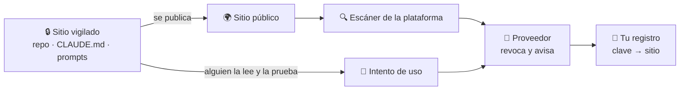

🌐 **Español** · [English](https://github.com/AbstractBike/SilvioMaciasSanchez/blob/en/abstract-architectures/llaves-de-miel.md) · [Deutsch](https://github.com/AbstractBike/SilvioMaciasSanchez/blob/de/abstract-architectures/llaves-de-miel.md)

# Patrón: Llaves de miel

> **En una frase:** deja una clave real e inofensiva donde no debería salir nunca; si sale, te avisa quien la emitió.

| | |
| --- | --- |
| **Problema** | Un repositorio privado, el contexto de un agente de IA o un almacén de prompts se filtran, y nadie se entera. |
| **Solución** | Poner en cada sitio una clave real, sin permisos, de un proveedor que ya vigila las fugas. Si aparece en público o alguien la usa, salta su alarma. |
| **Úsalo para** | Vigilar repositorios privados, `CLAUDE.md` y configuración de agentes, transcripciones y almacenes de prompts. |
| **No lo uses para** | Sustituir la gestión de secretos, ni en sistemas que no son tuyos. |
| **Se mide por** | Saber **qué** se ha filtrado, y cuándo, sin construir ninguna alarma propia. |

## La idea

Los proveedores que emiten claves (AWS, Anthropic, OpenAI, Google, Slack, Stripe, GitHub…) y las plataformas donde se publica código (GitHub, GitLab, npm, PyPI, Hugging Face…) ya tienen montado, entre todos, un detector de fugas: las plataformas **escanean lo que se hace público** y, cuando encuentran una clave, avisan al proveedor, que **la revoca y escribe a su dueño**.

Ese correo es una alarma que nadie tiene que construir ni mantener. Una **llave de miel** (*honeypot key*) se aprovecha de ella: es una clave real, a tu nombre e inofensiva, dejada a propósito en un sitio del que no debería salir. Si ese sitio se publica, se filtra o alguien la prueba, la alarma suena sola.

Es la misma idea que la [Forja](forja.md), al revés: no construir lo que ya existe, sino ponerse en el camino de quien ya lo hace.

## Un ejemplo rápido

Tienes tres sitios que vigilar: el repositorio privado de tu infraestructura, el `CLAUDE.md` de tus agentes y la base de datos donde guardas los prompts.

1. Creas una cuenta aparte en un proveedor, sin datos ni permisos, y emites **tres claves**, una por sitio.
2. Apuntas en tu gestor de secretos, lejos de esos sitios: *"clave …a1f3 → repo de infra"*, *"…7c22 → CLAUDE.md"*, *"…e90b → base de prompts"*.
3. Meses después, alguien pega una transcripción de una sesión en un issue público. A la hora te llega un correo del proveedor: *"hemos revocado tu clave …7c22, apareció en github.com/…"*.
4. Miras tu registro: **se ha filtrado el contexto de los agentes**, y sabes dónde. Rotas la clave y vas a ver qué más salió.

## Cuándo aplicarlo (y cuándo no)

Aplícalo donde una fuga sería **silenciosa**: repositorios privados, ramas sin publicar, el contexto que llevan los agentes de IA (sus instrucciones, su memoria, la configuración de sus servidores MCP), las transcripciones que salen del ordenador y los almacenes de prompts y respuestas.

**No** lo uses como sustituto de no filtrar: las claves de verdad siguen en el gestor de secretos. Y **solo en lo tuyo**: claves de tus cuentas en tus sistemas.

## Cómo funciona

### Dos disparos

| Disparo | Qué lo dispara | Qué te dice |
| --- | --- | --- |
| **Publicación** | La clave aparece en un sitio público que se escanea. | Que el contenido que la llevaba **se ha hecho público**, y dónde. |
| **Uso** | Alguien intenta usar la clave. | Que alguien **ha leído** el contenido y ha ido a por la clave, aunque nunca se publicara. |

El primero detecta descuidos: un repo que pasa a público, una transcripción pegada donde no debía. El segundo detecta lectores: un atacante con acceso, una copia de seguridad robada, un agente al que una inyección de prompt convence de mandar su contexto a otro sitio.

### Una clave por sitio

Lo que convierte la miel en diagnóstico es que **cada sitio lleva su propia clave**. La alarma dice qué clave ha saltado; tu registro privado dice de qué sitio era. Así sabes **qué** se ha filtrado, no solo **que** algo se filtró.

- El registro clave → sitio se guarda **lejos de las llaves** (en el gestor de secretos), para que un atacante no sepa cuáles ignorar.
- Se apunta lo que el proveedor cita en su aviso (el id o los últimos caracteres), nunca la clave entera.
- Cuando una salta, se **rota**: se emite otra para el mismo sitio.

### Que sea inofensiva

La clave tiene que ser real para que la reconozcan los escáneres, pero no debe valer para nada: en una **cuenta aparte**, **sin permisos** o con **límite de gasto cero**, y sin relación con tus claves de verdad. Si un proveedor no permite eso, no sirve para llaves de miel.

### ¿Se lo dices al agente?

Una clave en `CLAUDE.md` la lee un agente, y un agente servicial puede intentar usarla.

- **Avisarle** ("estas claves son llaves de miel, no las uses"): el disparo por publicación sigue intacto, pero un atacante que lea el aviso la ignorará.
- **No avisarle**: el disparo por uso queda intacto, a cambio de algún falso positivo que el registro de uso del proveedor delata (vino de tu propia máquina).

Lo razonable: avisar donde trabajan tus agentes, no avisar donde solo debería leer una persona.

## Riesgos y salvaguardas

| Riesgo | Qué pasa | Salvaguarda |
| --- | --- | --- |
| **Clave con poder** | La llave de miel sirve para algo y la fuga se convierte en un ataque. | Cuenta aparte, sin permisos, gasto cero. Si no se puede, ese proveedor no vale. |
| **Registro filtrado con las llaves** | El atacante sabe cuáles son de miel y las evita. | El registro vive en el gestor de secretos, nunca en el sitio vigilado. |
| **Sitios que nadie escanea** | Una transcripción en un pastebin cualquiera no dispara la publicación. | El disparo por uso sigue ahí; y conviene repartir claves de proveedores distintos. |
| **Protección contra subidas** | La plataforma bloquea el push que lleva la clave. | Permitir esa clave en concreto; de paso, compruebas que la protección funciona. |

## La tensión de fondo

Una llave de miel no impide nada: avisa de que algo **ya** ha salido. Es una alarma, no una cerradura. Su valor está en lo barata que es: una clave por sitio, una línea en un registro, y toda la red de escaneo del sector trabajando para ti sin saberlo.

## Ver también

- [Forja](forja.md) y [Agencia](agencia.md): sus almacenes de prompts son buenos sitios para una llave de miel.
- Divulgación técnica, con sus variantes y su sello de tiempo: [AbstractBike/cristales — llaves de miel](https://github.com/AbstractBike/cristales/blob/main/doc/llaves-de-miel.md).

---

© 2026 Silvio Macías Sánchez. Todos los derechos reservados. Libre para investigación y docencia sin ánimo de lucro, citando al autor; para uso comercial, escríbeme a silvio.macias.sanchez@abstract.bike o info@abstractarchitectures.ltd. Ver [COPYRIGHT.md](../COPYRIGHT.md).
