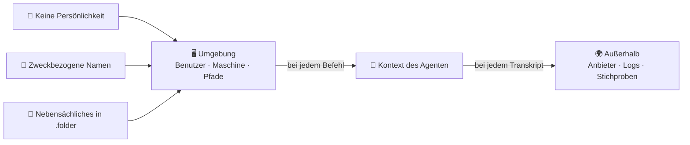

🌐 [Español](https://github.com/AbstractBike/SilvioMaciasSanchez/blob/es/abstract-architectures/proposito-sobre-personalidad.md) · [English](https://github.com/AbstractBike/SilvioMaciasSanchez/blob/en/abstract-architectures/proposito-sobre-personalidad.md) · **Deutsch**

# Muster: Zweck vor Persönlichkeit

> **In einem Satz:** Die Umgebung deines Agenten soll nicht verraten, wer du bist, sondern wozu er da ist.

| | |
| --- | --- |
| **Problem** | Die Umgebung (Benutzer, Maschine, Pfade, Ordner) landet bei jedem Befehl im Kontext des Agenten. Sie verrät in jedem Transkript ihren Besitzer und beeinflusst den Agenten, ohne dass das jemand so entworfen hätte. |
| **Lösung** | Alles Persönliche aus der Umgebung entfernen, Benutzer, Maschine und Ordner nach dem Zweck des Agenten benennen und alles, was diesem Zweck nicht dient, in versteckte Ordner (`.folder`) verschieben. |
| **Verwende es für** | Maschinen, Container und Konten, auf denen KI-Agenten arbeiten, und für Flotten, in denen mehrere Agenten sich eine Umgebung teilen. |
| **Verwende es nicht für** | Anonymisierung: Der Inhalt der Arbeit identifiziert weiterhin. Auch nicht als Zugriffskontrolle: Versteckt ist nicht geschützt. |
| **Gemessen wird es an** | Persönlichen Daten pro Transkript (sollten null sein), verbrauchtem Kontext und Erfolgsquote im Vergleich zu einer neutralen Umgebung, alles mit einem vorab registrierten Experiment. |

## Die Idee

Ein KI-Agent liest nicht nur seinen *Prompt*, sondern auch die Umgebung. `whoami` liefert ihm einen Namen, `pwd` einen Pfad, `ls` ein Inventar, und jede Fehlermeldung wiederholt die absoluten Pfade. Für das Modell ist das alles Text in seinem Kontext, genau wie die Anweisungen.

Daraus ergeben sich zwei Folgen. Die erste betrifft die **Vertraulichkeit**: Transkripte verlassen den Rechner (zum Modellanbieter, in Logs, in Prompt-Speicher) und nehmen mit, was die Umgebung über ihren Besitzer erzählt. Die zweite betrifft das **Verhalten**: Wenn der Kontext beeinflusst, was das Modell als Nächstes schreibt, dann gehört die Umgebung zum *Prompt*, und fast immer wird sie ungewollt gestaltet.

Das Muster behandelt die Umgebung als Designartefakt: etwas, das man deklariert, mit einem Ziel benennt und misst.

## Ein kurzes Beispiel

Ein Agent, der Strategien für ein Turnier auf dem Papier entwirft und testet, arbeitet heute auf deinem Laptop:

```
  vorher                                    nachher
  ──────                                    ───────
  silvia@portatil-casa                      winner@arena-1
  /home/silvia/                             /home/winner/
  ├── Proyectos-2026/                       ├── strategies/   was antritt
  │   ├── cliente-acme/  ← für wen          ├── results/      jede Partie, ihr Ergebnis
  │   └── tesis-final-v3/                   ├── work/         Experimente (löschbar)
  ├── Fotos/  Descargas/  Banco/  ← Leben   ├── docs/         Regeln und Siegkriterium
  └── ...                                   └── .media/ .archive/ .backups/ …  (versteckt)
```

1. Du legst einen Benutzer **`winner`** auf einer Maschine **`arena-1`** an, beide in der Systemkonfiguration deklariert.
2. Sein Home-Verzeichnis hat vier sichtbare Ordner, alle im Dienst des Zwecks: `strategies/` treibt zum Vorschlagen an, `results/` zum Messen, und `docs/` enthält das Siegkriterium.
3. Alles andere ist versteckt. Wenn der Agent ankommt, sieht er seinen Zweck und sonst nichts.
4. Sollte ein Transkript durchsickern, verrät es, dass jemand Strategien testet, nicht aber, wer das ist oder für wen er arbeitet.

Für die allgemeine Arbeit (denken, bauen, betreiben) heißt der Benutzer **`logical`**, mit `src/`, `work/` und `docs/`.

## Wann du es anwendest (und wann nicht)

Wende es in jeder Umgebung an, in der ein Agent arbeitet: auf deiner Entwicklungsmaschine, einem Server, einem Container, einer Flotte. Es lohnt sich umso mehr, je weiter die Transkripte herumkommen (externe Anbieter, geteilte Logs, veröffentlichte Stichproben).

Verwechsle es **nicht** mit Anonymität oder Sicherheit. Und wenn deine Flotte schon mit einem anderen Verzeichnisbaum läuft, migriere nicht alles auf einmal, sondern Knoten für Knoten.

## So funktioniert es



### Drei Bausteine

| Baustein | Was er tut | Warum |
| --- | --- | --- |
| **Keine Persönlichkeit** | Weder Benutzer noch Maschine noch Pfade tragen Eigennamen, Kunden, Jahreszahlen, Versionen oder private Metaphern. Was heute im Pfad steht (Lizenz, Kunde, Datum), wandert in die Metadaten: `LICENSE`, README, git. | Was nicht im Kontext steht, sickert nicht durch und wird nicht auswendig gelernt. |
| **Zweckbezogene Namen** | Ein Benutzer pro Zweck (`logical` zum Denken und Betreiben, `winner` zum Antreten und Gewinnen), Maschinen nach Funktion (`arena-1`, `build-2`) und Ordner nach dem, was man darin tut. | Der Zweck wiederholt sich in jedem Pfad, ohne eine Zeile des *Prompts* zu kosten. |
| **Nebensächliches versteckt** | Medien, Archiv, Kopien, Bare-Repos: alles, was dem Zweck nicht dient, liegt in `.media/`, `.archive/`, `.backups/`, `.bare/`. | `ls`, *Globs* und Suchwerkzeuge überspringen es: weniger Rauschen und weniger Ablenkung. |

### Die Ordner

Wenige und flache. Man verwendet konventionelle Namen, wo die Konvention den Zweck schon ausdrückt (das Modell kennt sie, man muss sie nicht erklären), und Domänennamen, wo der Zweck konkret ist:

- **Der Name sagt, wofür der Inhalt da ist.** Lässt sich ein Ordner nicht so benennen, ist er überflüssig oder gehört versteckt.
- **Flach statt tief.** `src/<repo>`, nicht `src/<kunde>/<jahr>/<lizenz>/<repo>`: Jede Ebene ist ein weiteres Datum in jedem Pfad.
- **Ein Pfad pro Sache.** Das Kanonische an einem Ort, das Flüchtige in `work/`.
- **Der Zweck versteckt, nicht der Wert.** Die Familienfotos sind mehr wert als jedes Repo, und sie liegen gerade deshalb in `.media/`, weil der Agent damit nichts zu tun hat.

## So setzt du es um

1. **Deklariere den Benutzer und seinen Baum** in der Systemkonfiguration (in NixOS `users.users.<zweck>` und `systemd.tmpfiles`-Regeln), auf allen Knoten mit diesem Zweck gleich. Nie von Hand anlegen.
2. **Gib ihm eine eigene git-Identität**: die des Zwecks oder des Projekts, niemals deine.
3. **Nimm ihm den Zugriff auf alles Persönliche.** Was er braucht, wird in sein Home gemountet oder geklont.
4. **Miss, bevor du an die Wirkung glaubst** (siehe unten).

## Was wir wissen und was nicht

| Hypothese | Stand der Evidenz |
| --- | --- |
| **H1.** Ohne Persönlichkeit in der Umgebung enthalten die Transkripte weniger persönliche Daten. | Folgt aus der Konstruktion; ein Audit genügt. |
| **H2.** Nebensächliches zu verstecken verringert Fehler und verbrauchten Kontext. | Gestützt durch Studien zu irrelevantem Kontext (Shi et al., 2023; Liu et al., 2024), bei Agenten aber nicht gemessen. |
| **H3.** Eine Benennung nach dem Zweck verbessert das Ergebnis. | **Nicht gemessen.** Eine Rollenzuweisung im *Prompt* verbessert laut Kong et al. (2024) das Schlussfolgern; laut Zheng et al. (2024) verbessert sie es nicht konsistent. Zur Umgebungsrolle, die sich in der Umgebung wiederholt, kennen wir keine Studien. |

Die ersten beiden rechtfertigen das Muster auch dann, wenn die dritte sich als wirkungslos erweist. Um die dritte zu messen: dieselbe Aufgabe, dasselbe Modell und drei Umgebungen (persönlich, neutral mit `user` und `src/`, und zweckbezogen), mit Aufgaben, Erfolgsmetrik und Stichprobengröße, die **vor** der Ausführung festgelegt werden. Das ist die Lehre aus dem Priming in der Psychologie: ein plausibler, eindrucksvoller Effekt, der sich nicht replizieren ließ (Bargh et al., 1996; Doyen et al., 2012).

## Risiken und Schutzmaßnahmen

| Risiko | Was passiert | Schutzmaßnahme |
| --- | --- | --- |
| **Es für anonym halten** | Code, Commits und Anweisungen identifizieren weiterhin. | Das Muster entfernt, was die Umgebung hinzufügt; was die Arbeit in sich trägt, bleibt drin. |
| **Versteckt mit geschützt verwechseln** | `ls -a` zeigt jeden `.folder`. | Was der Agent nicht lesen darf, wird per Berechtigungen geschützt oder gar nicht gemountet. |
| **Ein Zweck, der zu stark antreibt** | `winner` treibt zum Gewinnen an, und ein Agent, der zum Gewinnen getrieben wird, will womöglich um jeden Preis gewinnen (*specification gaming*, Krakovna et al., 2020). | Das Siegkriterium und die Grenzen des Agenten, mit derselben Sorgfalt geschrieben wie der Name. |
| **Im laufenden Betrieb migrieren** | Benutzer und Bäume zu ändern, bricht Dienste, Berechtigungen und absolute Pfade. | Schrittweise, Knoten für Knoten, beim unkritischsten angefangen. |

## Die grundlegende Spannung

Die Umgebung eines Agenten ist Teil seines Kontexts, ob man sie gestaltet oder nicht. Dieses Muster schlägt vor, sie zu gestalten: ohne Spur ihres Besitzers, nach ihrem Zweck benannt und mit dem Nebensächlichen außer Sichtweite. Der erste Teil ist durch die Vertraulichkeit gerechtfertigt. Der zweite ist eine vernünftige Wette, die man misst, bevor man sie für gut befindet.

## Siehe auch

- [Honigschlüssel](llaves-de-miel.md): Diese warnen, dass ein Transkript durchgesickert ist; dieses Muster verringert, was es verrät, wenn es durchsickert.
- [Kristallisation](cristalizacion.md) und [Schmiede](forja.md): Ohne persönliche Pfade lassen sich Stichproben und Seeds veröffentlichen, ohne sie von Hand zu bereinigen.
- Technische Version, mit Versuchsdesign und vollständigen Referenzen: [AbstractBike/cristales — propósito sobre personalidad](https://github.com/AbstractBike/cristales/blob/main/doc/proposito-sobre-personalidad.md).

## Referenzen

- Bargh, J. A., Chen, M. und Burrows, L. (1996). Automaticity of social behavior. *Journal of Personality and Social Psychology*, 71(2), 230–244.
- Doyen, S., Klein, O., Pichon, C.-L. und Cleeremans, A. (2012). Behavioral priming: It's all in the mind, but whose mind? *PLoS ONE*, 7(1).
- Kong, A. et al. (2024). Better zero-shot reasoning with role-play prompting. *NAACL 2024*.
- Krakovna, V. et al. (2020). Specification gaming: the flip side of AI ingenuity. *DeepMind Blog*.
- Liu, N. F. et al. (2024). Lost in the middle: How language models use long contexts. *Transactions of the ACL*, 12.
- Shi, F. et al. (2023). Large language models can be easily distracted by irrelevant context. *ICML 2023*.
- Zheng, M. et al. (2024). When "A helpful assistant" is not really helpful: Personas in system prompts do not improve performances of large language models. *Findings of EMNLP 2024*.

---

© 2026 Silvio Macías Sánchez. Alle Rechte vorbehalten. Frei für Forschung und Lehre ohne Gewinnabsicht unter Nennung des Autors; für die kommerzielle Nutzung schreib mir an silvio.macias.sanchez@abstract.bike oder info@abstractarchitectures.ltd. Siehe [COPYRIGHT.md](../COPYRIGHT.md).
