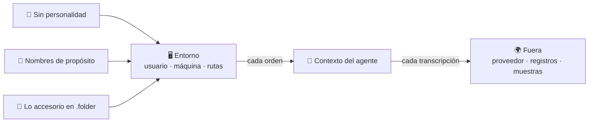

🌐 **Español** · [English](https://github.com/AbstractBike/SilvioMaciasSanchez/blob/en/abstract-architectures/proposito-sobre-personalidad.md) · [Deutsch](https://github.com/AbstractBike/SilvioMaciasSanchez/blob/de/abstract-architectures/proposito-sobre-personalidad.md)

# Patrón: Propósito sobre personalidad

> **En una frase:** que el entorno de tu agente no diga quién eres, sino a qué ha venido.

| | |
| --- | --- |
| **Problema** | El entorno (usuario, máquina, rutas, carpetas) entra en el contexto del agente con cada orden. Revela a su dueño en cada transcripción y lo condiciona sin que nadie lo haya diseñado. |
| **Solución** | Quitar del entorno todo lo personal, nombrar usuario, máquina y carpetas según el propósito del agente, y llevar lo que no sirve a ese propósito a carpetas ocultas (`.folder`). |
| **Úsalo para** | Máquinas, contenedores y cuentas donde trabajan agentes de IA, y flotas donde varios agentes comparten entorno. |
| **No lo uses para** | Anonimizar: el contenido del trabajo sigue identificando. Ni como control de acceso: oculto no es protegido. |
| **Se mide por** | Datos personales por transcripción (deben ser cero), contexto consumido y tasa de éxito frente a un entorno neutro, todo con un experimento prerregistrado. |

## La idea

Un agente de IA no solo lee su *prompt*: también lee el entorno. `whoami` le devuelve un nombre, `pwd` una ruta, `ls` un inventario, y cada error repite las rutas absolutas. Para el modelo todo eso es texto en su contexto, igual que las instrucciones.

De ahí salen dos consecuencias. La primera es de **confidencialidad**: las transcripciones salen del ordenador (al proveedor del modelo, a registros, a almacenes de prompts) y se llevan lo que el entorno cuenta de su dueño. La segunda es de **comportamiento**: si el contexto condiciona lo que el modelo escribe después, el entorno forma parte del *prompt*, y casi siempre se diseña sin querer.

El patrón trata el entorno como un artefacto de diseño: algo que se declara, se nombra con un objetivo y se mide.

## Un ejemplo rápido

Un agente que diseña y prueba estrategias para un torneo en papel trabaja hoy en tu portátil:

```
  antes                                     después
  ─────                                     ───────
  silvia@portatil-casa                      winner@arena-1
  /home/silvia/                             /home/winner/
  ├── Proyectos-2026/                       ├── strategies/   lo que compite
  │   ├── cliente-acme/  ← para quién       ├── results/      cada partida, su resultado
  │   └── tesis-final-v3/                   ├── work/         experimentos (purgable)
  ├── Fotos/  Descargas/  Banco/  ← vida    ├── docs/         reglas y criterio de victoria
  └── ...                                   └── .media/ .archive/ .backups/ …  (ocultas)
```

1. Creas un usuario **`winner`** en una máquina **`arena-1`**, declarados en la configuración del sistema.
2. Su casa tiene cuatro carpetas visibles, todas al servicio del propósito: `strategies/` empuja a proponer, `results/` a medir y `docs/` guarda el criterio de victoria.
3. Todo lo demás va oculto. Al llegar, el agente ve su propósito y nada más.
4. Si una transcripción se filtra, cuenta que alguien prueba estrategias, no quién es ni para quién trabaja.

Para el trabajo general (razonar, construir, operar), el usuario es **`logical`**, con `src/`, `work/` y `docs/`.

## Cuándo aplicarlo (y cuándo no)

Aplícalo en todo entorno donde trabaje un agente: tu máquina de desarrollo, un servidor, un contenedor, una flota. Tiene más valor cuanto más salen las transcripciones (proveedores externos, registros compartidos, muestras que se publican).

**No** lo confundas con anonimato ni con seguridad. Y si tu flota ya funciona con otro árbol, no lo migres todo de golpe: hazlo nodo a nodo.

## Cómo funciona



### Tres componentes

| Componente | Qué hace | Por qué |
| --- | --- | --- |
| **Sin personalidad** | Ni el usuario, ni la máquina, ni las rutas llevan nombres propios, clientes, años, versiones ni metáforas privadas. Lo que hoy va en la ruta (licencia, cliente, fecha) pasa a los metadatos: `LICENSE`, README, git. | Lo que no está en el contexto no se filtra ni se memoriza. |
| **Nombres de propósito** | Un usuario por propósito (`logical` para razonar y operar, `winner` para competir y ganar), máquinas por función (`arena-1`, `build-2`) y carpetas por lo que se hace en ellas. | El propósito se repite en cada ruta sin gastar una línea del *prompt*. |
| **Lo accesorio, oculto** | Medios, archivo, copias, repos bare: todo lo que no sirve al propósito va en `.media/`, `.archive/`, `.backups/`, `.bare/`. | `ls`, los *globs* y las herramientas de búsqueda lo saltan: menos ruido y menos distracción. |

### Las carpetas

Pocas y poco profundas. Se usan nombres convencionales donde la convención ya dice el propósito (el modelo los conoce y no hay que explicárselos) y nombres del dominio donde el propósito es concreto:

- **El nombre dice para qué sirve lo que hay dentro.** Si una carpeta no se puede nombrar así, sobra o va oculta.
- **Plano mejor que hondo.** `src/<repo>`, no `src/<cliente>/<año>/<licencia>/<repo>`: cada nivel es un dato más en cada ruta.
- **Una ruta por cosa.** Lo canónico en un sitio, lo efímero en `work/`.
- **Lo oculta el propósito, no el valor.** Las fotos de familia valen más que cualquier repo, y van en `.media/` precisamente porque el agente no tiene nada que hacer con ellas.

## Cómo implementarlo

1. **Declara el usuario y su árbol** en la configuración del sistema (en NixOS, `users.users.<propósito>` y reglas de `systemd.tmpfiles`), igual en todos los nodos con ese propósito. Nada de crearlos a mano.
2. **Dale una identidad de git propia**: la del propósito o la del proyecto, nunca la tuya.
3. **Quítale el acceso a lo personal.** Lo que necesite se le monta o se le clona en su casa.
4. **Mide antes de creerte el empuje** (ver abajo).

## Lo que sabemos y lo que no

| Hipótesis | Estado de la evidencia |
| --- | --- |
| **H1.** Sin personalidad en el entorno, las transcripciones llevan menos datos personales. | Se sigue de la construcción; basta con auditar. |
| **H2.** Ocultar lo accesorio reduce errores y contexto consumido. | La apoyan los estudios sobre contexto irrelevante (Shi et al., 2023; Liu et al., 2024), pero no está medida en agentes. |
| **H3.** Nombrar por el propósito mejora el resultado. | **Sin medir.** Asignar un rol en el *prompt* mejora el razonamiento según Kong et al. (2024); según Zheng et al. (2024), no mejora de forma consistente. Del rol ambiental, repetido en el entorno, no conocemos estudios. |

Las dos primeras justifican el patrón aunque la tercera resulte nula. Para medir la tercera: la misma tarea, el mismo modelo y tres entornos (personal, neutro con `user` y `src/`, y con propósito), con las tareas, la métrica de éxito y el tamaño de muestra fijados **antes** de ejecutar. Es la lección del primado en psicología, un efecto plausible y llamativo que no replicó (Bargh et al., 1996; Doyen et al., 2012).

## Riesgos y salvaguardas

| Riesgo | Qué pasa | Salvaguarda |
| --- | --- | --- |
| **Creerlo anónimo** | El código, los commits y las instrucciones siguen identificando. | El patrón quita lo que el entorno añade; lo que el trabajo lleva dentro, lo lleva. |
| **Confundir oculto con protegido** | `ls -a` enseña cualquier `.folder`. | Lo que el agente no debe leer se protege con permisos o no se monta. |
| **Un propósito que empuja de más** | `winner` empuja a ganar, y un agente empujado a ganar puede querer ganar como sea (*specification gaming*, Krakovna et al., 2020). | El criterio de victoria y los límites del agente, escritos con el mismo cuidado que el nombre. |
| **Migrar en caliente** | Cambiar usuarios y árboles rompe servicios, permisos y rutas absolutas. | Por pasos, nodo a nodo, empezando por el menos crítico. |

## La tensión de fondo

El entorno de un agente es parte de su contexto, se diseñe o no. Este patrón propone diseñarlo: sin rastro de su dueño, nombrado según su propósito y con lo accesorio fuera de la vista. La primera parte se justifica por la confidencialidad. La segunda es una apuesta razonable que se mide antes de darla por buena.

## Ver también

- [Llaves de miel](llaves-de-miel.md): estas avisan de que una transcripción se ha filtrado; este patrón reduce lo que cuenta cuando se filtra.
- [Cristalización](cristalizacion.md) y [Forja](forja.md): sin rutas personales, las muestras y las semillas se pueden publicar sin limpiarlas a mano.
- Versión técnica, con el diseño experimental y las referencias completas: [AbstractBike/cristales — propósito sobre personalidad](https://github.com/AbstractBike/cristales/blob/main/doc/proposito-sobre-personalidad.md).

## Referencias

- Bargh, J. A., Chen, M. y Burrows, L. (1996). Automaticity of social behavior. *Journal of Personality and Social Psychology*, 71(2), 230–244.
- Doyen, S., Klein, O., Pichon, C.-L. y Cleeremans, A. (2012). Behavioral priming: It's all in the mind, but whose mind? *PLoS ONE*, 7(1).
- Kong, A. et al. (2024). Better zero-shot reasoning with role-play prompting. *NAACL 2024*.
- Krakovna, V. et al. (2020). Specification gaming: the flip side of AI ingenuity. *DeepMind Blog*.
- Liu, N. F. et al. (2024). Lost in the middle: How language models use long contexts. *Transactions of the ACL*, 12.
- Shi, F. et al. (2023). Large language models can be easily distracted by irrelevant context. *ICML 2023*.
- Zheng, M. et al. (2024). When "A helpful assistant" is not really helpful: Personas in system prompts do not improve performances of large language models. *Findings of EMNLP 2024*.

---

© 2026 Silvio Macías Sánchez. Todos los derechos reservados. Libre para investigación y docencia sin ánimo de lucro, citando al autor; para uso comercial, escríbeme a silvio.macias.sanchez@abstract.bike o info@abstractarchitectures.ltd. Ver [COPYRIGHT.md](../COPYRIGHT.md).
