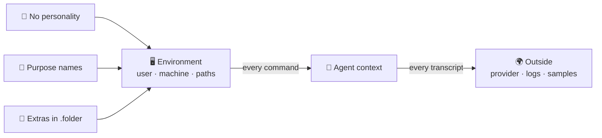

🌐 [Español](https://github.com/AbstractBike/SilvioMaciasSanchez/blob/es/abstract-architectures/proposito-sobre-personalidad.md) · **English** · [Deutsch](https://github.com/AbstractBike/SilvioMaciasSanchez/blob/de/abstract-architectures/proposito-sobre-personalidad.md)

# Pattern: Purpose over Personality

> **In one sentence:** your agent's environment shouldn't say who you are, but what it's here to do.

| | |
| --- | --- |
| **Problem** | The environment (user, machine, paths, folders) enters the agent's context with every command. It reveals its owner in every transcript and shapes the agent's behavior without anyone having designed it. |
| **Solution** | Remove everything personal from the environment, name the user, machine and folders after the agent's purpose, and move whatever doesn't serve that purpose into hidden folders (`.folder`). |
| **Use it for** | Machines, containers and accounts where AI agents work, and fleets where several agents share an environment. |
| **Don't use it for** | Anonymizing: the content of the work still identifies you. Nor as access control: hidden is not protected. |
| **Measured by** | Personal data per transcript (it should be zero), context consumed and success rate against a neutral environment, all in a preregistered experiment. |

## The idea

An AI agent doesn't just read its *prompt*: it also reads the environment. `whoami` returns a name, `pwd` a path, `ls` an inventory, and every error repeats the absolute paths. For the model, all of that is text in its context, just like the instructions.

Two consequences follow. The first is about **confidentiality**: transcripts leave the computer (to the model provider, to logs, to prompt stores) and carry with them whatever the environment says about its owner. The second is about **behavior**: if the context shapes what the model writes next, the environment is part of the *prompt*, and it is almost always designed by accident.

The pattern treats the environment as a design artifact: something you declare, name with a goal in mind and measure.

## A quick example

An agent that designs and tests strategies for a paper tournament works on your laptop today:

```
  before                                    after
  ──────                                    ─────
  silvia@portatil-casa                      winner@arena-1
  /home/silvia/                             /home/winner/
  ├── Proyectos-2026/                       ├── strategies/   what competes
  │   ├── cliente-acme/  ← who it's for     ├── results/      every game, its outcome
  │   └── tesis-final-v3/                   ├── work/         experiments (purgeable)
  ├── Fotos/  Descargas/  Banco/  ← life    ├── docs/         rules and victory criterion
  └── ...                                   └── .media/ .archive/ .backups/ …  (hidden)
```

1. You create a user **`winner`** on a machine **`arena-1`**, both declared in the system configuration.
2. Its home has four visible folders, all serving the purpose: `strategies/` pushes it to propose, `results/` to measure, and `docs/` holds the victory criterion.
3. Everything else is hidden. On arrival, the agent sees its purpose and nothing else.
4. If a transcript leaks, it says that someone is testing strategies, not who they are or who they work for.

For general work (reasoning, building, operating), the user is **`logical`**, with `src/`, `work/` and `docs/`.

## When to apply it (and when not to)

Apply it in every environment where an agent works: your development machine, a server, a container, a fleet. It's worth more the further your transcripts travel (external providers, shared logs, samples that get published).

Do **not** confuse it with anonymity or security. And if your fleet already runs on a different tree, don't migrate everything at once: do it node by node.

## How it works



### Three components

| Component | What it does | Why |
| --- | --- | --- |
| **No personality** | Neither the user, nor the machine, nor the paths carry proper names, clients, years, versions or private metaphors. What goes in the path today (license, client, date) moves to metadata: `LICENSE`, README, git. | What isn't in the context can't leak or be memorized. |
| **Purpose names** | One user per purpose (`logical` for reasoning and operating, `winner` for competing and winning), machines by function (`arena-1`, `build-2`) and folders by what's done in them. | The purpose is repeated in every path without spending a line of the *prompt*. |
| **Extras, hidden** | Media, archive, copies, bare repos: everything that doesn't serve the purpose goes in `.media/`, `.archive/`, `.backups/`, `.bare/`. | `ls`, *globs* and search tools skip them: less noise and less distraction. |

### The folders

Few and shallow. Use conventional names where the convention already states the purpose (the model knows them and they don't need explaining) and domain names where the purpose is specific:

- **The name says what the contents are for.** If a folder can't be named that way, it's surplus or it goes hidden.
- **Flat beats deep.** `src/<repo>`, not `src/<client>/<year>/<license>/<repo>`: each level is one more piece of data in every path.
- **One path per thing.** Canonical things in one place, ephemeral things in `work/`.
- **Purpose hides things, not value.** Family photos are worth more than any repo, and they go in `.media/` precisely because the agent has nothing to do with them.

## How to implement it

1. **Declare the user and its tree** in the system configuration (in NixOS, `users.users.<purpose>` and `systemd.tmpfiles` rules), identical on every node with that purpose. Never create them by hand.
2. **Give it its own git identity**: the purpose's or the project's, never yours.
3. **Remove its access to anything personal.** Whatever it needs is mounted or cloned into its home.
4. **Measure before you believe the nudge** (see below).

## What we know and what we don't

| Hypothesis | State of the evidence |
| --- | --- |
| **H1.** Without personality in the environment, transcripts carry less personal data. | Follows from the construction; an audit is enough. |
| **H2.** Hiding the extras reduces errors and context consumed. | Supported by studies on irrelevant context (Shi et al., 2023; Liu et al., 2024), but not measured in agents. |
| **H3.** Naming by purpose improves the result. | **Unmeasured.** Assigning a role in the *prompt* improves reasoning according to Kong et al. (2024); according to Zheng et al. (2024), it doesn't improve it consistently. We know of no studies on the ambient role, repeated throughout the environment. |

The first two justify the pattern even if the third turns out to be null. To measure the third: the same task, the same model and three environments (personal, neutral with `user` and `src/`, and purpose-based), with the tasks, the success metric and the sample size fixed **before** running. It's the lesson of priming in psychology, a plausible and striking effect that failed to replicate (Bargh et al., 1996; Doyen et al., 2012).

## Risks and safeguards

| Risk | What happens | Safeguard |
| --- | --- | --- |
| **Believing it's anonymous** | The code, the commits and the instructions still identify you. | The pattern removes what the environment adds; what the work carries inside, it carries. |
| **Confusing hidden with protected** | `ls -a` shows any `.folder`. | What the agent must not read is protected with permissions or not mounted. |
| **A purpose that pushes too hard** | `winner` pushes toward winning, and an agent pushed to win may want to win at any cost (*specification gaming*, Krakovna et al., 2020). | The victory criterion and the agent's limits, written with the same care as the name. |
| **Migrating live** | Changing users and trees breaks services, permissions and absolute paths. | Step by step, node by node, starting with the least critical. |

## The underlying tension

An agent's environment is part of its context, whether you design it or not. This pattern proposes designing it: with no trace of its owner, named after its purpose and with the extras out of sight. The first part is justified by confidentiality. The second is a reasonable bet that gets measured before it's taken as good.

## See also

- [Honey Keys](llaves-de-miel.md): these warn you that a transcript has leaked; this pattern reduces what it reveals when it does.
- [Crystallization](cristalizacion.md) and [Forge](forja.md): without personal paths, samples and seeds can be published without cleaning them by hand.
- Technical version, with the experimental design and full references: [AbstractBike/cristales — propósito sobre personalidad](https://github.com/AbstractBike/cristales/blob/main/doc/proposito-sobre-personalidad.md).

## References

- Bargh, J. A., Chen, M. and Burrows, L. (1996). Automaticity of social behavior. *Journal of Personality and Social Psychology*, 71(2), 230–244.
- Doyen, S., Klein, O., Pichon, C.-L. and Cleeremans, A. (2012). Behavioral priming: It's all in the mind, but whose mind? *PLoS ONE*, 7(1).
- Kong, A. et al. (2024). Better zero-shot reasoning with role-play prompting. *NAACL 2024*.
- Krakovna, V. et al. (2020). Specification gaming: the flip side of AI ingenuity. *DeepMind Blog*.
- Liu, N. F. et al. (2024). Lost in the middle: How language models use long contexts. *Transactions of the ACL*, 12.
- Shi, F. et al. (2023). Large language models can be easily distracted by irrelevant context. *ICML 2023*.
- Zheng, M. et al. (2024). When "A helpful assistant" is not really helpful: Personas in system prompts do not improve performances of large language models. *Findings of EMNLP 2024*.

---

© 2026 Silvio Macías Sánchez. All rights reserved. Free for non-profit research and teaching, citing the author; for commercial use, write to silvio.macias.sanchez@abstract.bike or info@abstractarchitectures.ltd. See [COPYRIGHT.md](../COPYRIGHT.md).
