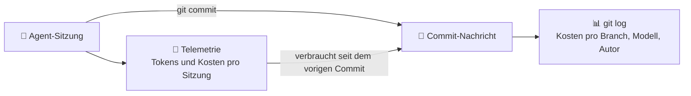

🌐 [Español](https://github.com/AbstractBike/SilvioMaciasSanchez/blob/es/abstract-architectures/seguimiento-de-costes.md) · [English](https://github.com/AbstractBike/SilvioMaciasSanchez/blob/en/abstract-architectures/seguimiento-de-costes.md) · **Deutsch**

# Muster: Kostenverfolgung

> **In einem Satz:** Jeder Commit, den eine KI schreibt, sagt, welches Modell ihn geschrieben hat und was er gekostet hat, und die Git-Historie wird zur Buchhaltung der Arbeit.

| | |
| --- | --- |
| **Problem** | Was jede Änderung eines Agenten kostet, weiß man beim Committen, danach geht es verloren: Eine Woche später weiß niemand, was teuer war oder ob es sich gelohnt hat. |
| **Lösung** | Es direkt in den Commit schreiben, als git-*Trailer*: Modell, Aufwand, Tokens nach Typ, Kosten und Sitzung. |
| **Nutze es für** | Jedes Repository, in dem KI-Agenten committen. |
| **Nutze es nicht für** | Das *gesamte* Ausgabevolumen zählen: Was nicht in einem Commit endet, taucht nicht auf (dafür gibt es die Telemetrie). |
| **Gemessen wird es an** | Dass die Summe der Trailer eines Branches genau den Kosten dieses Branches entspricht. |

## Die Idee

Ein menschlicher Commit kostet Stunden; einer von einem Agenten kostet Tokens, und Tokens haben einen Preis. Dieser Preis ist beim Committen bekannt, weil die Telemetrie des Agenten ihn mitgezählt hat, und geht unmittelbar danach verloren.

Die Kostenverfolgung (*token tracking*) notiert ihn **dort, wo er nicht verloren geht**: in der Commit-Nachricht. Dafür ist keine neue Infrastruktur nötig, denn git kann Trailer bereits lesen.

## Ein kurzes Beispiel

Am Ende jeder Commit-Nachricht, durch eine Leerzeile getrennt:

```
Model: claude-opus-5-5
Effort: medium
Tokens: 20, 2684, 38678, 751187 del commit
Cost: 0.51 USD del commit
Session: 39dfdb59-6748-440d-8d1b-fb089f2fe82d
```

Und mit einem einzigen Befehl erfährst du, was jede Änderung gekostet hat:

```bash
git log --format='%h %(trailers:key=Model,valueonly,separator=%x2C) %(trailers:key=Cost,valueonly)'
```

Alle Commits, die in diesem Repository von Agenten erstellt wurden, enthalten diese Trailer.

## Wann du es anwendest (und wann nicht)

Wende es an, sobald ein Agent committet. Es kostet eine Zeile in seinen Anweisungen und ein Werkzeug, das die Trailer schreibt, und es beantwortet Fragen, die sonst unbeantwortbar blieben: Was hat dieser Branch gekostet? Welches Modell macht was? Hat es sich gelohnt, diese Aufgabe [zu kristallisieren](cristalizacion.md)?

Erwarte **nicht**, dass es alles zählt: Eine Recherche, die nicht in einem Commit endet, taucht nicht auf. Das ist Absicht: Die Historie zählt, was **das Ergebnis** gekostet hat.

## Wie es funktioniert



### Die Trailer

| Trailer | Was er sagt | Wenn unbekannt |
| --- | --- | --- |
| `Model` | Die genaue Modell-ID. Wenn mehrere verwendet wurden (ein Subagent, ein Auftrag an die [Agentur](agencia.md)), eröffnet jeder einen eigenen Block. | Fehlt nie. |
| `Effort` | Die Stufe des Denkaufwands, mit der die Sitzung lief. | Wird weggelassen. |
| `Tokens` | `Eingabe, Ausgabe, Cache-Schreiben, Cache-Lesen`, in dieser Reihenfolge. | `n/d` |
| `Cost` | Die Kosten in USD, mit dem Tarif jedes Modells. | `n/d` |
| `Session` | Die Sitzungs-ID, um zur Telemetrie und zum Transkript zurückzukehren. | Wird weggelassen. |

Die vier Tokenarten werden getrennt ausgewiesen, weil sie unterschiedlich kosten und Verschiedenes messen: Viel Cache-Lesen ist Kontext, der mitgeschleppt wird; viel Ausgabe ist geschriebene Arbeit.

### Drei Regeln

1. **Nie erfinden.** Ein unbekannter Wert wird als `n/d` geschrieben. Eine falsche Zahl ist schlimmer als eine leere, weil die Summe der Historie dann nichts mehr taugt.
2. **Vom Commit, nicht von der Sitzung.** Eine Sitzung macht mehrere Commits. Jeder trägt das, was **seit dem vorigen Commit derselben Sitzung** verbraucht wurde, in jedem Repository. So wird nichts doppelt gezählt und die Summe des Branches stimmt.
3. **Was keine Tokens verbraucht, bekommt keine Zeile.** Ein Kristall der [Schmiede](forja.md) antwortet kostenlos: Das ist genau sein Daseinsgrund.

### Was du die Historie fragen kannst

- **Was ein Branch oder ein Kristall gekostet hat:** die Summe von `Cost` seiner Commits.
- **Welches Modell was macht:** die Kosten pro Commit, gruppiert nach `Model`.
- **Ob sich das Kristallisieren gelohnt hat:** was es gekostet hat, den Kristall zu erzeugen, im Vergleich zu dem, was die Aufgabe vorher verbraucht hat.
- **Wohin der Kontext fließt:** Commits mit viel Cache-Lesen und wenig Ausgabe sind Sitzungen, die Kontext mitschleppen, um wenig zu schreiben.

## Wie du es umsetzt

1. **Telemetrie.** Der Agent exportiert seine Metriken (Tokens nach Typ und Kosten, pro Sitzung und Modell) in eine Zeitreihendatenbank. Claude Code macht das mit OpenTelemetry.
2. **Ein Werkzeug, das die Trailer schreibt.** Vor dem Commit sucht es über den Trailer `Session` den vorigen Commit der Sitzung, summiert, was seitdem verbraucht wurde, und gibt es genau so aus, wie es in der Nachricht stehen soll. Gibt es keine Daten, schreibt es `n/d`.
3. **Eine Regel in den Anweisungen des Agenten:** „Beende jeden Commit mit der Ausgabe des Werkzeugs, unverändert; erfinde nie einen Wert."

Ohne Telemetrie enthält das Sitzungstranskript die Tokennutzung jeder Antwort und dient für die Tokens genauso; die Kosten wären dann `n/d`.

## Risiken und Schutzmaßnahmen

| Risiko | Was passiert | Schutzmaßnahme |
| --- | --- | --- |
| **Erfundene Zahlen** | Ein Agent „schätzt", statt zu messen, und die Buchhaltung taugt nichts mehr. | Die Trailer schreibt ein Werkzeug, nicht der Agent; dazu die Regel mit `n/d`. |
| **Doppelte Zählung** | Jeder Commit trägt die Gesamtsumme der Sitzung, und das Aufsummieren der Historie bläht die Kosten auf. | Nur was seit dem vorigen Commit der Sitzung verbraucht wurde, in jedem Repo. |
| **Verzögerung der Telemetrie** | Was in den letzten Sekunden verbraucht wurde, ist noch nicht angekommen. | Dieser Rest landet im nächsten Commit; die Summe des Branches stimmt weiterhin. |
| **Tarifpreis** | Bei einem Abo ist das, was wirklich gezahlt wird, etwas anderes. | Die Zahl dient weiterhin dem Vergleich von Branches, Modellen und Aufgaben. |

## Die grundlegende Spannung

Wenn Arbeit von einem Menschen erledigt wird, notiert niemand deren Kosten in jedem Commit, weil sie auf andere Weise gemessen werden. Wenn eine KI sie erledigt, lassen sich die Kosten auf den Cent genau messen, und fast niemand tut es. Dieses Muster schließt den Kreis der anderen: Die [Agentur](agencia.md) wählt das günstigste Modell, und die [Schmiede](forja.md) hört auf, es aufzurufen; die Kostenverfolgung ist das, was beweist, dass es sich gelohnt hat.

## Siehe auch

- [Agentur](agencia.md): Jeder Auftrag an ein anderes Modell erscheint im Commit mit einer eigenen Zeile.
- [Schmiede](forja.md) und [Kristallisation](cristalizacion.md): Was die Trailer erlauben herauszufinden, ist, ob sich das Kristallisieren gelohnt hat.

---

© 2026 Silvio Macías Sánchez. Alle Rechte vorbehalten. Frei für Forschung und gemeinnützige Lehre unter Nennung des Autors; für die kommerzielle Nutzung schreib mir an silvio.macias.sanchez@abstract.bike oder info@abstractarchitectures.ltd. Siehe [COPYRIGHT.md](../COPYRIGHT.md).
