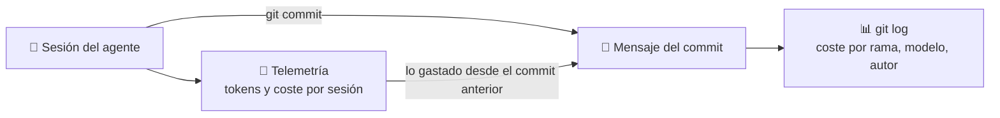

🌐 **Español** · [English](https://github.com/AbstractBike/SilvioMaciasSanchez/blob/en/abstract-architectures/seguimiento-de-costes.md) · [Deutsch](https://github.com/AbstractBike/SilvioMaciasSanchez/blob/de/abstract-architectures/seguimiento-de-costes.md)

# Patrón: Seguimiento de costes

> **En una frase:** cada commit que escribe una IA dice qué modelo lo escribió y cuánto costó, y el historial de git se convierte en la contabilidad del trabajo.

| | |
| --- | --- |
| **Problema** | Lo que cuesta cada cambio hecho por un agente se sabe al commitear y se pierde después: una semana más tarde nadie sabe qué salió caro ni si mereció la pena. |
| **Solución** | Apuntarlo en el propio commit, como *trailers* de git: modelo, esfuerzo, tokens por tipo, coste y sesión. |
| **Úsalo para** | Cualquier repositorio donde commitean agentes de IA. |
| **No lo uses para** | Contar *todo* el gasto: lo que no acaba en commit no aparece (para eso está la telemetría). |
| **Se mide por** | Que la suma de los trailers de una rama sea exactamente lo que costó la rama. |

## La idea

Un commit humano cuesta horas; uno de un agente cuesta tokens, y los tokens tienen precio. Ese precio se conoce en el momento de commitear, porque la telemetría del agente lo ha ido contando, y se pierde justo después.

El seguimiento de costes (*token tracking*) lo apunta **donde no se pierde**: en el mensaje del commit. No hace falta ninguna infraestructura nueva para leerlo, porque git ya sabe leer trailers.

## Un ejemplo rápido

Al final del mensaje de cada commit, separados por una línea en blanco:

```
Model: claude-opus-5-5
Effort: medium
Tokens: 20, 2684, 38678, 751187 del commit
Cost: 0.51 USD del commit
Session: 39dfdb59-6748-440d-8d1b-fb089f2fe82d
```

Y con un solo comando sabes qué costó cada cambio:

```bash
git log --format='%h %(trailers:key=Model,valueonly,separator=%x2C) %(trailers:key=Cost,valueonly)'
```

Todos los commits hechos por agentes en este repositorio llevan estos trailers.

## Cuándo aplicarlo (y cuándo no)

Aplícalo en cuanto un agente commitea. Cuesta una línea en sus instrucciones y una herramienta que escriba los trailers, y responde preguntas que de otra forma no tienen respuesta: ¿qué costó esta rama?, ¿qué modelo hace qué?, ¿salió a cuenta [cristalizar](cristalizacion.md) esta tarea?

**No** esperes que cuente todo: una investigación que no acaba en commit no aparece. Es deliberado: el historial cuenta lo que costó **lo que quedó**.

## Cómo funciona



### Los trailers

| Trailer | Qué dice | Si no se sabe |
| --- | --- | --- |
| `Model` | El id exacto del modelo. Si se usaron varios (un subagente, un encargo a la [Agencia](agencia.md)), cada uno abre su propio bloque. | Nunca falta. |
| `Effort` | El nivel de razonamiento con que corrió la sesión. | Se omite. |
| `Tokens` | `entrada, salida, escritura de caché, lectura de caché`, en ese orden. | `n/d` |
| `Cost` | El coste en USD, con la tarifa de cada modelo. | `n/d` |
| `Session` | El id de la sesión, para volver a la telemetría y a la transcripción. | Se omite. |

Los cuatro tipos de token van por separado porque cuestan distinto y cuentan cosas distintas: mucha lectura de caché es contexto que se arrastra; mucha salida es trabajo escrito.

### Tres reglas

1. **Nunca se inventa.** Un valor que no se sabe se escribe `n/d`. Una cifra falsa es peor que una vacía, porque la suma del historial deja de valer.
2. **Del commit, no de la sesión.** Una sesión hace varios commits. Cada uno lleva lo gastado **desde el commit anterior de la misma sesión**, en cualquier repositorio. Así nada se cuenta dos veces y la suma de la rama cuadra.
3. **Lo que no gasta tokens no lleva línea.** Un cristal de la [Forja](forja.md) responde gratis: esa es su razón de ser.

### Lo que puedes preguntarle al historial

- **Qué costó una rama o un cristal:** la suma de `Cost` de sus commits.
- **Qué modelo hace qué:** el coste por commit agrupado por `Model`.
- **Si cristalizar salió a cuenta:** lo que costó nuclear el cristal frente a lo que gastaba la tarea antes.
- **Dónde se va el contexto:** commits con mucha lectura de caché y poca salida son sesiones que arrastran contexto para escribir poco.

## Cómo implementarlo

1. **Telemetría.** El agente exporta sus métricas (tokens por tipo y coste, por sesión y modelo) a una base de series temporales. Claude Code lo hace con OpenTelemetry.
2. **Una herramienta que escriba los trailers.** Antes de commitear, busca el commit anterior de la sesión por su trailer `Session`, suma lo gastado desde entonces y lo imprime tal como va en el mensaje. Si no hay datos, escribe `n/d`.
3. **Una regla en las instrucciones del agente:** "termina cada commit con la salida de la herramienta, tal cual; nunca inventes un valor".

Sin telemetría, la transcripción de la sesión lleva el uso de tokens de cada respuesta y sirve igual para los tokens; el coste, entonces, `n/d`.

## Riesgos y salvaguardas

| Riesgo | Qué pasa | Salvaguarda |
| --- | --- | --- |
| **Cifras inventadas** | Un agente "estima" en vez de medir, y la contabilidad deja de valer. | Los trailers los escribe una herramienta, no el agente; y la regla de `n/d`. |
| **Doble conteo** | Cada commit lleva el total de la sesión y sumar el historial infla el coste. | Solo lo gastado desde el commit anterior de la sesión, en cualquier repo. |
| **Retraso de la telemetría** | Lo gastado en los últimos segundos aún no ha llegado. | Ese resto cae en el commit siguiente; la suma de la rama sigue cuadrando. |
| **Precio de tarifa** | Con una suscripción, lo que se paga de verdad es otra cosa. | La cifra sigue sirviendo para comparar ramas, modelos y tareas. |

## La tensión de fondo

Cuando el trabajo lo hace una persona, nadie apunta su coste en cada commit porque se mide de otra manera. Cuando lo hace una IA, el coste se puede medir al céntimo y casi nadie lo hace. Este patrón cierra el círculo de los demás: la [Agencia](agencia.md) elige el modelo más barato y la [Forja](forja.md) deja de llamarlo; el seguimiento de costes es lo que demuestra que mereció la pena.

## Ver también

- [Agencia](agencia.md): cada encargo a otro modelo aparece en el commit con su propia línea.
- [Forja](forja.md) y [Cristalización](cristalizacion.md): lo que los trailers permiten saber es si cristalizar salió a cuenta.

---

© 2026 Silvio Macías Sánchez. Todos los derechos reservados. Libre para investigación y docencia sin ánimo de lucro, citando al autor; para uso comercial, escríbeme a silvio.macias.sanchez@abstract.bike o info@abstractarchitectures.ltd. Ver [COPYRIGHT.md](../COPYRIGHT.md).
