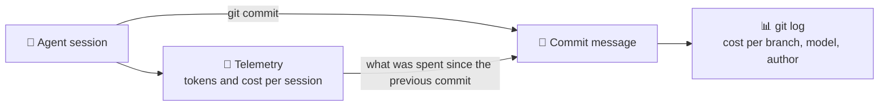

🌐 [Español](https://github.com/AbstractBike/SilvioMaciasSanchez/blob/es/abstract-architectures/seguimiento-de-costes.md) · **English** · [Deutsch](https://github.com/AbstractBike/SilvioMaciasSanchez/blob/de/abstract-architectures/seguimiento-de-costes.md)

# Pattern: Cost Tracking

> **In one sentence:** every commit an AI writes says which model wrote it and how much it cost, and the git history becomes the ledger of the work.

| | |
| --- | --- |
| **Problem** | What each agent-made change costs is known at commit time and lost afterwards: a week later nobody knows what was expensive or whether it was worth it. |
| **Solution** | Write it down in the commit itself, as git *trailers*: model, effort, tokens by type, cost and session. |
| **Use it for** | Any repository where AI agents commit. |
| **Don't use it for** | Counting *all* spending: whatever doesn't end up in a commit doesn't show up (that's what telemetry is for). |
| **Measured by** | The sum of a branch's trailers being exactly what the branch cost. |

## The idea

A human commit costs hours; an agent's commit costs tokens, and tokens have a price. That price is known at the moment of committing, because the agent's telemetry has been counting it, and it is lost right afterwards.

Cost Tracking (*token tracking*) writes it **where it can't be lost**: in the commit message. No new infrastructure is needed to read it, because git already knows how to read trailers.

## A quick example

At the end of each commit message, separated by a blank line:

```
Model: claude-opus-5-5
Effort: medium
Tokens: 20, 2684, 38678, 751187 del commit
Cost: 0.51 USD del commit
Session: 39dfdb59-6748-440d-8d1b-fb089f2fe82d
```

And with a single command you know what each change cost:

```bash
git log --format='%h %(trailers:key=Model,valueonly,separator=%x2C) %(trailers:key=Cost,valueonly)'
```

All commits made by agents in this repository carry these trailers.

## When to apply it (and when not to)

Apply it as soon as an agent commits. It costs one line in its instructions and a tool that writes the trailers, and it answers questions that otherwise have no answer: what did this branch cost? Which model does what? Was it worth [crystallizing](cristalizacion.md) this task?

Do **not** expect it to count everything: research that doesn't end up in a commit doesn't show up. That's deliberate: the history tells you the cost of **what remained**.

## How it works



### The trailers

| Trailer | What it says | If unknown |
| --- | --- | --- |
| `Model` | The exact model id. If several were used (a subagent, a job handed to the [Agency](agencia.md)), each one opens its own block. | Never missing. |
| `Effort` | The reasoning level the session ran at. | Omitted. |
| `Tokens` | `input, output, cache write, cache read`, in that order. | `n/d` |
| `Cost` | The cost in USD, using each model's rate. | `n/d` |
| `Session` | The session id, to get back to the telemetry and the transcript. | Omitted. |

The four token types are kept separate because they cost differently and tell you different things: a lot of cache reading is context being dragged along; a lot of output is work written.

### Three rules

1. **Never make things up.** A value that isn't known is written as `n/d`. A false figure is worse than an empty one, because the history's sum stops being valid.
2. **Per commit, not per session.** A session makes several commits. Each one carries what was spent **since the previous commit of the same session**, in any repository. That way nothing is counted twice and the branch sum adds up.
3. **What spends no tokens gets no line.** A crystal from the [Forge](forja.md) answers for free: that's its whole reason for existing.

### What you can ask the history

- **What a branch or a crystal cost:** the sum of `Cost` across its commits.
- **Which model does what:** the cost per commit grouped by `Model`.
- **Whether crystallizing paid off:** what it cost to nucleate the crystal versus what the task used to spend.
- **Where the context goes:** commits with a lot of cache reading and little output are sessions that drag context along to write very little.

## How to implement it

1. **Telemetry.** The agent exports its metrics (tokens by type and cost, per session and model) to a time-series database. Claude Code does this with OpenTelemetry.
2. **A tool that writes the trailers.** Before committing, it looks up the session's previous commit by its `Session` trailer, adds up what was spent since then and prints it exactly as it goes in the message. If there's no data, it writes `n/d`.
3. **A rule in the agent's instructions:** "end every commit with the tool's output, as is; never make up a value."

Without telemetry, the session transcript carries the token usage of each response and works just as well for tokens; the cost is then `n/d`.

## Risks and safeguards

| Risk | What happens | Safeguard |
| --- | --- | --- |
| **Made-up figures** | An agent "estimates" instead of measuring, and the ledger stops being valid. | The trailers are written by a tool, not by the agent; plus the `n/d` rule. |
| **Double counting** | Every commit carries the session total and summing the history inflates the cost. | Only what was spent since the session's previous commit, in any repo. |
| **Telemetry lag** | What was spent in the last few seconds hasn't arrived yet. | That remainder falls into the next commit; the branch sum still adds up. |
| **List price** | With a subscription, what you actually pay is something else. | The figure is still useful for comparing branches, models and tasks. |

## The underlying tension

When a person does the work, nobody writes its cost on every commit because it's measured in another way. When an AI does it, the cost can be measured to the cent and almost nobody does. This pattern closes the circle of the others: the [Agency](agencia.md) picks the cheapest model and the [Forge](forja.md) stops calling it; Cost Tracking is what proves it was worth it.

## See also

- [Agency](agencia.md): every job handed to another model shows up in the commit with its own line.
- [Forge](forja.md) and [Crystallization](cristalizacion.md): what the trailers let you find out is whether crystallizing paid off.

---

© 2026 Silvio Macías Sánchez. All rights reserved. Free for non-profit research and teaching, citing the author; for commercial use, write to silvio.macias.sanchez@abstract.bike or info@abstractarchitectures.ltd. See [COPYRIGHT.md](../COPYRIGHT.md).
