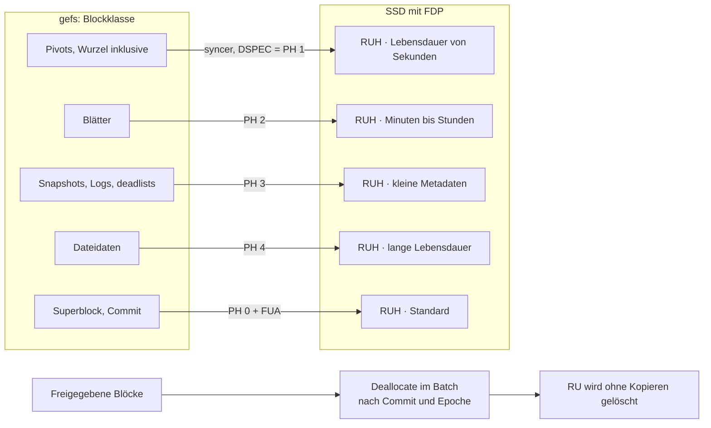

🌐 [Español](https://github.com/AbstractBike/SilvioMaciasSanchez/blob/es/sistemas-de-ficheros/gefs-fdp.md) · [English](https://github.com/AbstractBike/SilvioMaciasSanchez/blob/en/sistemas-de-ficheros/gefs-fdp.md) · **Deutsch**

# gefs + FDP: Design für die Datenplatzierung

*12. Oktober 2026*

## Zusammenfassung

Vorschlag: [gefs](https://orib.dev/gefs.html) versieht jeden Schreibvorgang mit einem FDP-*placement handle* (Flexible Data Placement, NVMe) passend zur Blockklasse (Pivot, Blatt, Log, Daten) und gibt nach jedem Commit mit Deallocate frei, was bereits tot ist. Ziel ist, dass die Schreibverstärkung der SSD (WAF) auf ≈1 sinkt, ohne das On-Disk-Format zu ändern.

- **Warum FDP und nicht ZNS:** FDP ist ein Hinweis zu einem normalen Schreibvorgang. Es erzwingt kein sequentielles Schreiben, verlangt kein Host-GC, und eine SSD ohne FDP funktioniert weiterhin genauso. ZNS würde erzwingen, lebende Blöcke zu verschieben, und in einem CoW-Baum mit Snapshots bedeutet das, Zeiger neu zu schreiben.
- **Warum es zu gefs passt:** gefs trennt die Arenen bereits nach Blocktyp, damit Schreibvorgänge sequentiell sind. FDP überträgt dieselbe Trennung auf den NAND, und dort zählt sie.
- **Kosten:** Änderungen am Allokator von gefs und am NVMe-Treiber (9front `sdnvme`, OpenBSD `nvme(4)`), ohne Migration der Platten.
- **Erster Schritt, ohne Hardware:** gefs instrumentieren, um die tatsächliche Lebensdauer jeder Blockklasse zu messen. Mit diesen Daten wird das Mapping validiert, bevor der Treiber angefasst wird.

## Kontext

Die SSD weiß nicht, welche gefs-Blöcke gemeinsam sterben, also mischt sie sie im selben NAND-Superblock und muss danach die lebenden kopieren, um ihn zu löschen. FDP sagt der SSD, welche Schreibvorgänge zusammengehören.

### gefs heute

- Alle Blöcke haben dieselbe Größe. Ein Zeiger ist `(addr, hash, birth_gen)`.
- Die Blöcke stammen aus **Arenen**. Jede Arena speichert ihre Allokationen und Freigaben in einem Log, die beim Mounten in einen AVL-Baum freier Regionen geladen werden.
- Die Arena wird per Round-Robin gewählt, versetzt nach Blocktyp (Daten, Pivot oder Blatt), sodass jeder Typ sequentiell geschrieben wird. Der Zähler rückt alle paar tausend Schreibvorgänge vor.
- Ein Block, der nach dem letzten Snapshot entstanden ist, wird sofort freigegeben. Andernfalls landet er in der *deadlist* und wird freigegeben, wenn der Snapshot stirbt, der ihn festhält.
- Etwa alle 5 s gibt es einen Commit: zuerst die schmutzigen Blöcke, dann der Superblock.

### FDP, soweit es uns betrifft

| Begriff | Was es ist |
| --- | --- |
| Reclaim Unit (RU) | Gruppe von NAND-Blöcken, die komplett gelöscht wird; normalerweise ein Superblock der SSD |
| Reclaim Unit Handle (RUH) | „Schreibkopf“ der SSD, der nach und nach eine RU füllt |
| Placement Handle (PH) | Index pro Namespace in die Liste der RUH, die beim Erstellen des Namespace festgelegt wird |
| Placement Identifier | Reclaim Group + PH; wird im DSPEC-Feld jedes Schreibvorgangs übertragen (Data-Placement-Direktive) |

- Ohne Direktive geht der Schreibvorgang an PH 0. Ein ungültiger PH bricht den Schreibvorgang nicht ab: Er wird dort platziert, wo die SSD es entscheidet, und als FDP-Ereignis vermerkt.
- SNIA empfiehlt eine einzige Reclaim Group, RUs in der Größe eines Superblocks und 8–32 RUH. QLC- oder kleine SSDs bieten möglicherweise nur 8.
- Die WAF sinkt, wenn die LBAs einer RU in eine andere RU umgeschrieben oder mit Deallocate freigegeben werden, bevor die SSD diese RU zurückfordert.
- Beispiel: In CacheLib brachte die Trennung von Metadaten (zufällig) und Daten (sequentiell) auf zwei RUH die WAF von ≈3 auf ≈1.

## Mapping von Klassen auf Placement Handles

Es werden 6 Placement Handles verwendet, unterhalb des Minimums von 8 RUH, das SSDs mit FDP bieten. Das Kriterium ist die erwartete Lebensdauer, nicht der logische Typ: Blöcke, die gemeinsam sterben, kommen zusammen.

| PH | Blockklasse | Erwartete Lebensdauer | Warum |
| --- | --- | --- | --- |
| 0 | Superblock und alle nicht etikettierten Schreibvorgänge | Wird bei jedem Commit an Ort und Stelle überschrieben | Das ist das Standardziel der SSD; so verunreinigt alles, was gefs nicht etikettiert, die anderen Klassen nicht |
| 1 | Pivots des Hauptbaums (inklusive Wurzel) | Sekunden: ein oder wenige Commits | Jedes Upsert kopiert die Wurzel und jeder Flush kopiert den Pfad; es ist die heißeste Klasse |
| 2 | Blätter des Hauptbaums | Minuten bis Stunden | Sie sterben, wenn ein Flush sie erreicht; sie werden seltener geschrieben als die Pivots |
| 3 | Snapshot-Baum, Allokations-Logs, deadlist-Blöcke | Bis zur nächsten Kompaktierung oder Löschung eines Snapshots | Kleine, rein anhängende Metadaten mit eigenem Zyklus |
| 4 | Dateidaten, Neuschreibung | Bis zum Überschreiben oder Löschen + Snapshot-Aufbewahrung | Der Großteil des Volumens; lange und unvorhersehbare Lebensdauer |
| 5 | Reserviert: kalte Daten oder Daten mit langer Aufbewahrung | Tage oder mehr | Für Phase 2: Dateien, die einmal geschrieben werden (Binärdateien), von solchen trennen, die neu geschrieben werden |

Hinweise:

- Die Lebensdauer eines Blocks in gefs hängt nicht nur davon ab, wann er überschrieben wird: Ein Snapshot, der ihn festhält, hält ihn am Leben. Wenn stündliche oder tägliche Snapshots aufbewahrt werden, landen auch die Klassen 1 und 2 in deadlists. Das muss gemessen werden (siehe [Messung](#messung)).
- Die Policy ist eine Tabelle `Klasse → PH` in der Mount-Konfiguration, kein Code. Bei weniger verfügbaren RUH werden Klassen zusammengelegt: 1+3 und 2+4.

## Schreibpfad

Jeder syncer schreibt mit dem Placement Handle der Blockklasse, sodass alles, was gleichzeitig stirbt, in derselben RU landet. Sobald der Commit, der einen Block freigibt, durable ist, invalidiert Deallocate dessen LBAs, und die SSD kann die RU löschen, ohne etwas zu kopieren.

## Änderungen am Allokator und am Format

Das On-Disk-Format ändert sich nicht: Der PH reist im Schreibkommando mit, nicht im Block. Eine mit FDP beschriebene Platte lässt sich genauso ohne FDP mounten, und umgekehrt.

Änderungen am Allokator:

1. **Klasse in der Blockanforderung.** Die Funktion, die einen neuen Block anfordert, erhält bereits den Typ (Daten, Pivot, Blatt, Log). Hinzu kommt eine Funktion `klasse(typ, baum)`, die den Hauptbaum vom Snapshot-Baum unterscheidet.
2. **Der PH reist mit dem schmutzigen Block.** Der Block im Cache speichert seine Klasse. Der syncer übergibt sie beim Schreiben an den Treiber.
3. **Arenen: bleiben erhalten, aber aus einem anderen Grund.** Mit FDP spielt es kaum eine Rolle, dass die LBAs sequentiell sind, denn die RUH entscheidet über die physische Position. Die Arenen dienen weiterhin dazu, Contention zu verteilen und die Leselokalität zu wahren. Der Versatz nach Typ kann beibehalten werden: Er stört nicht.
4. **Ohne FDP ändert sich nichts.** Wenn der Treiber FDP nicht meldet, wird die Klasse ignoriert und gefs verhält sich wie heute.

Optional, Phase 2:

- Das Log zur RUH-Nutzung lesen (wie viel in der offenen RU jedes Handles noch frei ist), damit große Schreibschübe einer Klasse in einer neuen RU beginnen.
- Falls gefs irgendwann große Blockbereiche vergibt (Extents, große Dateien), diese an der RU-Größe ausrichten.

## Deallocate und Commit

Ohne Deallocate leistet FDP nur die Hälfte: Die SSD hält die Blöcke, die gefs bereits freigegeben hat, weiter für lebendig und kopiert sie, wenn sie ihre RU zurückfordert.

### Deallocate, nach dem Commit und niemals davor

- Ein Block darf erst dann deallokiert werden, wenn **der Commit, der ihn freigibt, bereits durable ist**. Wird vorher deallokiert und das System stürzt ab, zeigt der vorherige Commit, der gemountet wird, auf einen gelöschten Block.
- Außerdem muss die Reclamation per Epochen abgewartet werden: Kein Leser darf sich noch in der alten Generation befinden.
- Reihenfolge: Commit durable → Epoche frei → die freigegebenen Bereiche wandern in eine Warteschlange → ein Prozess sendet sie in Batches per Dataset Management (Deallocate) und fasst dabei zusammenhängende Bereiche zusammen.
- Geht die Warteschlange bei einem Absturz verloren, passiert nichts: Diese Blöcke bleiben lediglich nicht deallokiert, bis gefs sie wiederverwendet.
- Das hilft jeder SSD, mit oder ohne FDP. Deshalb steht es in den Phasen vor FDP.

### Commit

1. Alle schmutzigen Blöcke schreiben, jeden mit seinem PH.
2. Flush, damit sie vor dem Superblock durable sind.
3. Den Superblock (PH 0) mit FUA schreiben.

- Meldet der Controller, dass er keinen flüchtigen Schreibcache hat (`VWC=0`, üblich bei SSDs mit Schutz vor Stromausfall), ist der Flush überflüssig: Es genügt, auf den Abschluss der Schreibvorgänge zu warten.
- Es wird nicht auf atomare Schreibvorgänge (AWUPF) gesetzt: Der Hash im Elternzeiger erkennt bereits einen defekten Block, und in NVMe lässt sich Atomarität nicht per Kommando anfordern.

## Treiberarbeit

Der Treiber muss nur drei Dinge tun: die Direktive in die Schreibvorgänge setzen, Deallocate senden und melden, ob FDP vorhanden ist. Die FDP-Konfiguration erfolgt einmalig außerhalb von gefs.

### Konfiguration (einmal pro Platte)

- FDP in der Endurance Group aktivieren und den Namespace mit seiner Liste von Placement Handles erstellen. Das geschieht mit `nvme-cli` unter Linux. Das Aktivieren von FDP setzt voraus, dass die Endurance Group keine Namespaces hat, also **löscht es die Platte**.
- Zum Entwickeln ohne Hardware: QEMU emuliert FDP seit Version 8.0.

### Im Schreibkommando

- Directive Type = Data Placement in CDW12 (Bits 23:20) und der Placement Identifier in DSPEC, CDW13 (Bits 31:16).
- Beim Binden: Identify und die FDP-Konfiguration lesen, um zu wissen, ob FDP aktiv ist, wie viele PH der Namespace hat und wie groß die RU ist.

### 9front `sdnvme`

- Problem: `devsd` bietet `data` als Bytedatei an und hat keinen Kanal, um pro Schreibvorgang einen Hinweis zu übergeben.
- Vorschlag: eine Control-Nachricht `placement N` auf dem geöffneten fid. gefs öffnet `data` einmal pro Klasse, und jeder syncer schreibt über den fid seiner Klasse. Die Lese- und Schreibschnittstelle bleibt unverändert.
- Deallocate: prüfen, ob `sdnvme` Discard/TRIM bereits über `ctl` bereitstellt. Falls nicht, eine Nachricht `deallocate lba n` hinzufügen, die in Dataset Management übersetzt wird.
- Die Fähigkeiten in `ctl` bereitstellen: `fdp on`, Anzahl der PH, RU-Größe und `vwc`.

### OpenBSD `nvme(4)`

- Es muss geklärt werden, wie der gefs-Port funktioniert: ob er im Kernel oder im Userspace auf dem Raw-Device läuft.
- Im Kernel: ein Hinweisfeld zu `struct buf` hinzufügen (oder ein Flag verwenden), das `nvme(4)` in DSPEC übersetzt.
- Im Userspace: ein Passthrough-`ioctl` in `nvme(4)` oder ein `ioctl` pro Deskriptor, äquivalent zu `placement N` unter 9front.

## Messung

Der Erfolg wird an der WAF der SSD bei 80 % Füllstand gemessen, wobei dieselbe Last mit und ohne FDP verglichen wird.

### Metriken

| Metrik | Formel | Quelle |
| --- | --- | --- |
| WAF der SSD | zum NAND geschriebene Bytes / vom Host geschriebene Bytes | FDP-Statistik-Log, vor und nach jedem Test |
| WAF von gefs | vom Host geschriebene Bytes / Bytes an Nutzerdaten | Neue Zähler in gefs |
| Gesamt-WAF | Produkt der beiden | — |
| Lebensdauer pro Klasse | Histogramm von `gen_freigabe − birth_gen` pro Klasse | Neue Zähler in gefs, beim Freigeben oder beim Übergang in die deadlist |
| Bytes pro Klasse | geschriebene Bytes pro Klasse und PH | Neue Zähler in gefs |

Das Lebensdauer-Histogramm lässt sich schon auf jeder Platte erheben und validiert die Mapping-Tabelle, bevor FDP-Hardware vorhanden ist.

### Testaufbau

- QEMU ≥ 8.0 mit emuliertem FDP, um zu prüfen, dass die Schreibvorgänge den richtigen PH tragen. QEMU bildet das NAND-GC nicht nach und taugt daher nicht zur WAF-Messung.
- Eine echte SSD mit FDP, konfiguriert mit einer Reclaim Group und ≥8 RUH. Vor jedem Test ein Deallocate der gesamten Platte statt Vorkonditionierung durch Schreiben, wie von SNIA empfohlen.

### Lasten

1. Den 9front-Kernel in einer Schleife kompilieren: viele kleine Dateien, die erstellt und gelöscht werden.
2. Zufällige 4-KiB-Schreibvorgänge innerhalb einer großen Datei.
3. Dasselbe mit stündlichen Snapshots, die 24 h aufbewahrt werden, um zu sehen, wie die Aufbewahrung die Lebensdauer verlängert.
4. Füllstand bei 50 %, 80 % und 90 %.

### Erfolgskriterien

- WAF der SSD ≤ 1,2 bei 80 % Füllstand in den Lasten 1 und 2.
- Kein Performanceverlust auf einer Platte ohne FDP.
- Kein Block wird deallokiert, solange ihn ein durable Commit referenziert (Absturztest mit Stromausfall mitten im Commit).

## Phasen, Risiken und offene Fragen

### Phasen

Jede Phase kann separat veröffentlicht werden und bringt etwas, auch wenn die folgenden nicht kommen.

| Phase | Lieferumfang | Braucht FDP |
| --- | --- | --- |
| 1 | Zähler in gefs: Bytes pro Klasse und Lebensdauer-Histogramm | Nein |
| 2 | Verzögertes Deallocate nach Commit und Epoche | Nein |
| 3 | `sdnvme`: Data-Placement-Direktive, `placement N`, Fähigkeiten in `ctl` | QEMU |
| 4 | gefs: Klasse → PH im Allokator und in den syncern; Tabelle in der Mount-Konfiguration | QEMU |
| 5 | Messung auf einer echten SSD; Mapping anhand des Histogramms anpassen | Ja |
| 6 | Optional: Schreibschübe an der RU ausrichten, Klasse für kalte Daten, Port auf `nvme(4)` | Ja |

### Risiken

- **Snapshot-Aufbewahrung:** Werden viele aufbewahrt, ähnelt die Lebensdauer von Pivots und Blättern der der Daten, und die Trennung bringt weniger. Phase 1 wird es zeigen.
- **Wenige RUH:** Mit 8 RUH, oder mit RUH, die mit anderen Namespaces geteilt werden, müssen Klassen zusammengelegt werden.
- **Zu frühes Deallocate:** Es ist die einzige Änderung, die Daten verlieren kann. Abgemildert wird das durch die strikte Reihenfolge und den Absturztest.
- **Deallocate-Latenz:** Bei manchen SSDs verursachen große Batches Latenzspitzen. Batch-Größe und Rate müssen begrenzt werden.
- **Hardware:** Außerhalb von Rechenzentren gibt es wenige SSDs mit FDP. Ohne eine gibt es keine Phase 5.

### Offene Fragen

- Welche Snapshot-Aufbewahrung verwendet gefs standardmäßig, und wie stark verlängert sie die Lebensdauer der Pivots?
- Sendet `sdnvme` bereits Dataset Management, oder muss es ergänzt werden?
- Läuft der OpenBSD-Port im Kernel oder im Userspace?
- Lohnt sich ein eigener PH für den Superblock, der bei jedem Commit an derselben Stelle überschrieben wird?
- Welche SSD mit FDP ist für Phase 5 verfügbar?

## Quellen

- [Gefs, Ori Bernstein (orib.dev)](https://orib.dev/gefs.html)
- [gefs.ms im 9front-Baum](https://git.9front.org/plan9front/9front/35cffbd08f2428ef2b9be2bc293aa4b345cf082a/sys/doc/gefs.ms/f.html)
- [Introduction to Flexible Data Placement, SNIA (Feb. 2026)](https://www.snia.org/sites/default/files/technical-work/whitepapers/IntroductiontoStorageDataPlacementwithFDP.pdf)
- [FDP Overview, NVM Express (FMS 2023)](https://nvmexpress.org/wp-content/uploads/FMS-2023-Flexible-Data-Placement-FDP-Overview.pdf)
- [Towards Efficient Flash Caches with Emerging NVMe FDP SSDs (EuroSys 2025)](https://arxiv.org/pdf/2503.11665)
- [What should we do about the nvme atomics mess? (linux-nvme, Juli 2025)](https://lists.infradead.org/pipermail/linux-nvme/2025-July/057343.html)
- [BetrFS: A Right-Optimized Write-Optimized File System (FAST 2015)](https://www.cs.unc.edu/~porter/pubs/fast15-final.pdf)

---

© 2026 Silvio Macías Sánchez. Alle Rechte vorbehalten. Frei für Forschung und Lehre ohne Gewinnabsicht, unter Nennung des Autors; für die kommerzielle Nutzung schreib mir an silvio.macias.sanchez@abstract.bike oder info@abstractarchitectures.ltd. Siehe [COPYRIGHT.md](../COPYRIGHT.md).
