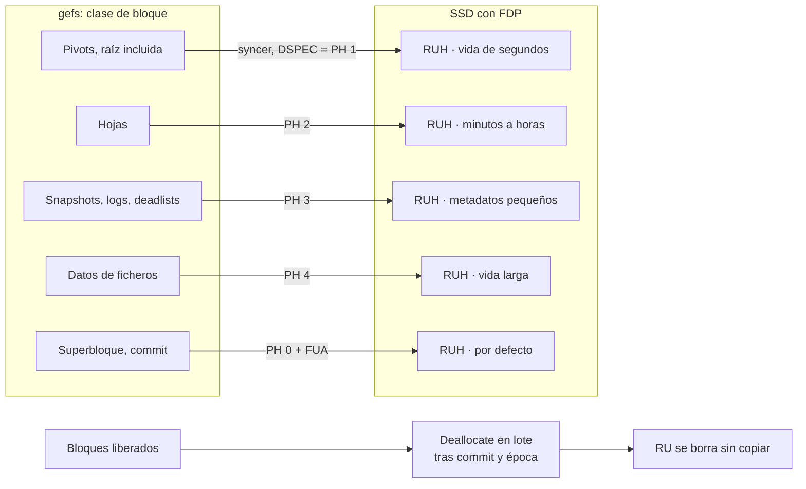

🌐 **Español** · [English](https://github.com/AbstractBike/SilvioMaciasSanchez/blob/en/sistemas-de-ficheros/gefs-fdp.md) · [Deutsch](https://github.com/AbstractBike/SilvioMaciasSanchez/blob/de/sistemas-de-ficheros/gefs-fdp.md)

# gefs + FDP: diseño de colocación de datos

*12 de octubre de 2026*

## Resumen

Propuesta: que [gefs](https://orib.dev/gefs.html) etiquete cada escritura con un *placement handle* de FDP (Flexible Data Placement, NVMe) según la clase de bloque (pivot, hoja, log, datos) y que libere con Deallocate lo que ya está muerto tras cada commit. El objetivo es que la amplificación de escritura del SSD (WAF) baje a ≈1 sin cambiar el formato en disco.

- **Por qué FDP y no ZNS:** FDP es una pista sobre una escritura normal. No obliga a escribir en secuencia, no exige GC del host y un disco sin FDP sigue funcionando igual. ZNS obligaría a reubicar bloques vivos, y en un árbol CoW con snapshots eso implica reescribir punteros.
- **Por qué encaja en gefs:** gefs ya separa las arenas por tipo de bloque para que las escrituras sean secuenciales. FDP traslada esa misma separación al NAND, que es donde cuenta.
- **Coste:** cambios en el asignador de gefs y en el driver NVMe (9front `sdnvme`, OpenBSD `nvme(4)`), sin migración de discos.
- **Primer paso, sin hardware:** instrumentar gefs para medir el tiempo de vida real de cada clase de bloque. Con esos datos se valida el mapeo antes de tocar el driver.

## Contexto

El SSD no sabe qué bloques de gefs mueren juntos, así que los mezcla en el mismo superbloque NAND y luego tiene que copiar los vivos para borrarlo. FDP le dice al SSD qué escrituras van juntas.

### gefs hoy

- Todos los bloques tienen el mismo tamaño. Un puntero es `(addr, hash, birth_gen)`.
- Los bloques salen de **arenas**. Cada arena guarda en un log sus asignaciones y liberaciones, que al montar se cargan en un AVL de regiones libres.
- La arena se elige por round-robin desplazado según el tipo de bloque (datos, pivot u hoja), para que cada tipo se escriba en secuencia. El contador avanza cada pocos miles de escrituras.
- Un bloque nacido después del último snapshot se libera al momento. Si no, va al *deadlist* y se libera cuando muere el snapshot que lo retiene.
- Hay un commit cada ~5 s: primero los bloques sucios, luego el superbloque.

### FDP en lo que nos importa

| Término | Qué es |
| --- | --- |
| Reclaim Unit (RU) | Grupo de bloques NAND que se borra entero; normalmente un superbloque del SSD |
| Reclaim Unit Handle (RUH) | "Cabeza de escritura" del SSD que va llenando una RU |
| Placement Handle (PH) | Índice, por namespace, a la lista de RUH fijada al crear el namespace |
| Placement Identifier | Reclaim Group + PH; viaja en el campo DSPEC de cada escritura (directiva Data Placement) |

- Sin directiva, la escritura va al PH 0. Un PH inválido no aborta la escritura: se coloca donde decida el SSD y queda anotado como evento FDP.
- SNIA recomienda un solo Reclaim Group, RU del tamaño de un superbloque y contar con 8–32 RUH. Los SSD QLC o pequeños pueden ofrecer solo 8.
- La WAF baja si las LBA de una RU se reescriben en otra RU o se liberan con Deallocate antes de que el SSD reclame esa RU.
- Ejemplo: en CacheLib, separar metadatos (aleatorios) de datos (secuenciales) en dos RUH llevó la WAF de ≈3 a ≈1.

## Mapeo de clases a placement handles

Se usan 6 placement handles, por debajo del mínimo de 8 RUH que ofrecen los SSD con FDP. El criterio es el tiempo de vida esperado, no el tipo lógico: bloques que mueren juntos van juntos.

| PH | Clase de bloque | Vida esperada | Por qué |
| --- | --- | --- | --- |
| 0 | Superbloque y cualquier escritura sin etiquetar | Se sobrescribe en sitio en cada commit | Es el destino por defecto del SSD; así lo que gefs no etiquete no contamina las demás clases |
| 1 | Pivots del árbol principal (raíz incluida) | Segundos: uno o pocos commits | Cada upsert copia la raíz y cada flush copia el camino; es la clase más caliente |
| 2 | Hojas del árbol principal | Minutos a horas | Mueren cuando un flush llega a ellas; escritas con menos frecuencia que los pivots |
| 3 | Árbol de snapshots, logs de asignación, bloques de deadlist | Hasta la siguiente compactación o borrado de snapshot | Metadatos pequeños, de solo añadir, con su propio ciclo |
| 4 | Datos de ficheros, escritura nueva | Hasta sobrescribir o borrar + retención de snapshots | El grueso del volumen; vida larga e impredecible |
| 5 | Reservado: datos fríos o de larga retención | Días o más | Para la fase 2: separar ficheros que se escriben una vez (binarios) de los que se reescriben |

Notas:

- El tiempo de vida de un bloque en gefs no depende solo de cuándo se sobrescribe: un snapshot que lo retiene lo mantiene vivo. Si se conservan snapshots horarios o diarios, las clases 1 y 2 también acaban en deadlists. Hay que medirlo (ver [Medición](#medición)).
- La política es una tabla `clase → PH` en la configuración de montaje, no código. Con menos RUH disponibles se colapsan clases: 1+3 y 2+4.

## Ruta de escritura

Cada syncer escribe con el placement handle de la clase del bloque, así que lo que muere a la vez acaba en la misma RU. Cuando el commit que libera un bloque es durable, el Deallocate invalida sus LBA y el SSD puede borrar la RU sin copiar nada.

## Cambios en el asignador y el formato

El formato en disco no cambia: el PH viaja en el comando de escritura, no en el bloque. Un disco escrito con FDP se monta igual sin FDP, y al revés.

Cambios en el asignador:

1. **Clase en la petición de bloque.** La función que pide un bloque nuevo recibe ya el tipo (datos, pivot, hoja, log). Se añade una función `clase(tipo, árbol)` que distingue el árbol principal del de snapshots.
2. **El PH viaja con el bloque sucio.** El bloque en caché guarda su clase. El syncer la pasa al driver al escribir.
3. **Arenas: se mantienen, pero por otra razón.** Con FDP, que las LBA sean secuenciales importa poco, porque es el RUH el que decide la posición física. Las arenas siguen sirviendo para repartir contención y localidad de lectura. El desplazamiento por tipo se puede conservar: no estorba.
4. **Sin FDP, nada cambia.** Si el driver no anuncia FDP, la clase se ignora y gefs se comporta como hoy.

Opcional, fase 2:

- Leer el log de uso de RUH (cuánto queda en la RU abierta de cada handle) para que las ráfagas grandes de una clase empiecen en una RU nueva.
- Si gefs llega a asignar rangos grandes de bloques (extents, ficheros grandes), alinearlos al tamaño de RU.

## Deallocate y commit

Sin Deallocate, FDP rinde la mitad: el SSD sigue creyendo vivos los bloques que gefs ya liberó y los copia al reclamar su RU.

### Deallocate, después del commit y nunca antes

- Un bloque solo puede desasignarse cuando **el commit que lo libera ya es durable**. Si se desasigna antes y el sistema cae, el commit anterior, que es el que se monta, apunta a un bloque borrado.
- También hay que esperar a la reclamación por épocas: ningún lector puede estar todavía dentro de la generación vieja.
- Orden: commit durable → época libre → los rangos liberados pasan a una cola → un proceso los envía en lotes con Dataset Management (Deallocate), juntando rangos contiguos.
- Si la cola se pierde en una caída no pasa nada: esos bloques solo quedan sin desasignar hasta que gefs los reutilice.
- Esto ayuda a cualquier SSD, tenga FDP o no. Por eso va antes que FDP en las fases.

### Commit

1. Escribir todos los bloques sucios, cada uno con su PH.
2. Flush, para que sean durables antes que el superbloque.
3. Escribir el superbloque (PH 0) con FUA.

- Si el controlador anuncia que no tiene caché de escritura volátil (`VWC=0`, habitual en SSD con protección ante cortes de luz), el flush sobra: basta con esperar a que se completen las escrituras.
- No se depende de escrituras atómicas (AWUPF): el hash del puntero padre ya detecta un bloque roto, y en NVMe la atomicidad no se puede pedir por comando.

## Trabajo de driver

El driver solo tiene que hacer tres cosas: poner la directiva en las escrituras, enviar Deallocate y decir si hay FDP. La configuración de FDP se hace una vez, fuera de gefs.

### Configuración (una vez por disco)

- Activar FDP en el endurance group y crear el namespace con su lista de placement handles. Se hace con `nvme-cli` desde Linux. Activar FDP exige que el endurance group no tenga namespaces, así que **borra el disco**.
- Para desarrollar sin hardware: QEMU emula FDP desde la versión 8.0.

### En el comando de escritura

- Directive Type = Data Placement en CDW12 (bits 23:20), y el Placement Identifier en DSPEC, CDW13 (bits 31:16).
- Al enlazar: leer Identify y la configuración FDP para saber si está activo, cuántos PH tiene el namespace y el tamaño de RU.

### 9front `sdnvme`

- Problema: `devsd` ofrece `data` como fichero de bytes y no tiene un canal para pasar una pista por escritura.
- Propuesta: un mensaje de control `placement N` sobre el fid abierto. gefs abre `data` una vez por clase y cada syncer escribe por el fid de su clase. No cambia la interfaz de lectura y escritura.
- Deallocate: comprobar si `sdnvme` ya expone discard/TRIM por `ctl`. Si no, añadir un mensaje `deallocate lba n` que se traduzca a Dataset Management.
- Exponer en `ctl` las capacidades: `fdp on`, número de PH, tamaño de RU y `vwc`.

### OpenBSD `nvme(4)`

- Hay que confirmar cómo funciona el port de gefs: si va en el kernel o en espacio de usuario sobre el dispositivo crudo.
- En el kernel: añadir un campo de pista a `struct buf` (o usar un flag) que `nvme(4)` traduzca a DSPEC.
- En espacio de usuario: un `ioctl` de passthrough en `nvme(4)`, o un `ioctl` por descriptor equivalente al `placement N` de 9front.

## Medición

El éxito se mide por la WAF del SSD con el disco al 80 % de ocupación, comparando la misma carga con y sin FDP.

### Métricas

| Métrica | Fórmula | Fuente |
| --- | --- | --- |
| WAF del SSD | bytes escritos al NAND / bytes escritos por el host | Log de estadísticas FDP, antes y después de cada prueba |
| WAF de gefs | bytes escritos por el host / bytes de datos de usuario | Contadores nuevos en gefs |
| WAF total | producto de las dos | — |
| Vida por clase | histograma de `gen_liberación − birth_gen` por clase | Contadores nuevos en gefs, al liberar o al pasar al deadlist |
| Bytes por clase | bytes escritos por clase y PH | Contadores nuevos en gefs |

El histograma de vida se puede sacar ya en cualquier disco y valida la tabla de mapeo antes de tener hardware FDP.

### Banco de pruebas

- QEMU ≥ 8.0 con FDP emulado, para comprobar que las escrituras llevan el PH correcto. QEMU no reproduce el GC del NAND, así que no sirve para medir WAF.
- Un SSD real con FDP, configurado con un Reclaim Group y ≥8 RUH. Antes de cada prueba, Deallocate de todo el disco en lugar de precondicionarlo escribiendo, como recomienda SNIA.

### Cargas

1. Compilar el kernel de 9front en bucle: muchos ficheros pequeños, creados y borrados.
2. Escrituras aleatorias de 4 KiB dentro de un fichero grande.
3. Lo mismo con snapshots cada hora conservados 24 h, para ver cómo la retención alarga la vida.
4. Ocupación al 50 %, 80 % y 90 %.

### Criterios de éxito

- WAF del SSD ≤ 1,2 al 80 % de ocupación en las cargas 1 y 2.
- Ninguna pérdida de rendimiento en un disco sin FDP.
- Ningún bloque desasignado mientras lo referencia un commit durable (prueba de caída con corte en mitad del commit).

## Fases, riesgos y preguntas abiertas

### Fases

Cada fase se puede publicar por separado y aporta algo aunque las siguientes no lleguen.

| Fase | Entrega | Necesita FDP |
| --- | --- | --- |
| 1 | Contadores en gefs: bytes por clase e histograma de vida | No |
| 2 | Deallocate diferido tras commit y época | No |
| 3 | `sdnvme`: directiva Data Placement, `placement N`, capacidades en `ctl` | QEMU |
| 4 | gefs: clase → PH en el asignador y los syncers; tabla en la configuración de montaje | QEMU |
| 5 | Medición en un SSD real; ajustar el mapeo con el histograma | Sí |
| 6 | Opcional: alinear ráfagas a RU, clase de datos fríos, port a `nvme(4)` | Sí |

### Riesgos

- **Retención de snapshots:** si se conservan muchos, la vida de pivots y hojas se parece a la de los datos y la separación aporta menos. La fase 1 lo dirá.
- **Pocos RUH:** con 8 RUH, o RUH compartidos con otros namespaces, hay que colapsar clases.
- **Deallocate demasiado pronto:** es el único cambio que puede perder datos. Se mitiga con el orden estricto y la prueba de caída.
- **Latencia de Deallocate:** en algunos SSD, los lotes grandes producen picos de latencia. Hay que limitar el tamaño del lote y su ritmo.
- **Hardware:** hay pocos SSD con FDP fuera de los centros de datos. Sin uno no hay fase 5.

### Preguntas abiertas

- ¿Qué retención de snapshots usa gefs por defecto y cuánto alarga la vida de los pivots?
- ¿`sdnvme` ya envía Dataset Management, o hay que añadirlo?
- ¿El port de OpenBSD va en el kernel o en espacio de usuario?
- ¿Merece la pena un PH aparte para el superbloque, que se sobrescribe en el mismo sitio en cada commit?
- ¿Qué SSD con FDP hay a mano para la fase 5?

## Fuentes

- [Gefs, Ori Bernstein (orib.dev)](https://orib.dev/gefs.html)
- [gefs.ms en el árbol de 9front](https://git.9front.org/plan9front/9front/35cffbd08f2428ef2b9be2bc293aa4b345cf082a/sys/doc/gefs.ms/f.html)
- [Introduction to Flexible Data Placement, SNIA (feb. 2026)](https://www.snia.org/sites/default/files/technical-work/whitepapers/IntroductiontoStorageDataPlacementwithFDP.pdf)
- [FDP Overview, NVM Express (FMS 2023)](https://nvmexpress.org/wp-content/uploads/FMS-2023-Flexible-Data-Placement-FDP-Overview.pdf)
- [Towards Efficient Flash Caches with Emerging NVMe FDP SSDs (EuroSys 2025)](https://arxiv.org/pdf/2503.11665)
- [What should we do about the nvme atomics mess? (linux-nvme, jul. 2025)](https://lists.infradead.org/pipermail/linux-nvme/2025-July/057343.html)
- [BetrFS: A Right-Optimized Write-Optimized File System (FAST 2015)](https://www.cs.unc.edu/~porter/pubs/fast15-final.pdf)

---

© 2026 Silvio Macías Sánchez. Todos los derechos reservados. Libre para investigación y docencia sin ánimo de lucro, citando al autor; para uso comercial, escríbeme a silvio.macias.sanchez@abstract.bike o info@abstractarchitectures.ltd. Ver [COPYRIGHT.md](../COPYRIGHT.md).
