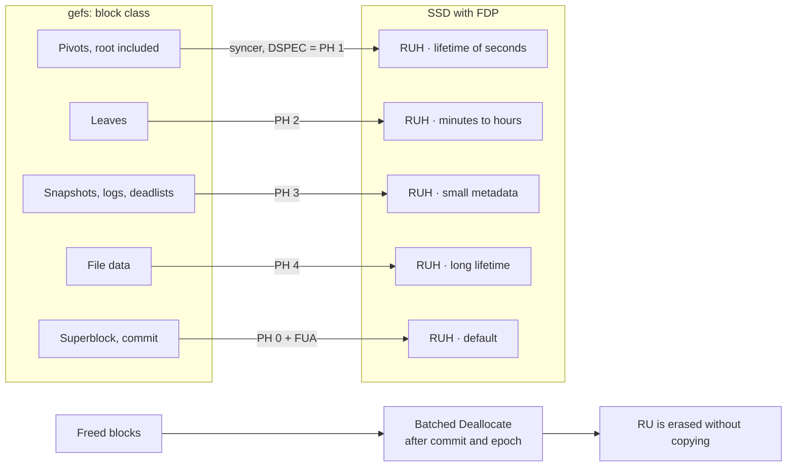

🌐 [Español](https://github.com/AbstractBike/SilvioMaciasSanchez/blob/es/sistemas-de-ficheros/gefs-fdp.md) · **English** · [Deutsch](https://github.com/AbstractBike/SilvioMaciasSanchez/blob/de/sistemas-de-ficheros/gefs-fdp.md)

# gefs + FDP: data placement design

*October 12, 2026*

## Summary

Proposal: have [gefs](https://orib.dev/gefs.html) tag every write with an FDP (Flexible Data Placement, NVMe) *placement handle* according to the block class (pivot, leaf, log, data), and release with Deallocate whatever is already dead after each commit. The goal is to bring the SSD's write amplification (WAF) down to ≈1 without changing the on-disk format.

- **Why FDP and not ZNS:** FDP is a hint on top of a normal write. It doesn't force you to write sequentially, it doesn't require host GC, and a disk without FDP keeps working the same. ZNS would force relocating live blocks, and in a CoW tree with snapshots that means rewriting pointers.
- **Why it fits gefs:** gefs already separates arenas by block type so that writes are sequential. FDP carries that same separation down to the NAND, which is where it counts.
- **Cost:** changes to the gefs allocator and to the NVMe driver (9front `sdnvme`, OpenBSD `nvme(4)`), with no disk migration.
- **First step, no hardware needed:** instrument gefs to measure the real lifetime of each block class. With that data, the mapping is validated before touching the driver.

## Context

The SSD doesn't know which gefs blocks die together, so it mixes them in the same NAND superblock and then has to copy the live ones in order to erase it. FDP tells the SSD which writes go together.

### gefs today

- All blocks have the same size. A pointer is `(addr, hash, birth_gen)`.
- Blocks come from **arenas**. Each arena keeps a log of its allocations and frees, which is loaded at mount time into an AVL tree of free regions.
- The arena is chosen by round-robin, offset according to block type (data, pivot or leaf), so that each type is written sequentially. The counter advances every few thousand writes.
- A block born after the last snapshot is freed immediately. Otherwise it goes to the *deadlist* and is freed when the snapshot holding it dies.
- There is a commit every ~5 s: dirty blocks first, then the superblock.

### FDP in what matters to us

| Term | What it is |
| --- | --- |
| Reclaim Unit (RU) | Group of NAND blocks that is erased as a whole; normally an SSD superblock |
| Reclaim Unit Handle (RUH) | The SSD's "write head" that keeps filling an RU |
| Placement Handle (PH) | Index, per namespace, into the list of RUHs fixed when the namespace is created |
| Placement Identifier | Reclaim Group + PH; travels in the DSPEC field of each write (Data Placement directive) |

- Without a directive, the write goes to PH 0. An invalid PH doesn't abort the write: it's placed wherever the SSD decides and is logged as an FDP event.
- SNIA recommends a single Reclaim Group, RUs the size of a superblock, and having 8–32 RUHs. QLC or small SSDs may offer only 8.
- WAF drops if the LBAs of an RU are rewritten into another RU or released with Deallocate before the SSD reclaims that RU.
- Example: in CacheLib, separating metadata (random) from data (sequential) into two RUHs brought the WAF from ≈3 to ≈1.

## Mapping classes to placement handles

6 placement handles are used, below the minimum of 8 RUHs that FDP SSDs offer. The criterion is expected lifetime, not logical type: blocks that die together go together.

| PH | Block class | Expected lifetime | Why |
| --- | --- | --- | --- |
| 0 | Superblock and any untagged write | Overwritten in place on every commit | It's the SSD's default destination; this way whatever gefs doesn't tag doesn't pollute the other classes |
| 1 | Pivots of the main tree (root included) | Seconds: one or a few commits | Every upsert copies the root and every flush copies the path; it's the hottest class |
| 2 | Leaves of the main tree | Minutes to hours | They die when a flush reaches them; written less often than pivots |
| 3 | Snapshot tree, allocation logs, deadlist blocks | Until the next compaction or snapshot deletion | Small, append-only metadata with its own cycle |
| 4 | File data, new writes | Until overwritten or deleted + snapshot retention | The bulk of the volume; long and unpredictable lifetime |
| 5 | Reserved: cold or long-retention data | Days or more | For phase 2: separating write-once files (binaries) from those that get rewritten |

Notes:

- The lifetime of a block in gefs doesn't depend only on when it's overwritten: a snapshot holding it keeps it alive. If you keep hourly or daily snapshots, classes 1 and 2 also end up in deadlists. It has to be measured (see [Measurement](#measurement)).
- The policy is a `class → PH` table in the mount configuration, not code. With fewer RUHs available, classes are collapsed: 1+3 and 2+4.

## Write path

Each syncer writes with the placement handle of the block's class, so what dies at the same time ends up in the same RU. Once the commit that frees a block is durable, Deallocate invalidates its LBAs and the SSD can erase the RU without copying anything.

## Changes to the allocator and the format

The on-disk format doesn't change: the PH travels in the write command, not in the block. A disk written with FDP mounts the same without FDP, and vice versa.

Allocator changes:

1. **Class in the block request.** The function that asks for a new block already receives the type (data, pivot, leaf, log). A `class(type, tree)` function is added that distinguishes the main tree from the snapshot tree.
2. **The PH travels with the dirty block.** The cached block stores its class. The syncer passes it to the driver when writing.
3. **Arenas: kept, but for a different reason.** With FDP, having sequential LBAs matters little, because the RUH decides the physical position. Arenas still serve to spread contention and read locality. The per-type offset can be kept: it does no harm.
4. **Without FDP, nothing changes.** If the driver doesn't advertise FDP, the class is ignored and gefs behaves as it does today.

Optional, phase 2:

- Read the RUH usage log (how much is left in each handle's open RU) so that large bursts of a class start in a new RU.
- If gefs ends up allocating large ranges of blocks (extents, large files), align them to the RU size.

## Deallocate and commit

Without Deallocate, FDP delivers half: the SSD still believes the blocks gefs already freed are alive and copies them when reclaiming their RU.

### Deallocate, after the commit and never before

- A block can only be deallocated once **the commit that frees it is already durable**. If it's deallocated earlier and the system crashes, the previous commit, which is the one that gets mounted, points to an erased block.
- You also have to wait for epoch-based reclamation: no reader may still be inside the old generation.
- Order: durable commit → epoch free → freed ranges go into a queue → a process sends them in batches with Dataset Management (Deallocate), merging contiguous ranges.
- If the queue is lost in a crash, nothing happens: those blocks just stay un-deallocated until gefs reuses them.
- This helps any SSD, with or without FDP. That's why it comes before FDP in the phases.

### Commit

1. Write all dirty blocks, each with its PH.
2. Flush, so they are durable before the superblock.
3. Write the superblock (PH 0) with FUA.

- If the controller advertises that it has no volatile write cache (`VWC=0`, common in SSDs with power-loss protection), the flush is unnecessary: it's enough to wait for the writes to complete.
- It doesn't depend on atomic writes (AWUPF): the parent pointer's hash already detects a broken block, and in NVMe atomicity can't be requested by command.

## Driver work

The driver only has to do three things: put the directive on writes, send Deallocate, and report whether FDP is present. FDP configuration is done once, outside gefs.

### Configuration (once per disk)

- Enable FDP on the endurance group and create the namespace with its list of placement handles. This is done with `nvme-cli` from Linux. Enabling FDP requires the endurance group to have no namespaces, so it **wipes the disk**.
- To develop without hardware: QEMU emulates FDP since version 8.0.

### In the write command

- Directive Type = Data Placement in CDW12 (bits 23:20), and the Placement Identifier in DSPEC, CDW13 (bits 31:16).
- At attach time: read Identify and the FDP configuration to find out whether it's enabled, how many PHs the namespace has, and the RU size.

### 9front `sdnvme`

- Problem: `devsd` offers `data` as a byte file and has no channel for passing a per-write hint.
- Proposal: a `placement N` control message on the open fid. gefs opens `data` once per class and each syncer writes through the fid of its class. The read and write interface doesn't change.
- Deallocate: check whether `sdnvme` already exposes discard/TRIM through `ctl`. If not, add a `deallocate lba n` message that translates to Dataset Management.
- Expose the capabilities in `ctl`: `fdp on`, number of PHs, RU size and `vwc`.

### OpenBSD `nvme(4)`

- We need to confirm how the gefs port works: whether it runs in the kernel or in user space on the raw device.
- In the kernel: add a hint field to `struct buf` (or use a flag) that `nvme(4)` translates to DSPEC.
- In user space: a passthrough `ioctl` in `nvme(4)`, or a per-descriptor `ioctl` equivalent to 9front's `placement N`.

## Measurement

Success is measured by the SSD's WAF with the disk at 80% occupancy, comparing the same workload with and without FDP.

### Metrics

| Metric | Formula | Source |
| --- | --- | --- |
| SSD WAF | bytes written to NAND / bytes written by the host | FDP statistics log, before and after each test |
| gefs WAF | bytes written by the host / bytes of user data | New counters in gefs |
| Total WAF | product of the two | — |
| Lifetime per class | histogram of `free_gen − birth_gen` per class | New counters in gefs, on free or when moved to the deadlist |
| Bytes per class | bytes written per class and PH | New counters in gefs |

The lifetime histogram can already be collected on any disk and validates the mapping table before having FDP hardware.

### Test bench

- QEMU ≥ 8.0 with emulated FDP, to check that writes carry the correct PH. QEMU doesn't reproduce NAND GC, so it isn't useful for measuring WAF.
- A real SSD with FDP, configured with one Reclaim Group and ≥8 RUHs. Before each test, Deallocate the whole disk instead of preconditioning it by writing, as SNIA recommends.

### Workloads

1. Compile the 9front kernel in a loop: many small files, created and deleted.
2. Random 4 KiB writes inside a large file.
3. The same with hourly snapshots kept for 24 h, to see how retention lengthens lifetime.
4. Occupancy at 50%, 80% and 90%.

### Success criteria

- SSD WAF ≤ 1.2 at 80% occupancy in workloads 1 and 2.
- No performance loss on a disk without FDP.
- No block deallocated while a durable commit references it (crash test with power cut in the middle of the commit).

## Phases, risks and open questions

### Phases

Each phase can be published separately and delivers something even if the following ones never arrive.

| Phase | Deliverable | Needs FDP |
| --- | --- | --- |
| 1 | Counters in gefs: bytes per class and lifetime histogram | No |
| 2 | Deferred Deallocate after commit and epoch | No |
| 3 | `sdnvme`: Data Placement directive, `placement N`, capabilities in `ctl` | QEMU |
| 4 | gefs: class → PH in the allocator and the syncers; table in the mount configuration | QEMU |
| 5 | Measurement on a real SSD; tune the mapping with the histogram | Yes |
| 6 | Optional: align bursts to RU, cold data class, port to `nvme(4)` | Yes |

### Risks

- **Snapshot retention:** if many are kept, the lifetime of pivots and leaves looks like that of data and the separation brings less. Phase 1 will tell.
- **Few RUHs:** with 8 RUHs, or RUHs shared with other namespaces, classes have to be collapsed.
- **Deallocating too early:** it's the only change that can lose data. It's mitigated with the strict ordering and the crash test.
- **Deallocate latency:** on some SSDs, large batches cause latency spikes. The batch size and its pace have to be limited.
- **Hardware:** there are few SSDs with FDP outside data centers. Without one there's no phase 5.

### Open questions

- What snapshot retention does gefs use by default, and how much does it lengthen the lifetime of pivots?
- Does `sdnvme` already send Dataset Management, or does it need to be added?
- Does the OpenBSD port run in the kernel or in user space?
- Is a separate PH worth it for the superblock, which is overwritten in the same place on every commit?
- Which SSD with FDP is at hand for phase 5?

## Sources

- [Gefs, Ori Bernstein (orib.dev)](https://orib.dev/gefs.html)
- [gefs.ms in the 9front tree](https://git.9front.org/plan9front/9front/35cffbd08f2428ef2b9be2bc293aa4b345cf082a/sys/doc/gefs.ms/f.html)
- [Introduction to Flexible Data Placement, SNIA (Feb. 2026)](https://www.snia.org/sites/default/files/technical-work/whitepapers/IntroductiontoStorageDataPlacementwithFDP.pdf)
- [FDP Overview, NVM Express (FMS 2023)](https://nvmexpress.org/wp-content/uploads/FMS-2023-Flexible-Data-Placement-FDP-Overview.pdf)
- [Towards Efficient Flash Caches with Emerging NVMe FDP SSDs (EuroSys 2025)](https://arxiv.org/pdf/2503.11665)
- [What should we do about the nvme atomics mess? (linux-nvme, Jul. 2025)](https://lists.infradead.org/pipermail/linux-nvme/2025-July/057343.html)
- [BetrFS: A Right-Optimized Write-Optimized File System (FAST 2015)](https://www.cs.unc.edu/~porter/pubs/fast15-final.pdf)

---

© 2026 Silvio Macías Sánchez. All rights reserved. Free for non-profit research and teaching, citing the author; for commercial use, write to silvio.macias.sanchez@abstract.bike or info@abstractarchitectures.ltd. See [COPYRIGHT.md](../COPYRIGHT.md).
